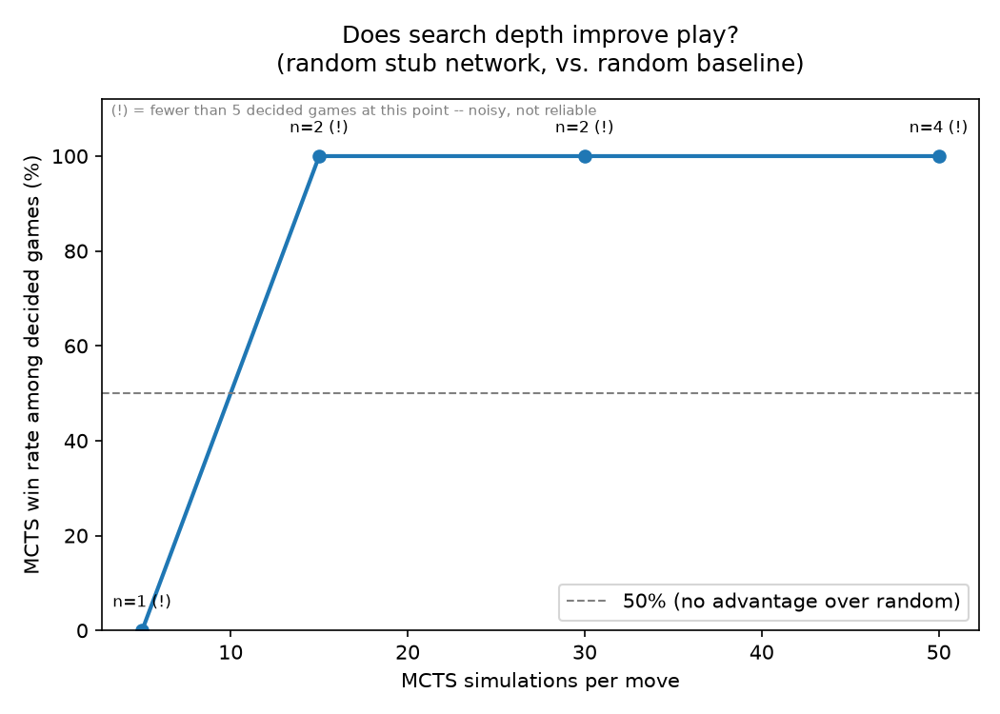
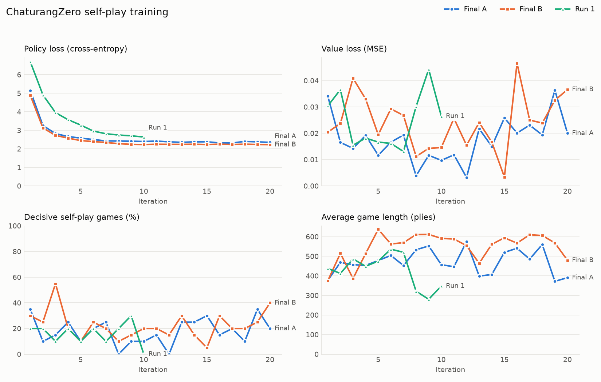
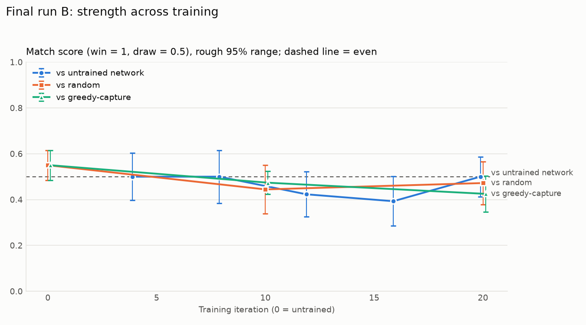
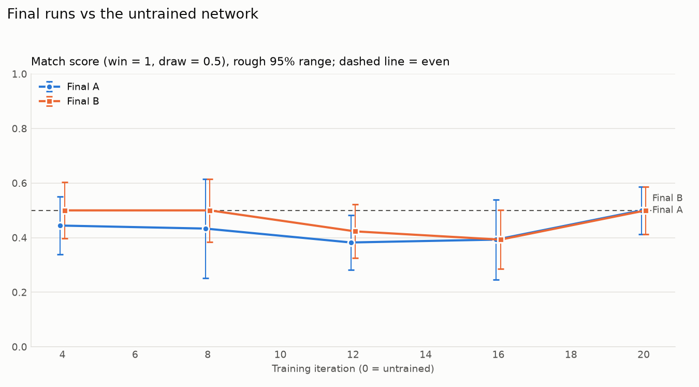
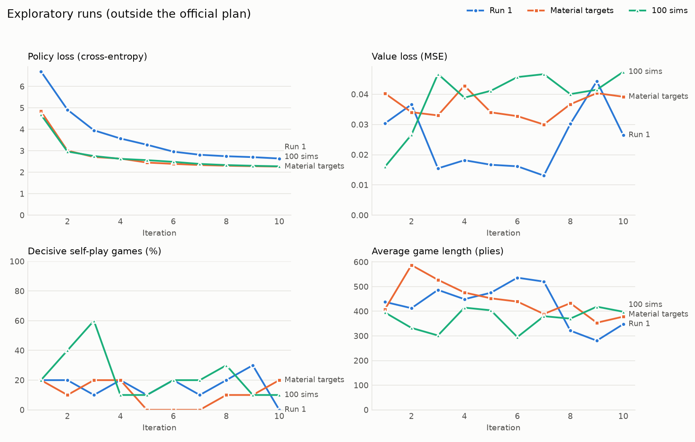
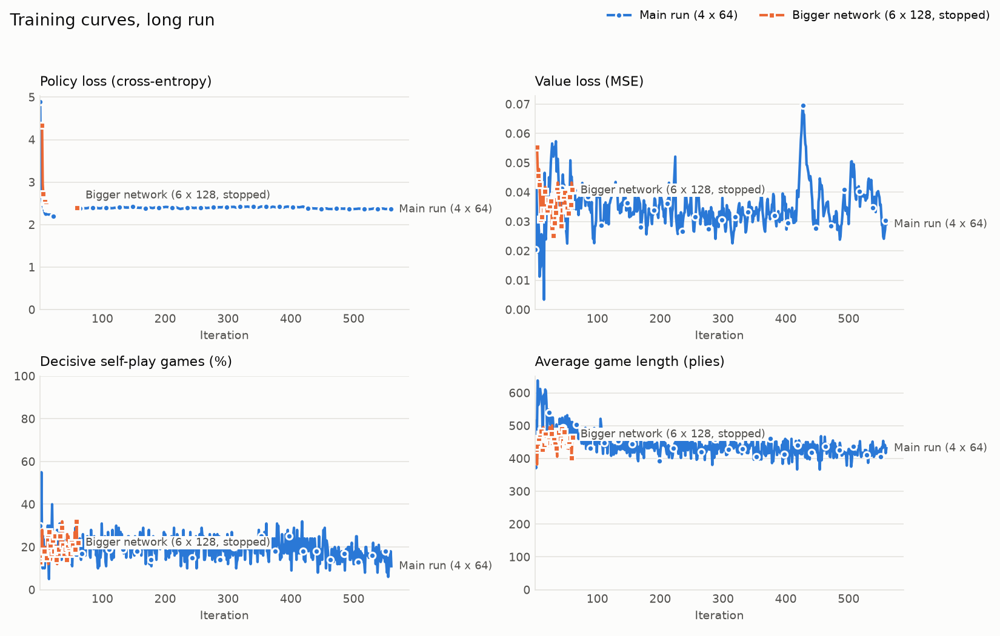
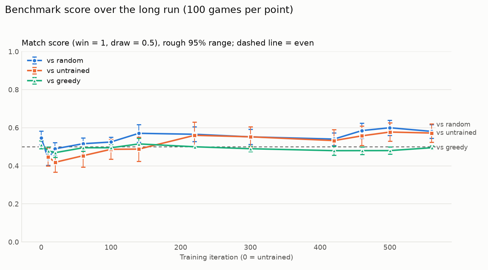

# How to read this document {-}

This document explains the whole ChaturangZero project from the very
beginning to the very end. It is written so that someone who has never seen
the project, or who missed parts of it, can understand every step: what we
built, why we built it that way, what every experiment was, what the results
were, and what they mean.

It is much longer and more detailed than the formal report. The report is
written to the required format for the professors; this document is the full
story behind it, useful for preparing the presentation, answering questions,
and keeping the team up to date.

The document is organized in the order things happened, with reference
material at the end:

- **The project in one page**: the whole story in short.
- **The basics, from zero**: what machine learning, neural networks, GPUs,
  Git and tests are, and how we measure strength. Start here if the project
  is new to you.
- **The math, made simple**: every formula in the project, with small worked
  examples.
- **A short history of Chaturanga**, and the **background**: the game's rules
  and how AlphaZero works.
- **How every piece moves, with diagrams.**
- **The course rules, milestones and team** (with the proposal checked line by line), the **timeline** of every pull
  request, and **the story of the project** in more detail.
- **Building the system**: how every part was built, and **diagrams** of how
  it all fits together.
- **Walkthroughs with real examples**: real numbers followed through the
  system, from the board encoding to one training step.
- **The first training runs**, which did not work, and why.
- **Making training about 11 times faster**, and **the speed-ups in depth**.
- **The long run and the final model.**
- **Trying to make it even stronger**: every later experiment.
- **Playing against the AI, and the human games**, including **game 10
  replayed move by move**, **the other nine games replayed** with their key
  moments, and **the patterns across all ten games**.
- **The decision log**, **every training option**, a **tour of the code**,
  **real code snippets explained line by line**, **every one of the 157
  tests in plain words**, and a guide to **presenting the project**.
- **Our project compared with the original AlphaZero.**
- **What it all means**, **limitations**, and the **key numbers**.
- **Reference**: how to read every graph and data file, the repository file
  by file, how to set up and run everything from nothing (with common
  problems and fixes), questions the professors may ask, a **self-test quiz**,
  and a glossary.

Every chapter starts with a one-line "In short" summary, so you can skim the
document by reading only those lines.

A note on words used throughout: a **ply** is one move by one player (so 100
plies is 50 moves by each side). An **iteration** (also called a round) is one
cycle of "play games against itself, then learn from them". A **checkpoint**
is the saved network after an iteration. A **simulation** is one step of the
search the agent does before choosing a move.

# The project in one page

*In short: The whole project in short: what we built, what happened, and the main lesson.*

**Goal.** Build an AlphaZero-style artificial intelligence for Chaturanga, the
ancient Indian ancestor of chess, from scratch. The AI is given only the rules
of the game. It gets no opening books, no piece values and no human games. It
learns entirely by playing against itself.

**What we built.**

1. A complete Chaturanga **rules engine**: the board, every piece's moves,
   check, checkmate, stalemate and the draw rules, checked by unit tests.
2. A **neural network** (a residual network with 4 blocks of 64 filters) that
   looks at a position and outputs two things: which moves look promising
   (the policy) and who is likely to win (the value).
3. **Monte Carlo Tree Search (MCTS)**, the look-ahead search that uses the
   network to decide which moves to explore and to judge positions.
4. A **self-play training loop**: the AI plays thousands of games against
   itself, and the network learns from the results.
5. An **evaluation suite**: fixed benchmarks against simple opponents,
   matches between versions of the AI, analysis of how games end, and a
   system for logging games against humans.
6. A **terminal game** and a **browser game** to play against the AI.
7. **157 automated tests** that check every part.

**What happened.**

- The **first training runs** (400 games each, about 7 hours) did not make
  the AI any stronger. We investigated and found why: about 80% of games
  were draws, so the network almost never saw a win or a loss to learn from,
  and 400 games is far too little data for this method.
- We made training **about 11 times faster** without changing what it
  computes, and then ran a **long training run**: 540 more iterations,
  54,000 games, about 144 hours on one laptop.
- The long run produced the **final model**
  (`models/chaturangzero_final.pt`). It beats the model it started from
  27 wins to 0, beats a random player 16 to 0, and beats an untrained network
  17 to 4. It still draws almost every game against a "greedy capture"
  player and rarely finishes games with checkmate.
- We tried many ways to make it stronger: a bigger network (twice), counting
  draws as slightly bad, resigning hopeless games, even smaller learning
  steps, learning from the search's own values, shorter practice games, and
  averaging several trained versions into one. **None of them made it stronger within the project rules.** The one
  thing that clearly helps is letting it **think longer when playing**: with
  800 search steps per move instead of 50, it beats its normal self 23 to 0,
  and 1600 steps beat 800 by 15 wins to 3. 3200 was no better than 1600, so
  the browser game now uses 1600.
- We moved self-play to the laptop's GPU, making it about **2.2 to 2.4 times
  faster** again.
- An experienced chess player from outside the team (FIDE blitz rating
  **1641**) played **10 games** against the final model through the browser
  game: **5 human wins, 2 AI wins, 3 draws**.

**The main lesson.** Within the project's rules and the compute of one
laptop, the model has reached about its limit. Its central weakness is that
its "value" judgment does not know when a position is won or lost until the
very end, because nearly all of its training games are draws. Every
improvement we tried ran into this same problem.

# The basics, from zero

*In short: The ideas you need before anything else: machine learning, neural networks, GPUs, Git, tests, seeds and how strength is measured.*

This chapter assumes you know nothing about artificial intelligence,
programming tools or this project. Everything later in the document builds on
these ideas, so it is worth reading even if some parts feel obvious.

## What "artificial intelligence" and "machine learning" mean here

A normal computer program follows rules a person wrote: "if this, do that".
A chess program written that way would need a person to write down how good
every kind of position is, which pieces are worth how much, which openings
are good, and so on. That is called **hand-written knowledge** or **domain
knowledge**.

**Machine learning** is different. Instead of writing the rules of good play,
we write a program that can **adjust itself** based on examples or
experience. We give it a structure with millions of adjustable numbers, and a
procedure that nudges those numbers so that the program does better and
better at some task.

There are three main kinds of machine learning:

- **Supervised learning**: you give the program examples with the right
  answers (for example, photos labeled "cat" or "dog"), and it learns to
  produce the right answer.
- **Unsupervised learning**: you give it data without answers, and it finds
  patterns.
- **Reinforcement learning**: the program acts in some environment (here, a
  game), gets a reward or penalty at the end (win, loss or draw), and learns
  which actions lead to good rewards.

Our project is **reinforcement learning**. Nobody tells the program which
moves are good. It plays, sees who won, and learns from that. The specific
way we do it is called **self-play**: the program plays against itself, so it
always has an opponent at exactly its own level.

## What a neural network is

A **neural network** is the adjustable structure that does the learning. You
can think of it as a very large mathematical function: numbers go in, numbers
come out, and in between there are many layers of simple calculations.

**A single "neuron"** takes several input numbers, multiplies each by a
**weight** (an adjustable number), adds them up, adds a **bias** (another
adjustable number), and passes the result through a simple function. A common
one is **ReLU**, which just turns negative numbers into 0 and leaves positive
numbers as they are.

**A layer** is many neurons side by side, all looking at the same inputs.
**A deep network** is many layers stacked, so the output of one layer is the
input of the next. Early layers learn simple patterns; later layers combine
them into more complex patterns.

**The weights are what gets learned.** At the start they are random, so the
network's outputs are meaningless. Training adjusts them. Our network has
836,359 of these adjustable numbers, which we call **parameters**.

## How a neural network learns: loss, gradients and steps

Learning happens in small steps:

1. Show the network an example input (for us, a board position).
2. The network produces an output (its guess).
3. Compare the guess with the target (what it should have said). The size of
   the mistake is measured by a number called the **loss**. A small loss
   means a good guess.
4. Work out, for every weight, in which direction it should change to make
   the loss a bit smaller. This is done with calculus, and the result is
   called the **gradient**. The technique for computing it efficiently through
   all the layers is called **backpropagation**.
5. Change every weight a tiny amount in that direction. How big the change
   is depends on the **learning rate**.

Repeat this thousands or millions of times on many examples, and the network
gradually gets better at the task.

Some related words:

- **Batch**: instead of one example at a time, the network looks at a group
  of examples (for us, 64 or 256 positions) and averages the corrections.
  This is faster and steadier.
- **Training step**: one update of the weights using one batch.
- **Optimizer**: the exact rule for updating weights. We use **Adam**, the
  most common one, which adapts the step size for each weight automatically.
- **Learning rate**: the size of each step. Too big and the network jumps
  around and never settles. Too small and it learns very slowly. A common
  trick, which we used, is to start with a bigger rate and lower it later.
  Learning rates are written like 1e-3 (0.001), 1e-4 (0.0001), 3e-5 (0.00003)
  and 2e-5 (0.00002).
- **Weight decay (L2 regularization)**: a small extra penalty that keeps the
  weights from growing too large, which helps the network generalize instead
  of memorizing.
- **Overfitting**: when a network memorizes its training examples instead of
  learning general patterns. A replay buffer of many varied positions helps
  avoid this.

## Why the network uses "convolutions"

A board game position is a grid, like an image. A **convolution** is a kind
of layer designed for grids. Instead of looking at the whole board at once,
it slides a small window (we use 3x3 squares) across the board and applies
the same small set of weights at every location. This means a pattern
learned in one corner (for example, "a horse attacking a piece") is
automatically recognized everywhere else on the board.

A convolution layer has many **filters**, each looking for a different
pattern. "64 filters" means each layer produces 64 different pattern maps of
the board.

**Batch normalization** is a layer that rescales the numbers flowing through
the network so they stay in a reasonable range, which makes training faster
and more stable.

**A residual block** is two convolution layers plus a **skip connection**:
the block's input is added back to its output. This lets information flow
easily through deep networks and makes them much easier to train. This design
is called a **ResNet** and is what AlphaZero uses.

## What a "tensor" is

A **tensor** is just a block of numbers with a shape. A single number is a
tensor of shape [] , a list of 10 numbers has shape [10], a table of 8 rows
and 8 columns has shape [8, 8], and a stack of 13 such tables has shape
[13, 8, 8]. Our network takes a position as a [13, 8, 8] tensor and outputs a
[4096] tensor (one score per possible move) and one number (the value).

## What a GPU is and why it matters

A **CPU** (the computer's main processor) is good at doing a few complicated
things quickly, one after another. A **GPU** (graphics processor) is good at
doing thousands of simple calculations at the same time. Neural networks are
mostly huge numbers of simple multiplications, so they run much faster on a
GPU, **especially when you give it many inputs at once** (a batch). Giving a
GPU one position at a time wastes most of its power. This is why, later in
the project, we rebuilt self-play so that many games send their positions to
the GPU together.

Our laptop is an Apple machine with an A18 Pro chip: 2 fast "performance"
CPU cores, 4 slower "efficiency" CPU cores, a built-in GPU, and 8 GB of
memory. On Apple computers, PyTorch calls the GPU **"mps"**.

## The tools we used

- **Python**: the programming language everything is written in.
- **NumPy**: a Python library for fast work with arrays of numbers.
- **PyTorch** (imported as `torch`): a Python library for building and
  training neural networks, on the CPU or the GPU.
- **Matplotlib**: a Python library for drawing graphs.
- **pytest**: a tool that runs all the automated tests.
- **pandoc**: a tool that converts the Markdown report into a Word document.
- **The terminal**: the text window where commands like
  `python play_web.py` are typed.

## Git, GitHub and pull requests

The code lives in a **Git repository**, a folder whose full history of
changes is recorded.

- A **commit** is one saved set of changes with a message describing them.
- A **branch** is a separate line of work, so changes can be made without
  disturbing the main version. The main version is the **main** branch.
- **GitHub** is the website that stores the shared copy of the repository
  (ours is https://github.com/f20241463-cmd/CS-F407-chaturanga).
- A **pull request (PR)** is a request to add a branch's changes into main.
  Others can review it first. When it is accepted, it is **merged**.
- The team **squash-merges**: all commits of a pull request become one
  commit on main. Because of this, every new piece of work was started on a
  fresh branch from the latest main.

The project has 24 numbered pull requests, listed in the timeline.

## Automated tests

A **unit test** is a small program that checks that one piece of code does
what it should, for example "a horse on b1 can move to a3 and c3 and nowhere
else" or "after checkmate, the result is a loss for the side to move". Tests
are run with `python -m pytest -q`. If someone changes code and breaks
something, a test fails and shows exactly what broke. The project has 157
tests, and all of them pass.

## Random seeds and reproducibility

Many parts of the project use randomness: the network's starting weights, the
noise added to the search, the sampling of moves in self-play. Computers
produce "random" numbers from a starting value called a **seed**. With the
same seed, the same "random" numbers come out every time. We seeded
everything, so running the same command twice gives exactly the same games
and results. This is important for science: anyone can reproduce our
results.

## How we measure strength: scores, margins and ranges

When two players play many games, we compute a **score**:

score = (wins + 0.5 x draws) / finished games

A score of 0.5 means the two are even. Above 0.5 means the first player is
better; below 0.5 means worse. A draw counts as half a win.

**Example (the final model against the starting model):** 27 wins, 0 losses,
59 draws and 14 unfinished games (stopped at the 800-ply cap). The finished
games are 27 + 0 + 59 = 86. The score is (27 + 0.5 x 59) / 86 = 56.5 / 86 =
0.657.

**The margin (+/-).** Any score from a limited number of games has some luck
in it. The margin is a 95% range: if we played many more games, the true
score would very likely be within that distance. We compute it from how much
the individual game scores (1, 0.5 or 0) vary: margin = 1.96 x (standard
deviation of the game scores) / sqrt(number of finished games). For the
example above, that is about +/- 0.049, so the true score is very likely
between about 0.61 and 0.71: clearly above 0.5.

**Reading a result:** if the score minus its margin is still above 0.5, the
first player is clearly better. If 0.5 is inside the range, we cannot tell
them apart.

**The Wilson range** is a more careful version of the same idea for very
small numbers of games, like the human games. With only 10 games, the range
is wide (for the AI against the human: 0.137 to 0.646), which honestly shows
how uncertain a 10-game result is.

**Why draws make this hard.** When 85% of games are draws, wins and losses
are rare, so you need many games to see a difference. That is why we moved
from 20-game to 100-game and 200-game matches.

# The math, made simple

*In short: Every formula used in the project, each with a small worked example.*

The project uses a handful of mathematical ideas. None of them needs advanced
math to understand. Each is explained here with a small worked example.

## ReLU

ReLU(x) = x if x is positive, otherwise 0.

Examples: ReLU(3) = 3, ReLU(-2) = 0, ReLU(0.5) = 0.5. It is used after most
layers. It lets the network represent complicated, bent shapes instead of
only straight lines.

## Tanh

tanh squashes any number into the range -1 to +1. Large positive numbers
become close to +1, large negative numbers close to -1, and 0 stays 0.

Examples: tanh(0) = 0, tanh(1) is about 0.76, tanh(3) is about 0.995,
tanh(-1) is about -0.76. The value head ends with tanh so its output is a
valid value between "sure loss" (-1) and "sure win" (+1).

## Softmax

Softmax turns a list of scores into probabilities that are all positive and
add up to 1. For each score s, compute e to the power s (e is about 2.718),
then divide each by the total.

Example with scores 2, 1 and 0:

- e^2 is about 7.39, e^1 is about 2.72, e^0 = 1;
- the total is about 11.11;
- the probabilities are 7.39 / 11.11 = 0.67, 2.72 / 11.11 = 0.24 and
  1 / 11.11 = 0.09.

Higher scores get more probability, but every move keeps some. In our code,
softmax is applied **only to the legal moves**, so illegal moves get exactly
0.

## Mean squared error (the value loss)

For each position: take the predicted value minus the actual result, and
square it. Then average over the batch.

Example: the network predicts +0.2 for a position, and the side to move
actually lost (-1). The error is 0.2 - (-1) = 1.2, squared is 1.44: a big
mistake. If the game was a draw (0), the error is 0.2, squared 0.04: a small
mistake. Squaring makes big mistakes count much more than small ones.

Note what happens when almost every target is 0: the network can get a very
low value loss just by always predicting about 0. That is exactly what our
value head did in the first runs, which is why the value loss looked small
even though the value head had learned almost nothing.

## Cross-entropy (the policy loss)

Cross-entropy measures how well the network's move probabilities match the
search's visit distribution. For each move, multiply the target probability
by the logarithm of the network's probability, add these up, and flip the
sign.

Example with two moves: the search visited move A 80% of the time and move B
20%. If the network said A 0.8, B 0.2, the cross-entropy is
-(0.8 x ln 0.8 + 0.2 x ln 0.2), about 0.50, which is the lowest possible for
this target. If the network said A 0.2, B 0.8, it is
-(0.8 x ln 0.2 + 0.2 x ln 0.8), about 1.33: much worse. Training pushes the
network toward the search's choices.

Our policy loss settled around 2.2 to 2.4. It cannot reach 0, because the
search's visits are spread over several moves, and the targets change as the
search improves.

## The PUCT formula, term by term

score(move) = Q(move) + c_puct x P(move) x sqrt(N_parent) / (1 + N(move))

- **Q(move)**: the average value of the positions found below this move,
  from the point of view of the side choosing. It starts at 0. This is the
  "how good has this move looked so far" part.
- **P(move)**: the network's prior probability for the move.
- **N_parent**: how many times the current position has been visited.
- **N(move)**: how many times this move has been explored.
- **c_puct = 1.5**: how much weight exploration gets.

The second part, c_puct x P x sqrt(N_parent) / (1 + N(move)), is the
**exploration bonus**. It is large for moves the network likes but that have
not been explored much, and it shrinks as a move gets explored. As the parent
gets more visits, the square root slowly grows, so even low-prior moves
eventually get a look.

Small worked example: the parent has 16 visits (sqrt = 4). Move A has prior
0.5, 10 visits and Q = 0.1. Move B has prior 0.3, 2 visits and Q = 0.0.

- A: 0.1 + 1.5 x 0.5 x 4 / 11 = 0.1 + 0.27 = 0.37
- B: 0.0 + 1.5 x 0.3 x 4 / 3 = 0.0 + 0.60 = 0.60

So B is explored next, even though A has the better result so far, because B
has been explored much less.

## Dirichlet noise

A **Dirichlet distribution** produces a random list of positive numbers that
add up to 1, one per legal move. With alpha = 0.3 (small), the numbers tend
to be uneven: a few moves get most of the weight. At the root during
self-play, each prior is replaced by 0.75 x prior + 0.25 x noise. So every
game, a few random moves get an extra push and are explored more than the
network alone would explore them.

## Temperature

After the search, the move is chosen from the visit counts:

- **Temperature 1** (used in self-play): pick each move with probability
  proportional to its visits. With visits A 34, B 12, C 4, A is picked 68% of
  the time, B 24% and C 8%.
- **Temperature 0**: always pick the most visited move (A).
- **Temperature 0.3** (used in benchmarks): in between; the visit counts are
  raised to the power 1/0.3 before choosing, which strongly favors the most
  visited move but still allows variety.

## The score margin

For n finished games with game scores x (1 for a win, 0.5 for a draw, 0 for a
loss), the score is the average of x, and the margin is

margin = 1.96 x sd(x) / sqrt(n)

where sd is the standard deviation (how spread out the game scores are).

Worked example (the final model against the starting model): 27 wins, 59
draws, 0 losses, so n = 86.

- The average is (27 x 1 + 59 x 0.5) / 86 = 0.657.
- The average of x squared is (27 x 1 + 59 x 0.25) / 86 = 0.486.
- The variance is 0.486 - 0.657 x 0.657 = 0.054, so sd is about 0.232.
- The margin is 1.96 x 0.232 / sqrt(86) = 1.96 x 0.232 / 9.27, about 0.049.

The number 1.96 comes from statistics: about 95% of the time, the true value
lies within 1.96 standard errors of the measured average.

Notice that with all draws, sd is 0 and the margin is 0: a match of only
draws says "even" with full confidence, which is why draws were left in the
score and why we always looked at wins and losses too.

## The Wilson range

The simple margin above is unreliable for very few games (it can even go
below 0 or above 1). The **Wilson score interval** is a formula designed for
small samples that always stays between 0 and 1. For the 10 human games
against the final model (AI score 0.35), it gives 0.137 to 0.646: wide,
because 10 games cannot pin down a score precisely.

# A short history of Chaturanga

*In short: Where the game comes from and why its exact rules had to be fixed by us.*

Chaturanga is generally considered the oldest known ancestor of chess. It
appears in India around the 6th century CE, during the Gupta period. The
name comes from Sanskrit and means "four limbs" or "four divisions", referring
to the four divisions of an ancient Indian army: infantry (Padati), cavalry
(Ashva), elephants (Gaja) and chariots (Ratha). These are exactly the piece
types of the game, along with the king (Raja) and his counselor (Mantri).

From India the game spread to Persia, where it became **chatrang** and later
**shatranj**, and from there to the Arab world and Europe, where it slowly
turned into modern chess. In the other direction it gave rise to xiangqi
(Chinese chess), shogi (Japanese chess) and makruk (Thai chess).

Because the game is so old, nobody knows its exact rules for certain.
Historians reconstruct them from later descriptions, and details differ
between sources, such as where the kings start, exactly how the elephant
moves, and how the game ends. For this project we fixed one clear set of
rules (described in the Background chapter), wrote them down in the code,
and tested them. What matters for the project is that the rules are fixed
and consistent, so the AI learns a well-defined game.

# Background

*In short: The rules of Chaturanga and how AlphaZero's network, search and self-play work.*

## Chaturanga, the game

Chaturanga is an Indian board game from around the 6th century. It is the
ancestor of chess, shogi, xiangqi and makruk. It is played on the same 8x8
board as chess, with the same starting arrangement, but most pieces are
weaker.

**The pieces.**

| Piece | Chess equivalent | How it moves |
|---|---|---|
| Raja (king) | King | One square in any direction. |
| Mantri (counselor, minister) | Queen's position, but much weaker | One square diagonally only. |
| Ratha (chariot) | Rook | Any number of squares in a straight line (horizontal or vertical). |
| Gaja (elephant) | Bishop's position, but different | Exactly two squares diagonally, jumping over the square in between. |
| Ashva (horse) | Knight | An L-shaped jump, exactly like a knight. |
| Padati (foot soldier) | Pawn | One square forward; captures one square diagonally forward; becomes a Mantri on reaching the last rank. |

**Starting position.** Each side has, on its back rank from left to right:
Ratha, Ashva, Gaja, Raja, Mantri, Gaja, Ashva, Ratha, and eight Padati on the
rank in front. (Historical sources differ on where exactly the kings go; we
used the chess-like layout because it is simple and unambiguous, and
documented this choice in the code.)

**Rules that differ from modern chess.**

- There is **no castling**, **no pawn double step** and **no en passant**.
- A soldier that reaches the last rank always becomes a Mantri.

**How a game ends.**

- **Checkmate** wins: the side to move is in check and has no legal move.
- **Stalemate** is a draw: the side to move is not in check but has no legal
  move.
- The **no-progress rule**: 100 plies (50 moves each) with no capture and no
  soldier move is a draw.
- **Threefold repetition**: the same position with the same side to move
  occurring three times is a draw.

**Why this matters for learning.** Because the Mantri and Gaja are
short-range pieces, it is much harder to turn a material advantage into
checkmate than in chess. You can be several pieces ahead and still be unable
to force mate. This made a huge difference to our results: most games end in
draws, often by the no-progress rule, and a learning system gets very little
win or loss signal from drawn games.

## The idea behind AlphaZero

AlphaZero (DeepMind, 2017 and 2018) learned chess, shogi and Go to
superhuman level starting from nothing but the rules. It combines two ideas.

**A neural network** that looks at a board position and outputs:

- a **policy**: a probability for every possible move, saying how promising
  each move looks;
- a **value**: a single number between -1 and +1 saying how likely the side
  to move is to win (+1 means sure win, -1 sure loss, 0 even or drawn).

**A search (MCTS)** that, before every move, explores possible future moves.
The network guides the search: the policy says which moves are worth
exploring, and the value judges the positions the search reaches, so the
search does not need to play games to the end to evaluate them.

**Self-play training** connects the two. The AI plays games against itself
using the search. After each game:

- every position is labeled with **what the search preferred** (how often it
  visited each move), and the network's policy is trained to predict that;
- every position is also labeled with **who actually won the game**, and the
  network's value is trained to predict that.

Then the improved network is used to play more games. Because the search
looks ahead, it is a bit stronger than the network alone, so the network
keeps learning to imitate a slightly stronger player. Over many iterations,
this loop is supposed to make the AI steadily stronger.

The important point for our project: the value head learns **only** from the
final results of games. If almost every game is a draw, almost every value
target is 0, and the value head learns very little.

## Monte Carlo Tree Search, step by step

Before each move, the AI runs a fixed number of **simulations** (50 during
training). Each simulation does four things:

1. **Selection.** Start at the current position (the root) and walk down the
   tree of already-explored positions. At each step, pick the move with the
   highest score according to the **PUCT** formula:

   score = (value of that move so far) + c_puct x (network's prior for that
   move) x sqrt(visits of the parent) / (1 + visits of that move)

   The first part favors moves that have looked good so far
   (**exploitation**). The second part favors moves the network likes but
   that have not been explored much yet (**exploration**). We use
   c_puct = 1.5.

2. **Expansion.** When the walk reaches a position that has not been explored,
   ask the network about it. Its policy gives the priors for the moves from
   that position.

3. **Evaluation.** The network's value for that new position is used as its
   score. There are **no random playouts**, unlike classic MCTS.

4. **Backup.** That value is passed back up the path to the root, with its
   sign flipped at every step (a position good for White is bad for Black),
   and every position on the path updates its visit count and average value.

After all simulations, the move that was **visited most** is the search's
choice. The visit counts also become the training target for the policy.

**Dirichlet noise.** During self-play, some random noise is mixed into the
root's priors (alpha 0.3, weight 0.25). This makes the AI sometimes try moves
the network does not yet like, so it can discover new ideas instead of always
playing the same thing.

**Temperature.** During self-play, the move is **sampled** in proportion to
visit counts rather than always taking the most visited move. This gives
variety in the training games. When measuring strength, we use a low
temperature (0.3) so the AI plays close to its best moves while games still
vary.

## Other key ideas

- **Residual network (ResNet).** A deep neural network built from blocks
  that each add their input back to their output (a "skip connection"). This
  makes deep networks train well. AlphaZero uses this design.
- **Replay buffer.** A store of the most recent training positions. Each
  training step picks random positions from it, so the network learns from a
  mix of recent games instead of only the last one.
- **Loss.** The quantity training tries to make smaller. Ours is the value
  error (mean squared error between predicted and actual result) plus the
  policy error (cross-entropy between the network's move probabilities and
  the search's visit distribution), plus a small penalty on large weights
  (L2 regularization).
- **Learning rate.** How big a step the network takes when it updates. Big
  steps learn fast but jump around; small steps are slow but settle more
  precisely. This turned out to matter a lot.
- **Adam.** The standard optimizer we used to update the network's weights.

# How every piece moves, with diagrams

*In short: A picture of every piece's moves, and why checkmate is hard in this game.*

In each diagram, the piece stands in the middle of an empty board area, and
an **x** marks every square it can move to. Dots are squares it cannot
reach. Rows are drawn from Black's side at the top to White's side at the
bottom, as in the browser game when you play White.

**Raja (king)**: one square in any of the 8 directions. It may never move
into check.

```
. . . . .
. x x x .
. x K x .
. x x x .
. . . . .
```

**Mantri (counselor)**: one square diagonally only, so at most 4 squares.
This is much weaker than a chess queen.

```
. . . . .
. x . x .
. . M . .
. x . x .
. . . . .
```

**Ratha (chariot)**: any number of squares in a straight line, up, down, left
or right, until it meets a piece. It can capture the first enemy piece it
meets. It moves exactly like a chess rook and is the strongest piece in
Chaturanga.

```
. . x . .
. . x . .
x x R x x
. . x . .
. . x . .
```

**Gaja (elephant)**: exactly two squares diagonally, jumping over the square
in between even if it is occupied. So at most 4 squares. An elephant can only
ever reach 8 squares of the whole board, which makes it a weak piece.

```
x . . . x
. . . . .
. . G . .
. . . . .
x . . . x
```

**Ashva (horse)**: an L-shaped jump (two squares one way, then one square to
the side), jumping over anything in between, exactly like a chess knight. At
most 8 squares.

```
. x . x .
x . . . x
. . A . .
x . . . x
. x . x .
```

**Padati (foot soldier), White**: one square forward onto an empty square
(marked m), or one square diagonally forward to capture an enemy piece
(marked c). It never moves backward or sideways, has no two-square first move,
and becomes a Mantri when it reaches the far rank.

```
. . . . .
. c m c .
. . P . .
. . . . .
. . . . .
```

**Why this makes checkmate hard.** Compare with chess: the chess queen and
bishops are long-range pieces that can attack from across the board. In
Chaturanga, only the Rathas are long-range. The Mantri and Gajas are slow and
limited, so building a mating net around a king takes a lot of coordination.
That is why so many games end with one side ahead in material but unable to
force mate, and why the no-progress rule ends most of our games.

# The course rules, milestones and team

*In short: The constraints we had to follow, the four milestones, and who did what.*

## The constraints

The official project plan set these rules, and our final model follows all of
them:

- **No human domain knowledge** beyond the rules: no opening books, no piece
  values, no hand-written evaluation of positions.
- **30 to 50 MCTS simulations per move during training.** (Play-time search
  can be higher; the limit is about training.)
- **A residual network with 4 to 6 blocks and 64 to 128 filters.**
- **A 4096-wide action space**: every move is a (from-square, to-square)
  pair, 64 x 64 = 4096 possibilities.

## The four milestones

1. A rules engine verified by unit tests.
2. MCTS working with an untrained network.
3. A self-play pipeline with the loss tracked over at least 50 to 100 games.
4. Benchmarks against earlier iterations and baseline players, with learning
   curves.

All four are complete, and the project went well beyond them.

## The team roles

| Role | Area |
|---|---|
| Student 1: Environment and logic | The rules engine (`chaturanga/`) and `play.py` |
| Student 2: Deep learning and pipeline | The network, the training loop, the replay buffer |
| Student 3: Search and evaluation | MCTS, the evaluation suite, benchmarks, plots, `play_vs_ai.py` |

Early on, the team agreed on fixed "contracts" between the parts, so each
person could build their part independently: how squares are numbered, how a
position is turned into numbers for the network, how moves map to action
numbers, and what a network function returns. Later in the project, while
teammates were away, the training, the experiments, the speed-ups, the
browser game and the report were completed and merged through pull requests.

## The project proposal, line by line

The course professors gave us a written proposal. Here is every thing it
asks for, whether we did it, and where in this document it is explained.

| What the proposal asks for | Done? | Where it is explained |
|---|---|---|
| Play on the 8x8 uncheckered Ashtapada board | Yes. The browser game draws the board in one color, like the historical board | "The browser game" |
| The Mantri moves one step diagonally; the Gaja jumps two squares diagonally | Yes, with every other piece rule, all tested | "How every piece moves, with diagrams" |
| A fast, bug-free rules engine: legal moves, turns, game end | Yes. 36 rule tests, and a fast version checked to give exactly the same moves | "Building the system", "Every test, explained" |
| 12 piece types as a 13-channel 8x8 tensor with a turn indicator | Yes, exactly 13 channels | "The basics, from zero", "Walkthroughs with real examples" |
| Moves as from-square to to-square pairs | Yes | "The basics, from zero" |
| Learn from scratch with no human knowledge beyond the rules | Yes for the final model. Two early test runs that broke this rule are clearly marked as exploratory and were not used | "The first training runs, and why they did not work" |
| A two-headed residual network: policy and value | Yes. Policy over 4,096 moves; value from -1 to +1 | "Building the system" |
| MCTS guided by the policy, leaves judged by the value, no random rollouts | Yes, with the PUCT formula | "Building the system", "The math, made simple" |
| Loss: value MSE + policy cross-entropy + L2 regularization | Yes (weight decay 1e-4) | "The math, made simple" |
| Self-play loop with a replay buffer | Yes. Replay buffer of 250,000 positions | "Building the system" |
| 4 to 6 residual blocks, 64 to 128 filters | Yes. Final model 4 x 64; 6 x 128 also tried | "The long run and the final model", "Trying to make it even stronger" |
| 30 to 50 simulations per move in training | Yes. 50 in every training run | "The course rules, milestones and team" |
| 4,096 actions, illegal moves masked before softmax | Yes | "The basics, from zero" |
| Runs on consumer hardware in an academic timeframe | Yes. One laptop; we made self-play about 11 times faster, then 2.2 to 2.4 times faster again on its GPU | "Making training about 11 times faster" |
| Milestone 1: rules engine verified by unit tests | Yes | "Every test, explained" |
| Milestone 2: MCTS with an untrained network | Yes | "Building the system" |
| Milestone 3: self-play pipeline, loss tracked over 50 to 100 games | Yes, and far beyond: 54,000 games | "The long run and the final model" |
| Milestone 4: benchmarks against past versions and baseline players, learning curves | Yes. Against random, greedy-capture, untrained and earlier versions, with plots | "The long run and the final model", "How to read every graph and data file" |
| Agent vs. random and agent vs. human | Yes. 16 human games: 6 by a beginner, 10 by a FIDE-rated club player | "Playing against the AI, and the human games" |
| Progress plots | Yes | "How to read every graph and data file" |
| Three students, split by part | Yes | "The team roles" above |
| An agent that **masters** the game | **No.** It would need about 800 times more games (roughly 13 years on our laptop). We measured and explained this gap instead | "Our project compared with the original AlphaZero" |

So everything the proposal asks to build and measure is done. The only aim
not reached is mastery itself, and that is a limit of compute, not of the
method or the code.

# Timeline

*In short: Every pull request from October 2 to November 6, grouped into phases.*

Every change to the project was made through the shared GitHub repository
(https://github.com/f20241463-cmd/CS-F407-chaturanga). This is the full
history.

| Date (2026) | Step | What was added |
|---|---|---|
| Oct 2 | Initial upload | The rules engine files (board, moves, game, encoding, notation, stub network) |
| Oct 3 | PR #1 | MCTS module: tree nodes, search, tests |
| Oct 3 | PR #2 | The neural network model (`ChaturangaNet`) |
| Oct 3 | Direct commits | Benchmark option to use the real network; untrained baseline (37.5%); first agent-vs-human terminal game |
| Oct 17 | PRs #3, #4, #6 | Root Dirichlet noise, checkpoint loading, seeded networks, checkpoint-vs-checkpoint matches, the self-play training loop, lazy MCTS children |
| Oct 17 | PRs #5, #8 | Optional material-based value targets (exploratory) |
| Oct 18 | PR #7 | Temperature and repetition avoidance in checkpoint comparison |
| Oct 18 | PR #9 | The evaluation suite: baseline players, iteration benchmark, plots |
| Oct 18 | PR #10 | Repetition avoidance in self-play |
| Oct 18 | PR #11 | Small fix to the training summary message |
| Oct 18 | PR #12 | First training results, benchmarks, plots and write-up |
| Oct 18 | PR #13 | Project README, human-game logging, iteration 20 vs 10 match |
| Oct 18 | PR #14 | Agent vs human results with a Wilson confidence range |
| Oct 18 | PR #15 | The first report draft (Markdown and Word) |
| Oct 18 | PR #16 | Self-play about 13 times faster per core, parallel self-play, faster benchmarks |
| Oct 24 | PR #17 | Bigger-network and bootstrap options for training |
| Oct 26 | PR #18 | The long-run results, the final model, the updated report |
| Oct 27 | PR #19 | Play-time search and draw-penalty tests on the final model |
| Oct 30 | PR #20 | GPU self-play, the second bigger-network attempt, the resignation check |
| Oct 30 | PR #21 | The 400 and 800 simulation results and the 2e-5 training stretch |
| Nov 5 | PR #22 | The browser version of the game |
| Nov 6 | PR #23 | The first six human games against the final model |
| Nov 6 | PR #24 | The last four human games (ten in total) |
| Nov 6 to 7 | PRs #26 to #29 | This full explanation, the beginner's guide, diagrams, replayed games and a quiz |
| Nov 7 | PR #30 | Search-value targets, the uncheckered board, the gap to mastery in the report |
| Nov 8 | PR #31 | Search-value (q_mix) results: no gain |
| Nov 8 | PR #32 | Correct who played the human games (an experienced player, FIDE blitz 1641) |
| Nov 8 | PR #33 | Shorter practice games (300 plies): no gain |
| Nov 8 | PR #34 | The project proposal, checked line by line |
| Nov 8 | PR #35 | Future work: GPU time (for example Colab) for the bigger network |
| Nov 9 | PR #36 | Averaged checkpoints (no gain), 1600 against 800 simulations (a small gain), browser game at 1600 |
| Nov 9 | PR #37 | 3200 against 1600 simulations (no gain), keeping the search between moves |

Roughly, the project had seven phases:

1. **Oct 2 to Oct 3: building the parts.** Rules engine, MCTS, network, first
   baselines.
2. **Oct 17 to Oct 18: the training pipeline and the first runs.** Self-play,
   training loop, evaluation suite, first results (no improvement), diagnosis,
   first report draft.
3. **Oct 18 to Oct 26: speed and the long run.** Self-play made much faster,
   then 144 hours of training produced the final model.
4. **Oct 27 to Oct 30: trying to go further.** More search when playing,
   draw penalty, bigger network twice, GPU self-play, resignation check,
   smaller learning rate.
5. **Nov 5: the browser game.**
6. **Nov 6: human games against the final model**, added to the report.
7. **Nov 7 to Nov 9: the last ideas.** Search-value targets, shorter
   practice games, averaging checkpoints, thinking longer (1600 and 3200)
   and keeping the search between moves. Only thinking up to 1600 helped,
   so the final model stays iteration 560, playing at 1600 simulations.

# The story of the project, in more detail

*In short: The project told as a story, including the setbacks.*

This chapter tells the project as a story, including the problems along the
way.

**Getting started (early October).** The team agreed on the design and the
contracts between the parts. The rules engine came first, with tests for
every piece and every way a game can end. The search was built and tested
with a fake random network and a toy game, before the real network existed.
The real network was then added, and an integration check confirmed that
the rules, network and search worked together end to end, with identical
results on repeated runs.

**First numbers (October 3).** With the random stub network, MCTS beat a
random player in about 70% of decided games: search helps. With the real but
untrained network, it won only 3 of 8 decided games: an untrained network can
mislead the search. Both results were recorded as reference points.

**The pipeline (October 17 to 18).** Root noise, checkpoints, the self-play
loop, lazy children, repetition avoidance and the full evaluation suite were
added in a burst of pull requests. Early self-play games often ended in
repetition loops, which led to the repetition-avoidance rule.

**The disappointment (October 18).** The first proper runs, final A and final
B, each took about 7 hours. The benchmarks were flat: no measurable
improvement. A human beginner beat the AI easily. Instead of accepting this
or blaming a bug, the team tested for bugs, measured how games ended, and
measured what the value head had learned. The conclusion: too little data
and too many draws. The first report draft described this negative result
honestly.

**Going faster (October 18).** The obvious fix was more data, and the
obvious obstacle was speed. The rules engine was rewritten for speed (with a
test proving it gives the same answers), the network got a faster prediction
copy, and self-play was split across 6 processes. Training moved to the GPU.

**The long run (October 18 to 26).** The long run started from final B and
ran for days. It was restarted once, at iteration 220, which meant the replay
buffer had to refill before training continued. Progress was checked with
100-game matches. Most of the gain came in the first 100 to 140 iterations,
then the model stalled. Matches between iterations 140, 300 and 420 showed
they were all even: the learning rate was too high to settle. Lowering it to
1e-4 produced iteration 460, which beat all three. Two more stretches at
smaller rates gave iteration 560, the final model, after about 144 hours.
Meanwhile, the first attempt at the bigger network ran alongside but was too
slow and was stopped after 61 iterations.

**Testing the final model (October 27).** More search at play time gave a
small edge at 200 simulations. Counting draws as slightly bad made the AI
weaker, and was stopped.

**GPU self-play and the second wave (October 28 to 30).** Self-play was
rebuilt so that many games share each GPU call, with tests proving the games
are identical. The bigger network was tried again, starting from the final
model's games: it caught up but did not pass it, first getting weaker at a
high learning rate and then staying level at a lower one. One of these runs
stopped when the laptop was running on battery power, a reminder that long
runs need the laptop plugged in. A resignation measurement showed the AI does
not see losses coming. Thinking-time tests at 400 and 800 simulations showed
clear gains. A last training stretch at an even smaller learning rate gave
nothing measurable, and training was ended. Two last ideas were tested in
November (learning from the search's own values, and shorter practice games;
next chapter); neither helped.

**The demo and the human games (November 5 to 6).** A browser version of the
game was built for the presentation, and ten human games against the final
model were played by an experienced chess player (FIDE blitz 1641) and added
to the report: 5 human wins, 2 AI wins, 3 draws.

**Documentation.** Throughout, every result was written into the results
page and the report, and this explanation document was written so that every
team member can understand and present the whole project.

# Building the system

*In short: How each part was built and first tested: rules, search, network, training loop and evaluation tools.*

## The rules engine (`chaturanga/`)

The rules engine knows everything about the game and nothing about strategy.

**Squares.** The board is 64 squares numbered 0 to 63: square = row x 8 +
column. Row 0 is White's back rank (rank 1 in chess notation), column 0 is
the a-file. So a1 is 0, h1 is 7, a2 is 8, and h8 is 63. The board is always
seen from White's side; it is not flipped when Black is to move.

**The parts of the engine.**

- `types.py`: colors (White, Black), the six piece types, and helper
  functions for squares.
- `board.py`: a 64-square array of pieces with no rules attached, plus the
  starting position and helpers like "find the king".
- `moves.py`: how every piece moves (pseudo-legal moves), and attack
  detection.
- `game.py`: the `GameState` class, which everything else uses. It holds the
  board, the side to move, the no-progress counter and the history of
  positions. Its main functions:
  - `legal_moves()`: all fully legal moves (moves that leave your own king in
    check are removed);
  - `apply_move(move)`: returns a **new** state (states are never changed in
    place, which makes search safe);
  - `is_in_check()`, `is_game_over()` and `result()`: +1, -1 or 0 from the
    point of view of the side to move, or None if the game is not over.
- `encoding.py`: turns positions and moves into numbers for the network (see
  below).
- `notation.py`: converts squares and moves to text like "e2e4".
- `stub_network.py`: a fake network that returns random outputs with the
  right shapes, so the search could be built and tested before the real
  network existed.

**Encoding a position for the network.** A position becomes 13 "planes",
each an 8x8 grid of 0s and 1s: one plane for each of the 6 piece types for
each of the 2 colors (12 planes), and one plane that says whose turn it is.

**Encoding a move.** A move from square `f` to square `t` is action number
`f x 64 + t`, giving 4096 possible actions. Most are never legal (for
example, moving from an empty square), so before the network's policy is
turned into probabilities, all illegal actions are masked out.

**Tests.** 36 tests cover the rules: every piece's movement, captures,
promotion, check, checkmate, stalemate, the no-progress rule, threefold
repetition, the encoding and the move numbering.

**`play.py`** lets a person play against a random-move player in the
terminal, and can run thousands of random games as a stress test of the
rules.

## The search (`mcts/`)

- `node.py`: a node in the search tree. Each node stores its position, its
  visit count, its total and mean value, and its children with their priors.
  It implements the PUCT selection.
- `search.py`: runs the simulations (selection, expansion, evaluation,
  backup) and returns the visit counts and the chosen move. It can add
  Dirichlet noise at the root.

**Testing the search.** Besides the rules tests, 8 search tests were written
first, including a **toy game with a known best move** (to check that the
search finds it, independent of Chaturanga) and a check that, with a network
that has no preferences, visits spread evenly over all legal moves.

**First experiment: does search help at all?** Using the stub network (pure
random outputs), MCTS played against a random-move player:

| Test | Result |
|---|---|
| 60 games | MCTS won 5 of 8 decided games (62.5%) |
| 200 games | MCTS won 14 of 19 decided games (73.7%) |
| Sweep at 5, 15, 30 and 50 simulations, 20 games each | MCTS won 8 of 9 decided games |



Pooled, MCTS won 19 of 27 decided games, about 70%. So the search itself
works and adds strength even with a network that knows nothing. Most games
were draws, which was the first sign of what would become the project's main
challenge.

## The network (`network/`)

`ChaturangaNet` follows the AlphaZero design, scaled down:

- **Input:** the 13 x 8 x 8 planes.
- **Stem:** a 3x3 convolution to 64 filters, batch normalization, ReLU.
- **Body:** 4 residual blocks, each with two 3x3 convolutions, batch
  normalization and a skip connection.
- **Policy head:** a 1x1 convolution to 2 planes, then a fully connected layer
  to 4096 move scores (logits).
- **Value head:** a 1x1 convolution to 1 plane, a 64-unit hidden layer, then
  a tanh output between -1 and +1.

It has **836,359 parameters**. The loss is value mean squared error plus
policy cross-entropy, with weight decay 1e-4. The network module also saves
and loads **checkpoints** (the weights, the optimizer state and the iteration
number), so training can be stopped and resumed.

**The untrained baseline.** With the real but untrained network guiding the
search, MCTS won only 3 of 8 decided games against random (37.5%), with 86.7%
draws. This was lower than with the random stub. The explanation: the stub's
outputs are fresh random noise each time, so the search effectively relies on
pure look-ahead, while an untrained network gives fixed, arbitrary
preferences that can consistently steer the search the wrong way. With only 8
decided games, this is not strong evidence either way, but it set a clear
"before training" reference point.

## The self-play training loop (`training/`)

`python -m training.train` runs the loop. Each iteration:

1. **Self-play.** The current network plays a number of games against itself
   (20 in the first runs, 100 in the long run), with 50 simulations per move,
   root noise and sampled moves. Games longer than 800 plies are stopped and
   counted as draws.
2. **Making examples.** Every position becomes one training example: the
   encoded position, the search's visit distribution (policy target) and the
   final result from the point of view of the player who moved (value
   target: +1 win, -1 loss, 0 draw).
3. **Training.** Examples go into the replay buffer. Once it holds enough
   positions, the network takes a number of Adam steps on random batches.
4. **Checkpoint.** The network is saved as `iter_NNNN.pt` and one row of
   statistics is added to a CSV log (games, wins, draws, average length,
   losses, timings).

**Options that were added along the way:**

- `--avoid_repetition`: the agent never plays a move that causes a threefold
  repetition draw, unless every searched move does. This uses only the rules
  (repetition is a rule), so it fits the no-domain-knowledge requirement. We
  added it because early games often ended in repetition loops.
- `--temperature_moves`: for how many plies moves are sampled rather than
  picked greedily.
- `--resume`: continue from a checkpoint, optionally with a new learning rate.
- `--material_scale` (exploratory only, breaks the rules): value targets for
  drawn games from the final material balance.
- `--draw_value`: the value target for drawn games (normally 0).
- `--q_mix`: blend the search's own value of each position into its value
  target (normally 0, off; tested at 0.5).
- `--workers`, `--device`, `--selfplay_device`, `--bootstrap`, network size
  options and resignation options, described in later chapters and in the
  table of every training option.

**Lazy children.** To save time, the search creates a child position only
when it first visits it, instead of creating all children of a node at once.
The results are identical.

## The evaluation suite (`evaluation/`)

Measuring strength fairly is hard when most games are draws, so we built a
careful toolkit.

**Baseline opponents.**

- **untrained**: the same MCTS agent with a freshly initialized network;
- **random**: picks a uniformly random legal move;
- **greedy-capture**: captures the most valuable piece it can, otherwise
  plays randomly. It uses piece values, but only as an opponent; our agent
  never uses them.

**The benchmark protocol.** Every checkpoint plays the same set of games
against a fixed opponent under the same conditions: 50 simulations, no root
noise, temperature 0.3, repetition avoidance on, alternating colors, the same
random seed for every checkpoint, and an 800-ply cap. Games that hit the cap
are left out. The score is:

score = (wins + 0.5 x draws) / finished games

with a 95% margin of 1.96 x sqrt(p(1-p)/n). A score of 0.5 means even; above
0.5 means our agent is better. The first runs used 20 games per benchmark;
the long run used 100 (and 200 for the most important comparisons).

**Other tools.**

- `parallel_match.py` and `compare_checkpoints.py`: head-to-head matches
  between two checkpoints, with the same protocol, in parallel.
- `game_endings.py`: plays games and counts how each one ended (checkmate,
  stalemate, no-progress, repetition, ply cap).
- `human_log.py`: records every human game (player, model, color, result,
  ending, length, full move list) in `results/human_games.csv`, and computes
  the score with a **Wilson range**, a confidence interval that works well
  for small numbers of games.
- `benchmark.py`, `plot_benchmark.py`, `plot_training_curves.py`: run the
  benchmark over every saved checkpoint and draw the graphs.
- `resign_check.py`: measures whether resigning would be safe (see "Trying to make it even
  stronger").
- `play_vs_ai.py`: play against the AI in the terminal, typing moves like
  `e2e4`.

# How the system fits together, in diagrams

*In short: Diagrams of the whole system, one training iteration, one search and the network.*

## The big picture

```
            +---------------------+
            |    Rules engine     |  board, legal moves, game end
            |    (chaturanga/)    |
            +----------+----------+
                       |  positions and legal moves
                       v
+-------------+   asks   +---------------------+
|   Network   |<---------|        MCTS         |  50 simulations per move
|  (network/) |--------->|       (mcts/)       |
+------+------+  policy  +----------+----------+
       ^         + value            |  chosen move + visit counts
       |                            v
       |                 +---------------------+
       |   trains on     |      Self-play      |  the AI plays itself
       +-----------------|     (training/)     |  -> positions, targets
         replay buffer   +---------------------+

Evaluation (evaluation/) plays saved checkpoints against fixed opponents
and against each other to measure progress.
```

## One iteration of training

```
  current network
        |
        v
  1. SELF-PLAY: 100 games, each move chosen by a 50-simulation search
        |        (6 workers in parallel; network calls batched on the GPU)
        v
  every position -> (13x8x8 position, visit distribution, final result)
        |
        v
  2. REPLAY BUFFER: keep the newest 250,000 positions
        |
        v
  3. TRAINING: 500 steps, each on 256 random positions from the buffer
        |        loss = value error + policy error + weight penalty
        v
  4. SAVE: iter_NNNN.pt + one row in the log
        |
        v
  improved network -> next iteration
```

## One search (one move)

```
  for each of 50 simulations:
     start at the current position
     SELECT: walk down the tree, at each step taking the move with
             the highest  Q + 1.5 x prior x sqrt(N_parent) / (1 + N_move)
     EXPAND: at a new position, ask the network -> priors for its moves
     EVALUATE: the network's value for that position (no random playout)
     BACKUP: add the value to every position on the path,
             flipping its sign at every step
  play the most visited move (or sample from the visits in self-play)
```

## The network

```
  input: 13 x 8 x 8
     |
  3x3 convolution, 64 filters, batch norm, ReLU
     |
  residual block x 4   (each: conv, BN, ReLU, conv, BN, + skip, ReLU)
     |
     +-----------------------------+
     |                             |
  POLICY HEAD                   VALUE HEAD
  1x1 conv -> 2 planes          1x1 conv -> 1 plane
  fully connected -> 4096       fully connected -> 64 -> 1
  (one score per move)          tanh -> value in [-1, +1]
```

# Walkthroughs with real examples

*In short: Real numbers followed through the system, from the board encoding to one move in the browser game.*

This chapter follows concrete examples through the system, with real numbers
from our code, so that every abstract idea above becomes something you can
picture.

## Example 1: how the starting position becomes numbers

**Square numbers.** Square = row x 8 + column, where row 0 is White's back
rank and column 0 is the a-file.

- a1 is row 0, column 0, so square 0.
- d1 is row 0, column 3, so square 3. This is where the White Raja starts.
- e2 is row 1, column 4, so square 1 x 8 + 4 = 12.
- e3 is row 2, column 4, so square 2 x 8 + 4 = 20.
- h8 is row 7, column 7, so square 63.

**The 13 planes.** Each plane is an 8x8 grid of zeros, with a 1 wherever a
certain piece stands:

| Plane | Contents | Number of 1s at the start |
|---|---|---|
| 0 | White Raja | 1 (on d1) |
| 1 | White Mantri | 1 (on e1) |
| 2 | White Rathas | 2 (a1, h1) |
| 3 | White Gajas | 2 (c1, f1) |
| 4 | White Ashvas | 2 (b1, g1) |
| 5 | White Padatis | 8 (a2 to h2) |
| 6 to 11 | The same for Black | 1, 1, 2, 2, 2, 8 |
| 12 | Whose turn it is | All 0 when White is to move, all 1 when Black is |

So the network's input for the starting position is a [13, 8, 8] block with
32 ones (one per piece) in the piece planes and zeros everywhere else.

**Moves as numbers.** The move e2-e3 (a soldier stepping forward) is action
from x 64 + to = 12 x 64 + 20 = **788**. Going back: 788 // 64 = 12 (e2) and
788 % 64 = 20 (e3).

**The legal moves at the start.** There are exactly 16:

- 8 soldier moves (a2a3 to h2h3; there is no double step in Chaturanga);
- 4 horse moves (b1a3, b1c3, g1f3, g1h3);
- 4 elephant jumps (c1a3, c1e3, f1d3, f1h3).

The Rathas, Mantri and Raja are blocked. Out of the 4096 possible actions, 16
are legal; the other 4080 are masked out before the network's move scores
are turned into probabilities.

## Example 2: what happens inside the network

When the position goes into the network:

1. **Stem**: a 3x3 convolution turns the 13 input planes into 64 feature
   planes (7,488 parameters), followed by batch normalization and ReLU.
2. **Body**: 4 residual blocks, each two 3x3 convolutions of 64 filters with
   batch normalization, plus the skip connection (295,936 parameters in
   total). After this, each of the 64 squares has 64 numbers describing
   what the network "sees" around it.
3. **Policy head**: a 1x1 convolution reduces this to 2 planes (2 x 64 = 128
   numbers), and a fully connected layer turns those into 4096 move scores.
   This last layer is the biggest part of the network (528,384 parameters),
   because it connects to every possible move.
4. **Value head**: a 1x1 convolution reduces to 1 plane (64 numbers), a
   hidden layer of 64 neurons, then one output squashed by **tanh** into the
   range -1 to +1.

Total: 836,359 parameters. The bigger 6 x 128 network we tried has 2,320,775.

**Turning scores into probabilities.** The 4096 move scores (called
**logits**) can be any numbers. We keep only the 16 legal ones and apply a
**softmax**, which turns them into positive numbers that add up to 1. For
example, if the legal moves' scores were 2.0, 1.0 and 0.0, the softmax gives
about 0.67, 0.24 and 0.09. These probabilities are the **priors** that guide
the search.

## Example 3: a search, step by step (an illustration)

Here is a simplified picture of how the search spreads its 50 simulations.
The numbers are made up to show the idea, but the formula is exactly ours.

Suppose the current position has three legal moves, A, B and C, and the
network gives priors of 0.6, 0.3 and 0.1. The PUCT score of each move is:

score = Q + 1.5 x prior x sqrt(N_parent) / (1 + N_move)

where Q is the average value found below that move so far (0 if unexplored)
and N counts visits.

- **At first**, nothing is explored, so Q = 0 for all, and the exploration
  part decides: A has the biggest prior, so A is explored first. Say the
  network judges the position after A as slightly good for us, so A gets
  Q = +0.1.
- **Next simulations**: A's exploration part shrinks because its visit count
  grows (the 1 + N_move below the line), while B's stays large. Soon B gets
  explored. Suppose B turns out to be clearly good, Q = +0.4.
- **Now** B has the best Q and still a decent prior, so the search keeps
  visiting B, looking deeper and deeper below it. C, with a small prior,
  gets a few visits just in case, since its exploration part grows slowly as
  the parent's visit count rises.
- **After 50 simulations**, the visit counts might be A: 12, B: 34, C: 4.
  The search chooses B, the most visited move, even though the network
  originally preferred A. The search has corrected the network.

That correction is the whole point. The visit counts (12/50, 34/50, 4/50 =
0.24, 0.68, 0.08) become the **policy target**: the network is trained to
output something closer to 0.24, 0.68, 0.08 next time, so it learns from the
search.

**Values flip sign as you go up.** A value is always "good or bad for the
side to move in that position". If a position is worth +0.4 for Black (Black
to move), it is worth -0.4 for White in the position just before it. So
during backup the sign flips at every level.

**Noise at the root.** In self-play, the priors at the root are mixed with
random **Dirichlet noise**: new prior = 0.75 x network prior + 0.25 x noise.
So sometimes C gets a boost and is explored more, letting the agent discover
moves the network undervalues.

## Example 4: one self-play game becomes training data

Imagine a (very short, made-up) game of 5 plies in which White delivers
checkmate:

| Ply | Side to move | Recorded position | Value target |
|---|---|---|---|
| 1 | White | position 1 | +1 (White went on to win) |
| 2 | Black | position 2 | -1 (Black went on to lose) |
| 3 | White | position 3 | +1 |
| 4 | Black | position 4 | -1 |
| 5 | White | position 5 | +1 |

Every recorded position also stores the search's visit distribution at that
moment, as its policy target. So this game gives 5 training examples, each
with (position, policy target, value target).

If the game had been a **draw**, every value target would be **0**. If it
reached the 800-ply cap, it would count as unfinished, also 0. Since about
80% of our games were draws, about 80% of all value targets were 0. That is
the root of the "value head learns almost nothing" problem.

## Example 5: one training step

1. Pick 256 random examples from the replay buffer (which holds up to 250,000
   positions from the most recent games).
2. Feed the 256 positions through the network to get 256 move-probability
   lists and 256 values.
3. Compute the loss:
   - **value loss**: the average of (predicted value minus target value)
     squared;
   - **policy loss**: the cross-entropy between the network's move
     probabilities and the search's visit distribution (how surprised the
     network is by what the search chose);
   - plus the small weight-decay penalty.
4. Backpropagate and let Adam update all 836,359 weights a tiny amount.

In the long run, each iteration did 500 such steps.

## Example 6: one iteration of the long run, with numbers

- **Self-play**: 100 games. With an average of about 430 plies per game,
  that is about 43,000 positions. Each position needs a 50-simulation
  search, so about 2.15 million network evaluations per iteration.
- **Training**: 500 steps of 256 positions, so 128,000 position samples
  drawn from the 250,000-position buffer.
- **Saving**: the checkpoint (`iter_0123.pt`, for example) and one row in the
  log (games, White wins, Black wins, draws, unfinished, average length,
  decisive share, buffer size, losses, timings).
- **Time**: about 9 minutes per iteration on the CPU workers, and about 4
  minutes after GPU self-play was added.

Over 540 iterations, that adds up to 54,000 games and about 23.7 million
positions.

## Example 7: the life of a single move in the browser game

1. You click a piece. The page highlights its legal destinations (the server
   already sent the list of legal moves).
2. You click a destination. The page sends the move (for example "g1h3") to
   the small Python server running on the laptop.
3. The server checks it is legal and applies it to the game state.
4. The page asks the server for the AI's move. The server runs a 1600-
   simulation search with the final model. It removes any move that would
   cause a threefold repetition (unless all moves would), and picks the most
   visited move.
5. The server records what the search thought: the root value (who is
   better, from -1 to +1) and the three most visited moves with their share
   of visits.
6. The page redraws the board, the move list and the "What the agent thinks"
   panel.
7. If the game is over, the server writes it to `results/human_games.csv`.

# The first training runs, and why they did not work

*In short: The first 400-game runs did not improve the AI; this is how we found out why.*

## The runs

| Run | Simulations | Games | Move choice in self-play | Decisive games | Policy loss | Time |
|---|---|---|---|---|---|---|
| Run 1 (early) | 30 | 10 iterations x 10 games | earlier settings | 16 of 100 (16%) | 6.70 to 2.64 | 0.5 h |
| Final A | 50 | 20 x 20 | sample for 30 plies, then best | 71 of 400 (18%) | 5.15 to 2.35 | 7.1 h |
| Final B | 50 | 20 x 20 | sample the whole game | 90 of 400 (22%) | 4.89 to 2.23 | 6.8 h |

The final runs used a replay buffer of 20,000 positions and 400 Adam steps of
batch 64 per iteration, on one CPU core. Final B was kept.



**What the curves showed.** The policy loss fell quickly for about 5
iterations and then flattened around 2.2 to 2.4: the network learned to
predict its own search, but the search was not getting better. The value loss
stayed below 0.05 and noisy, because most targets were 0. The share of
decisive games did not rise, and games stayed very long (400 to 600 plies).

## The benchmarks

| Iteration (final B) | vs untrained | vs random | vs greedy-capture |
|---|---|---|---|
| 0 (untrained) | 0.5 by definition | 0.550 +/- 0.066 | 0.550 +/- 0.066 |
| 4 | 0.500 +/- 0.103 | | |
| 8 | 0.500 +/- 0.115 | | |
| 10 | | 0.444 +/- 0.106 | 0.474 +/- 0.050 |
| 12 | 0.423 +/- 0.098 | | |
| 16 | 0.393 +/- 0.108 | | |
| 20 | 0.500 +/- 0.087 | 0.472 +/- 0.093 | 0.425 +/- 0.078 |

Final A against untrained: 0.444, 0.433, 0.382, 0.393 and 0.500 at
iterations 4, 8, 12, 16 and 20.





**Every score was within its margin of 0.5.** In head-to-head matches, final
B at iteration 20 against final A at iteration 20 scored 0.500 (1 win each,
15 draws, 3 unfinished), and final B at iteration 20 against its own
iteration 10 also scored 0.500 (0 wins, 0 losses, 15 draws, 5 unfinished).
Ten more iterations of training did not produce a single win.

**Conclusion: after 400 games, the AI was not measurably stronger than an
untrained network, than random play or than greedy capture.**

## Human games against final B

A team member new to chess played six games against final B (50
simulations), alternating colors:

| Game | Human plays | Result | Ending | Plies | Pieces left (human / AI) |
|---|---|---|---|---|---|
| 1 | White | Human win | Checkmate | 91 | 11 / 2 |
| 2 | Black | Human win | Checkmate | 128 | 12 / 2 |
| 3 | White | Draw | Stalemate | 137 | 12 / 1 |
| 4 | Black | Human win | Checkmate | 90 | 16 / 1 |
| 5 | White | Draw | Stalemate | 161 | 8 / 1 |
| 6 | Black | Draw | Stalemate | 260 | 7 / 1 |

The AI won none. Its score was 0.250 (Wilson range 0.060 to 0.635). The
draws were all stalemates: the AI had only its king left, and the human
stalemated it while trying to checkmate. The AI gave material away steadily.

## How the games ended

Final B at iteration 16, 10 games against each opponent:

| Ending | vs itself | vs random | vs greedy-capture |
|---|---|---|---|
| No-progress rule | 5 | 5 | 7 |
| Threefold repetition | 2 | 3 | 3 |
| Checkmate | 2 | 1 | 0 |
| 800-ply cap | 1 | 1 | 0 |

The main cause of draws was the no-progress rule, not repetition. The agent
reached positions it could win but could not convert, and shuffled pieces
until the 100-ply rule ended the game.

## The diagnosis

Before accepting a negative result, we checked for bugs. Tests confirmed that
value targets have the correct sign for both colors, policy targets match the
visit counts, and the encoding and actions agree for Black. A full
train-and-resume run is also tested. So we concluded the result reflected the
method at that scale, not an error. Three causes stood out:

1. **Too little data.** 400 games (about 200,000 positions) is tiny for this
   method. AlphaZero used millions of games, with far more search per move.
2. **The value head learns almost nothing.** With about 80% of games drawn,
   nearly every value target is 0. In run 1, 81% of value predictions were
   within 0.05 of zero, and their correlation with the material balance was
   only +0.07 (essentially none). Without a useful value, a 50-simulation
   search cannot tell losing a piece from a quiet move.
3. **Games are long and rarely decisive.** With 400 to 600 plies per game,
   the rare win or loss signal is spread across hundreds of quiet positions.

## Exploratory runs (outside the rules, to test the diagnosis)

These two short runs break the constraints on purpose, only to test the
diagnosis. They are clearly labeled and are not part of the final agent.

- **Material value targets** (30 simulations, 10 x 10 games): drawn games got
  a value target from the final material balance, which uses piece values
  (human knowledge). The value head did learn material (correlation +0.45,
  against +0.07 before), but strength did not improve (0.474 and 0.469
  against untrained at iterations 5 and 10).
- **100 simulations per move** (10 x 10 games, also with material targets):
  decisive games peaked at 60% in iteration 3, but strength against untrained
  was 0.421 at iteration 5 and 0.346 at iteration 10.



These suggested that a better value signal alone was not enough at that tiny
scale. The clearest fixable cause was the amount of data, and the limit on
data was speed: about 20 minutes per iteration of 20 games on one CPU core.

# Making training about 11 times faster

*In short: How self-play became much faster without changing its results.*

To train on much more data, we made self-play faster **without changing what
it computes**: the same rules, the same search, the same results, just
quicker.

## Where the speed came from

Measured on one game at 50 simulations per move:

| Change | Milliseconds per move |
|---|---|
| Original | 259 |
| Faster rules engine | 48 |
| Faster network copy for search | 19 |

**The faster rules engine.**

- Legal moves are computed once per position and cached, instead of every
  time they are asked for.
- Check detection looks outward from the king along the lines a piece could
  attack from, instead of generating every opponent move.
- Move tables (where a horse or elephant can jump from each square, for
  example) are precomputed once.

**The faster network copy.** During search, the network is only used to make
predictions, never trained. So for search we use a copy in which batch
normalization is **folded into the convolutions** (the two operations are
combined into one with the same result), which is faster.

**Proving nothing changed.** A test compares the fast engine with a frozen
copy of the original engine on every ply of 40 random games and on 3,000
random positions: the same legal moves in the same order, the same check
status and the same game results.

## Parallel self-play and GPU training

- **6 worker processes** play an iteration's games in parallel, roughly one
  per CPU core. Each game's random seed is computed from the run's seed, the
  iteration number and the game number, so the games are the same no matter
  how many workers are used. This keeps every run reproducible.
- **Training steps run on the laptop's GPU** (Apple's "mps" device), about 8
  to 10 times faster than one CPU core for this network.

The laptop is an Apple machine with an A18 Pro chip (2 performance cores and
4 efficiency cores, 8 GB of memory). Overall, an iteration of 100 games went
from hours to about 9 minutes, and later, with GPU self-play, to about 4
minutes.

# The speed-ups in depth

*In short: Why the original code was slow and exactly how each speed-up works.*

This chapter explains, in more detail, how self-play went from 259
milliseconds per move to 19, and then got faster again on the GPU.

## Why the original was slow

Each move needs 50 simulations. Each simulation may create a new position,
ask for its legal moves, check whether the game is over, and call the
network. So one move involves hundreds of legal-move generations and dozens
of network calls. Originally:

- Legal moves were recomputed every time they were asked for, even for the
  same position.
- Checking whether a king was in check meant generating every move of every
  enemy piece and seeing if any landed on the king.
- Each network call went through the full network, including batch
  normalization layers, for a single position.

## The three engine improvements

1. **Caching legal moves.** A position remembers its legal moves after the
   first time they are computed. Since positions never change, the cached
   answer is always right.
2. **Looking outward from the king.** To know whether the king is attacked,
   look from the king's square along each straight line (for an enemy
   Ratha), at the two-square diagonal jumps (for a Gaja), at the knight
   jumps (for an Ashva), at the neighboring squares (for a Raja or Mantri),
   and at the two squares a soldier could attack from. That is a handful of
   squares, instead of every enemy move.
3. **Precomputed move tables.** For every square, the squares a horse,
   elephant, king or counselor could jump to are computed once at the start,
   instead of being recalculated each time.

Together these brought the time from 259 to 48 milliseconds per move.

## The network improvement

Folding batch normalization into the convolutions (explained in the code
chapter) brought it from 48 to 19 milliseconds per move.

## Parallel workers

With 6 worker processes, 6 games are played at once, one per CPU core. The
seeds depend only on the run seed, the iteration and the game number, so the
same games are produced whether there are 1 or 6 workers.

## GPU self-play

Even at 19 milliseconds per move, each network call evaluated just one
position. The final step was to let many games share the GPU:

- Each worker runs many games at once, each as a paused search (a generator).
- When all of them are waiting for the network, their positions are stacked
  into one batch (for example 20 positions), sent to the GPU, and the
  answers are handed back.
- The GPU work and the CPU work are overlapped where possible, and very small
  batches go to the CPU, where they are faster.

The tree search itself was also tightened: probabilities are computed only
over legal moves, and children are created lazily, cutting tree work from
about 111 to 89 microseconds per position. The result was about 2.2 to 2.4
times faster self-play, with exactly the same games.

# The long run and the final model

*In short: 54,000 games over 144 hours produced a clearly stronger final model.*

## Setup

The long run continued from final B (iteration 20) with the same official
settings: 4 x 64 network, 50 simulations, root noise, repetition avoidance,
800-ply cap, draws valued 0, no domain knowledge. Each iteration played 100
self-play games and then took 500 Adam steps of batch 256 from a replay
buffer of 250,000 positions.

| Iterations | Learning rate | Notes |
|---|---|---|
| 21 to 420 | 1e-3 | Restarted once at 220; after a restart the buffer refills before training continues |
| 421 to 500 | 1e-4 | Two stretches of 40 iterations |
| 501 to 560 | 3e-5 | Final stretch |

In total: **540 iterations, 54,000 games, about 23.7 million positions, about
144 hours** on one laptop.

## The learning curves



The policy loss stayed around 2.4 and decisive games stayed around 15 to
25%. These curves do **not** show the improvement, because the targets move
with the network: as the AI improves, so does its opponent (itself). Game
length fell from about 530 to about 430 plies. Strength has to be measured by
matches.

## Progress against the starting model

Checkpoints against final B, 100 games each:

| Iteration | Wins | Losses | Draws | Unfinished | Score |
|---|---|---|---|---|---|
| 40 | 10 | 3 | 61 | 26 | 0.547 +/- 0.047 |
| 100 | 18 | 4 | 61 | 17 | 0.584 +/- 0.052 |
| 140 | 27 | 2 | 57 | 14 | 0.645 +/- 0.053 |
| 220 | 21 | 5 | 57 | 17 | 0.596 +/- 0.057 |
| 300 | 27 | 5 | 52 | 16 | 0.631 +/- 0.060 |
| 380 | 11 | 5 | 63 | 21 | 0.538 +/- 0.049 |
| 500 | 27 | 3 | 60 | 10 | 0.633 +/- 0.053 |
| **560 (final)** | **27** | **0** | **59** | **14** | **0.657 +/- 0.049** |

**Training now clearly helped.** Every checkpoint beat the starting model,
and the final one won 27 games and lost none. Most of the gain came in the
first 100 to 140 iterations; after that, at learning rate 1e-3, the score
moved up and down by about its own margin.

## Lowering the learning rate

To choose a model, iterations 140, 300, 420 and 460 played each other, 100
games per pair (row model's score against column model):

| | vs 140 | vs 300 | vs 420 | vs 460 |
|---|---|---|---|---|
| 140 | | 0.511 | 0.488 | 0.413 |
| 300 | 0.489 | | 0.500 | 0.463 |
| 420 | 0.512 | 0.500 | | 0.453 |
| 460 | **0.587** | **0.537** | **0.547** | |

Iterations 140, 300 and 420 were even with each other: at learning rate 1e-3
the network kept moving around one level of play. Iteration 460, the first
after lowering the learning rate to 1e-4, beat all three (41 wins, 9 losses
in total). Lowering the learning rate was the clearest single improvement of
the run. Further stretches still helped, by smaller steps: iteration 500
scored 0.526 against 460, and iteration 560 scored 0.524 against 500 over 300
games (26 wins, 12 losses). **Iteration 560 became the final model**, saved
as `models/chaturangzero_final.pt`.

## Benchmarks of the final model

100 games per point:

| Iteration | vs random | vs untrained | vs greedy-capture |
|---|---|---|---|
| 20 (final B) | 4 W, 6 L: 0.489 | 4 W, 18 L: 0.419 | 0 W, 6 L: 0.469 |
| 100 | 6 W, 1 L: 0.525 | 7 W, 9 L: 0.487 | 1 W, 2 L: 0.495 |
| 220 | 15 W, 2 L: 0.566 | 23 W, 13 L: 0.560 | 0 W, 0 L: 0.500 |
| 420 | 10 W, 2 L: 0.540 | 13 W, 8 L: 0.533 | 1 W, 5 L: 0.480 |
| **560 (final)** | **16 W, 0 L: 0.581** | **17 W, 4 L: 0.572** | **0 W, 1 L: 0.495** |



The final model beats random play and the untrained network and almost never
loses to them, where final B lost more than it won. Against greedy capture,
99 of 100 games were drawn.

How the final model's games end (30 games each):

| Ending | vs random | vs greedy-capture |
|---|---|---|
| Checkmate | 3 | 1 |
| Stalemate | 0 | 2 |
| No-progress rule | 12 | 27 |
| Threefold repetition | 14 | 0 |
| 800-ply cap | 1 | 0 |

The AI no longer gives material away, but it rarely turns an advantage into
checkmate. Against random, most games end by the no-progress rule or by
repetitions caused by the random player (our agent avoids them).

## The larger network, first attempt

We also tried the largest network the rules allow: 6 blocks of 128 filters
(about 2.3 million parameters). Its first 5 iterations trained on games
played by our best 4 x 64 checkpoint, so it did not start from random play.

| Match (100 games) | Wins | Losses | Score |
|---|---|---|---|
| 6 x 128 iteration 30 vs 4 x 64 iteration 460 | 4 | 21 | 0.411 |
| 6 x 128 iteration 60 vs 4 x 64 iteration 460 | 3 | 17 | 0.427 |
| 6 x 128 iteration 60 vs 4 x 64 iteration 420 | 8 | 14 | 0.468 |

Each iteration took 25 to 30 minutes instead of about 9. After 61 iterations
(about 31 hours) it was still behind and improving slowly, so we stopped it
and used the time to lower the learning rate of the main run instead.

# Trying to make it even stronger

*In short: Every later idea: more search, draw penalties, GPU self-play, a bigger network, resignation and smaller steps.*

After the final model, we tried every reasonable idea within the rules.

## Thinking longer when playing

The 30 to 50 simulation limit applies to training, so we measured the final
model with more search at play time, against itself at 50 simulations, 100
games each:

| Simulations per move | Wins | Losses | Draws | Unfinished | Score |
|---|---|---|---|---|---|
| 200 | 9 | 4 | 86 | 1 | 0.525 +/- 0.035 |
| 400 | 12 | 0 | 88 | 0 | 0.560 +/- 0.032 |
| 800 | 23 | 0 | 76 | 1 | 0.616 +/- 0.042 |

At 800 simulations the model won 23 games and lost none, a bigger gain than
the last 100 iterations of training. Most games are still drawn, so the extra
search mainly avoids mistakes and punishes the opponent's, rather than
converting slow advantages. A move takes about 0.3 seconds, which is fine
against a person. A later test (see "Averaging checkpoints, thinking
longer again") showed that 1600 is better still, so **the browser game now
uses 1600 simulations**.

## Counting draws as slightly bad

Idea: if draws are worth a little less than 0, the AI should prefer positions
that lead to a decisive result. We continued the final model with a value
target of -0.2 for both sides in every drawn or unfinished game, at learning
rate 1e-4. This uses only the game result, so it stays within the rules.

Decisive self-play games rose from about 14% to about 19%, **but the AI got
weaker**:

| Match (100 games) | Wins | Losses | Draws | Unfinished | Score |
|---|---|---|---|---|---|
| Iteration 600 vs final (560) | 4 | 9 | 85 | 2 | 0.474 |
| Iteration 630 vs final (560) | 0 | 9 | 89 | 2 | 0.454 |

We stopped it at iteration 631. Pushing for decisive results without a better
sense of which positions are actually won seems to lead to riskier, worse
play.

## Self-play on the GPU

Until now, self-play evaluated positions one at a time on the CPU. GPUs are
fast at evaluating many positions at once but slow at one at a time. So we
rewrote the search as a **generator**: a function that pauses every time it
needs the network and hands over the position it wants evaluated. Each worker
then runs many games side by side, collects all the positions they are
waiting on, sends them to the GPU **in one batch**, and hands each game its
answer.

- The games are **exactly the same** as before: on the CPU, the batched games
  are identical to the games played one at a time, and tests check this.
- Two changes made the search itself about 20% faster with the same moves:
  move probabilities are computed only over the legal moves, and a node's
  children are created only when first visited (about 111 down to 89
  microseconds of tree work per position).
- Small batches are sent to the CPU instead, where that is faster.

Results: for 120 games of the 4 x 64 network, self-play went from **544 to
246 seconds**; for 60 games of the 6 x 128 network, from **830 to 351
seconds**. That is about 2.2 to 2.4 times faster.

## The larger network, second attempt

With GPU self-play, an iteration of the 6 x 128 network took about 10 minutes
instead of 25 to 30. We tried again, this time letting it learn for 30
iterations from games played by the final model first ("bootstrapping").

| Run | Iteration | Wins | Losses | Draws | Score vs final |
|---|---|---|---|---|---|
| Learning rate 1e-3 | 30 (end of learning from the final model's games) | 5 | 6 | 89 | 0.495 |
| Learning rate 1e-3 | 60 | 2 | 13 | 82 | 0.443 |
| Learning rate 1e-3 | 120 | 1 | 16 | 80 | 0.423 |
| Learning rate 1e-4, from iteration 30 | 50 | 4 | 6 | 87 | 0.490 |
| Learning rate 1e-4, from iteration 30 | 70 | 6 | 7 | 86 | 0.495 |

Learning from the final model's games made the bigger network **as strong as
the final model**. But on its own games at 1e-3 it got steadily weaker, and
at 1e-4 it stayed level without improving. We stopped it at iteration 90.
**Network size is not what holds the AI back.**

## Could hopeless games end early (resignation)?

AlphaZero lets a player resign when its search says the position is clearly
lost. This turns long, hopeless games into real results, which would give the
value head more wins and losses to learn from. We added resignation to
training, but first measured whether it would be safe.

The final model played 160 self-play games, and we recorded its evaluation
of every position. Then, for each threshold, we counted how often a
resignation would have been **wrong** (the side that would have resigned did
not actually go on to lose):

| Resign when below (2 moves in a row) | Would resign | Wrong |
|---|---|---|
| -0.3 | 34 | 32 |
| -0.4 | 16 | 14 |
| -0.5 | 7 | 6 |
| -0.6 | 2 | 2 |
| -0.8 | 0 | 0 |

There is **no safe threshold**: nearly every resignation would have been in a
game that actually ended in a draw. The 21 decisive games were mostly short
(11 to 250 plies), and the losing side's evaluation stayed near 0 until just
before the mate. **The model does not see a loss coming.** Resigning would
have turned draws into wrong losses, so we did not use it.

This measurement explains the model's main weakness from the inside: it wins
by punishing sudden mistakes, and it cannot yet tell when a game is slowly
being won or lost.

## Even smaller learning steps

Lower learning rates had helped before, so we continued the final model from
iteration 560 for 140 more iterations at learning rate 2e-5 (about 10 hours
with GPU self-play):

| Match vs final (560) | Games | Wins | Losses | Draws | Score |
|---|---|---|---|---|---|
| Iteration 620 | 100 | 3 | 1 | 96 | 0.510 |
| Iteration 660 | 100 | 7 | 7 | 84 | 0.500 |
| Iteration 700 | 200 | 15 | 9 | 173 | 0.515 |

No checkpoint was clearly stronger, so we kept iteration 560 and stopped at
iteration 702. Earlier stretches gained about 0.52 to 0.53 each; at 2e-5 the
gain was within the margin.

## Learning from the search's own values

**The idea.** About 85% of practice games end in a draw, so for most positions
the value head is told "0" and learns nothing about which positions were good
or bad. But during every move, the search already works out a value for the
position (the average of everything it looked at). So we tried training on a
blend: half the game's result, half the search's own value.

```
target = (1 - w) x result + w x search value      (we used w = 0.5)
```

For example, in a drawn game (result 0), a position where the search found
+0.4 gets a target of 0.5 x 0 + 0.5 x 0.4 = +0.2 instead of 0. This uses only
the rules and the program's own search, so it is allowed. The option is
`--q_mix` in `training/train.py`, and it is 0 (off) unless switched on.

**The test.** We continued the final model from iteration 560 for 100 more
iterations with w = 0.5 and learning rate 1e-4 (about 10.6 hours), and played
three matches against iteration 560:

| Match vs final (560) | Games | Wins | Losses | Draws | Score |
|---|---|---|---|---|---|
| Iteration 600 | 100 | 7 | 5 | 84 | 0.510 |
| Iteration 630 | 100 | 9 | 6 | 84 | 0.515 |
| Iteration 660 | 200 | 21 | 14 | 162 | 0.518 |

**The result.** Each is a little above even, but inside the margin (about
+/- 0.03), so none is clearly stronger, and iteration 560 stays the final
model. Self-play hardly changed (16.6% decisive games, against 15.3% in the
2e-5 stretch). The value loss fell to about 0.007, but that is not progress:
half of each target is now the search's own estimate, which the network finds
easy to predict.

**Why it did not help.** The search's values come from the same value head we
are trying to teach. Where that head cannot tell a won position from a lost
one, the search cannot either, so the blended target adds little new
information. The files are in `results/qmix/`.

## Shorter practice games

**The idea.** In our matches, games with a winner were short (half ended
before ply 132) while draws were long (half went past ply 469). So most
practice time was spent on long drawn games that teach almost nothing. If
practice games stop at 300 plies instead of 800, about 9 in 10 games with a
winner still finish, and the long draws are cut short. Games that reach the
limit count as draws (target 0), exactly as before. This only changes a game
length setting (`--max_plies 300`), so it is allowed.

**The test.** We continued the final model from iteration 560 for 100 more
iterations with the 300-ply limit and learning rate 1e-4 (about 4 hours).
The matches against iteration 560 still used the normal 800-ply limit:

| Match vs final (560) | Games | Wins | Losses | Draws | Score |
|---|---|---|---|---|---|
| Iteration 600 | 100 | 4 | 4 | 92 | 0.500 |
| Iteration 630 | 100 | 10 | 4 | 86 | 0.530 |
| Iteration 660 | 200 | 10 | 10 | 177 | 0.500 |

**The result.** The data side worked: a round took about 2.4 minutes instead
of 6 to 7, 15% of games still had a winner, and the run produced about 2.4
times as many decisive games per hour as the previous experiment. Iteration
630 was the best result of any continuation (0.530), but still inside the
margin, and the bigger 200-game match at iteration 660 was exactly even. So
iteration 560 stays the final model.

**What it shows.** Giving the value head more decisive games per hour did not
make it stronger within 100 iterations. Together with the other tests, this
suggests the limit is what the network can learn from these games at this
size and search depth, not only how many decisive games it sees. The files
are in `results/shortcap/`.

## Averaging checkpoints, thinking longer again, and keeping the search

**Averaging checkpoints (a "model soup").** Every continuation ended up close
to the final model, each with slightly different weights. Averaging the
weights of several such networks sometimes gives a network better than any
of them, and it needs no training at all, only a few seconds. We averaged
seven: iteration 560 and iterations 620, 640 and 660 of both the q_mix and
the shorter-games runs.

| Match (50 simulations) | Games | Wins | Losses | Draws | Score |
|---|---|---|---|---|---|
| Averaged model vs final (560) | 200 | 16 | 10 | 173 | 0.515 +/- 0.025 |

Slightly ahead, but inside the margin, so iteration 560 stays the final model.

**1600 search steps against 800.** 800 steps had beaten 50 by 23 to 0. To see
whether thinking even longer still helps, the final model played itself with
1600 steps per move against 800 (100 games):

| Match | Games | Wins | Losses | Draws | Score |
|---|---|---|---|---|---|
| Final at 1600 vs final at 800 | 100 | 15 | 3 | 82 | 0.560 +/- 0.040 |
| Final at 3200 vs final at 1600 | 100 | 7 | 6 | 87 | 0.505 +/- 0.035 |

1600 is measurably better than 800: even at the bottom of the margin (0.52)
it is above 0.5. But the gain is smaller than going from 50 to 800 (0.616),
and 3200 is even with 1600. So each doubling of thinking time helps less
than the one before, and past 1600 it stops helping: more search cannot
make up for a "who is winning" judgment that does not recognize won
positions. A move takes about 0.55 seconds at 1600 instead of 0.3 at 800, so
the browser game (`play_web.py`) now uses 1600 by default. The ten human
games were played at 800, before this change. The files are in
`results/soup_and_sims/`.

**Keeping the search between moves.** Normally the search starts from
nothing on every move. But after the agent moves, its tree already contains
searches of the opponent's likely replies. Now the agent keeps that part of
the tree, and after the opponent replies it continues from the branch for
that reply (`mcts/reuse.py`). The browser game does this by default, and
the match tool can turn it on for either side (`--reuse_a`, `--reuse_b`).
With the final model at 1600 steps, 58 of 60 searches in a test game started
from a kept branch, but each brought only about 76 steps with it. The search
spreads widely, so the chosen move gets only 15 to 20% of the steps and the
opponent's actual reply even fewer. That is about 5% more thinking per
move, which is too small to measure when even doubling (3200 against 1600)
gave nothing, so we did not run a match for it. It is free and does no harm,
so we kept it.

## A last round of ideas

To be sure nothing obvious was left, we then tried every remaining idea we
know of that keeps to the course rules, one at a time. Ideas that only
change how the final model plays are tested with 200 games against it.
Training ideas continue the final model from iteration 560 for 60 more
iterations and then play 200 games against iteration 560. A score of 0.5
means "as strong as the final model". The files are in
`results/last_ideas/`.

| Idea | What it changes | Wins | Losses | Draws | Score |
|---|---|---|---|---|---|
| Search setting c_puct 1.0 (play only) | The search explores less than with the usual 1.5 | 9 | 10 | 177 | 0.497 |
| Search setting c_puct 2.0 (play only) | The search explores more | 15 | 14 | 171 | 0.502 |
| Search setting c_puct 3.0 (play only) | The search explores much more | 6 | 13 | 176 | 0.482 |
| Three networks averaged (play only, 400 games) | The final model and the two best continuations each give their opinion, and the search uses the average | 30 | 18 | 347 | 0.515 |
| More root noise (training) | Practice games mix more randomness into the first choice of each search | 8 | 19 | 168 | 0.472 |
| Late starts (training) | Some practice games begin from a position deep into an earlier game | 10 | 9 | 180 | 0.503 |
| Mixed searches (training) | Half of the moves in practice games get a quick search and are not learned from, so more games fit in the same time | 5 | 11 | 179 | 0.485 |
| Decisive games weighted (training) | Positions from games with a winner are picked three times as often for learning | 9 | 10 | 176 | 0.497 |
| Mirrored boards (training) | Half of the positions it learns from are flipped left to right | 13 | 9 | 177 | 0.510 |
| Older opponents (training) | A quarter of practice games are against earlier versions of itself | 9 | 10 | 178 | 0.497 |
| Gumbel search in practice (training, 400 games) | Practice games use a different way of spending the 50 simulations, and learn from a smarter target | 40 | 8 | 351 | 0.540 |
| Gumbel, 60 more rounds (training) | The Gumbel model kept training from round 620 to 680 | 40 | 3 | 156 | 0.593 |
| Gumbel plus three other ideas (training) | Like the row above, with mirrored boards, extra weight on games with a winner and late starts switched on too | 40 | 7 | 148 | 0.585 |
| Predicting moves left (training) | While learning, the network also guesses how many moves the game has left | 7 | 14 | 178 | 0.482 |
| Reanalysing old games (training) | Each round, 50 recent games are searched again with the newer network to give fresher lessons | 4 | 12 | 179 | 0.479 |

**Search setting.** "c_puct" decides how much the search tries moves the
network does not like yet, compared with following its favourites. 1.5,
the value we used everywhere, is as good as any other we tried.

**Three networks averaged.** Instead of one network, three (the final
model, and iteration 660 of the q_mix and short-games runs) look at each
position, and the search uses the average of their move preferences and
their guesses of who is winning. It scored a little above even in both
matches (0.521, then 0.510 with new games). Over all 400 games that is
0.515 +/- 0.017, which only just reaches 0.5, so it may be a very small gain
or just luck. It also makes every move three times as slow, so we kept the
single final model.

**More root noise.** In practice games, random "noise" is mixed into the
network's move preferences at the start of each search, so the agent tries
new openings. We raised its weight from 0.25 to 0.4. The model came out
slightly weaker (0.472), so more randomness does not help.

**Late starts.** Games with a winner are mostly decided late, but every
practice game starts from the opening, so most training positions are early
and drawn. Here 30% of practice games instead began from a position 50% to
90% of the way through one of the previous round's games, so the network
sees more late positions. It came out exactly as strong as the final model
(0.503).

**Mixed searches.** Only half of the moves in practice games got the full
50-simulation search, and only those were learned from. The other half got a
quick 30-simulation search, just to move the game along. That made room for
160 games per round instead of 100 in about the same time. It came out
slightly weaker (0.485), well inside the margin, so no gain.

**Decisive games weighted.** Only about 15% of practice games have a winner,
and those are the only ones that teach the network what winning and losing
look like. Here positions from those games were picked three times as often
when learning. It came out even (0.497).

**Mirrored boards.** Every Chaturanga rule works the same way when the
board is flipped left to right, so a flipped position (with every move
flipped with it) is just as good a training example, with the same result. A test checks this against
the rules. So each position can be learned from twice, once as played and
once mirrored. Half of the positions were flipped when learning. It came out
slightly above even (0.510), but well inside the margin, so no clear gain.

**Older opponents.** Normally the agent only ever plays its current self. A
risk is that it forgets how to beat styles it no longer plays. Here a quarter
of practice games were against one of four earlier versions (iterations 300,
420, 520 and 540, taking turns), and only the current version's moves were
learned from. It came out even (0.497).

**Gumbel search in practice.** Normally the network learns to copy how
often the search visited each move. With only 50 simulations that is a
rough target: a move the search never looked at gets no credit at all,
even if the network liked it. Gumbel search (from DeepMind, 2022) spends
the 50 simulations differently. It picks 16 candidate moves (the network's
favourites, with some randomness), then keeps halving the list, each time
dropping the moves that searched worst, until one is left. The network then
learns from a target built from its own preferences plus what the search
found for each move. This is the first idea that came out ahead of the
final model by more than luck: 17 wins against 5 losses, a score of 0.530
(+/- 0.023). 200 more games with new random seeds went even better: 23 wins
against 3 losses (0.550). Over all 400 games that is 40 wins against 8
losses, 0.540 +/- 0.017, so it is not luck.

We then let the Gumbel model keep training for 60 more rounds (620 to
680). It got stronger again: 40 wins against 3 losses against the final
model (0.593), and 16 wins against 10 losses against Gumbel round 620. Every
earlier attempt to keep training the final model stalled, so this is the
first sign of real progress since round 560. We are training it further.

**Combining ideas.** A second run also started from Gumbel round 620 and
trained to 680, but with mirrored boards, extra weight on games with a
winner, and late starts switched on as well. Against the final model it did
as well as Gumbel alone (0.585), and against Gumbel 680 it was even (18
wins, 20 losses). So the other ideas add nothing on top of Gumbel. Letting
three of these networks vote on each move (this one, Gumbel 680 and Gumbel
620) beat Gumbel 680 by 23 wins to 11, but it thinks three times slower, so
we did not use it.

**Predicting moves left.** Most practice games are draws, which tell the
value head almost nothing. But every game, drawn or not, says how many moves
were left from each position. Here a small extra part of the network
learned to guess that number while training (it is not used when playing),
in the hope that the shared layers would understand positions better. It
came out slightly weaker (0.482), inside the margin, so no gain.

**Reanalysing old games.** The lessons in the training data were written
by older versions of the network, which searched less well. Here, every
round, 50 games from the last five rounds were searched again, position by
position, with the current network, and added to the training data with
the new search's move preferences (an idea from DeepMind's MuZero). It came
out slightly weaker (0.479), inside the margin, so no gain.

## Why we stopped training

- Every extra idea within the rules (more training, smaller steps, a bigger
  network, draw penalties, resignation, search-value targets, shorter games,
  averaging checkpoints) either did not help or made things
  worse.
- No university machine was available, and paying for cloud computing was
  not worth it for the small expected gain.
- The underlying problem (draws starving the value head) is not something
  more of the same training can fix quickly.

# Playing against the AI, and the human games

*In short: The terminal and browser games, and the ten human games against the final model.*

## The terminal game

`play_vs_ai.py` lets a person play in the terminal. Moves are typed as
from-square and to-square, like `e2e4`. Typing `legal` lists all legal
moves, `board` reprints the board, `resign` gives up and `quit` stops (counted
as unfinished). Every game is logged automatically.

## The browser game

For the presentation, we built `play_web.py`, a clickable board in the
browser. It uses only Python's standard library (no new installs) and runs
entirely on the laptop, so it needs no internet.

```
python play_web.py --player YOUR_NAME
```

The browser opens at http://127.0.0.1:8000. The page shows:

- the board, drawn uncheckered in one wooden color like the historical
  Ashtapada (ancient Chaturanga boards had no light and dark squares): click a piece to see its legal moves (dots for moves, rings for
  captures), then click a square; the last move and a king in check are
  highlighted;
- buttons for a new game as White or Black, and Resign (click twice to
  confirm);
- **"What the agent thinks"**: its evaluation after its last search (from -1
  to +1, shown as a bar and in words) and the three moves it searched most,
  with percentages;
- the move list and a guide to how each piece moves.

It uses the final model at 1600 simulations per move and answers in about
half a second. Games are saved to `results/human_games.csv` like the terminal
version. Four tests cover it.

## Ten games against the final model

An experienced chess player from outside the team, with a **FIDE blitz
rating of 1641**, played ten games against the final model, five with each
color. (A FIDE rating is the official international chess rating; his ratings are
1641 in blitz and 1617 in rapid: a solid club player, well above a beginner.) The games were played on
the team member's laptop, so `human_games.csv` lists the team member's name
as the player:

| Game | Human plays | Result | Ending | Plies | Pieces left (human / AI) |
|---|---|---|---|---|---|
| 1 | White | Human win | Checkmate | 133 | 8 / 4 |
| 2 | Black | Draw | Stalemate | 234 | 6 / 1 |
| 3 | White | Human win | Checkmate | 105 | 9 / 2 |
| 4 | White | Human win | Checkmate | 87 | 12 / 5 |
| 5 | Black | Human win | Checkmate | 74 | 11 / 4 |
| 6 | Black | AI win | Human resigned | 295 | 6 / 1 |
| 7 | Black | AI win | Checkmate | 207 | 5 / 3 |
| 8 | White | Draw | Stalemate | 137 | 8 / 1 |
| 9 | White | Draw | Stalemate | 183 | 3 / 1 |
| 10 | Black | Human win | Checkmate | 66 | 13 / 7 |

(An eleventh game, stopped after 4 plies, is recorded as unfinished and left
out.)

**Totals: 5 human wins, 2 AI wins, 3 draws.** The AI's score is 0.350 (Wilson
range 0.137 to 0.646). Final B scored 0.250 against a beginner; the final
model scored more against a much stronger player.

| | Human wins | AI wins | Draws |
|---|---|---|---|
| Human as White (5) | 3 | 0 | 2 |
| Human as Black (5) | 2 | 2 | 1 |

**What the games show.**

- The final model kept much more material than final B: two to seven pieces
  in the games it lost, against one or two for final B.
- It did better when the human played Black.
- Beating a FIDE-rated club player (blitz 1641) twice and drawing three times is a fair result
  for a laptop-trained AI, but it still lost half the games.
- Four of the human's wins came in under 110 plies: a direct attack on its
  king still usually beats it.
- One of its wins was a resignation by the human in a position where the AI
  had only its king left, after the human could not find a checkmate in 295
  plies. It counts as an AI win because the human resigned.
- The likely reason it struggles against people: it has rarely seen a direct
  attack on the king in self-play, where about 85% of games are drawn.

# A complete game, move by move

*In short: One real human win against the final model, replayed and explained.*

To see what the AI actually does, here is game 10 of the human games against
the final model (800 simulations per move). The human played Black, the AI
played White, and the human won by checkmate in 66 plies. Every capture,
check and key moment comes from replaying the recorded moves.

**How to read the notation.** Each move is the starting square followed by
the destination square. "b1a3" means the piece on b1 moved to a3. Files are
the letters a to h from left to right (from White's side), and ranks are the
numbers 1 to 8 from White's side to Black's side.

## The opening (plies 1 to 13)

| Ply | Side | Move | What happened |
|---|---|---|---|
| 1 | AI (White) | b1a3 | Horse develops to the edge |
| 2 | Human (Black) | c8a6 | Elephant jumps out |
| 3 | AI | d2d3 | Soldier forward |
| 4 | Human | f8h6 | Second elephant out |
| 5 | AI | b2b3 | Soldier forward |
| 6 | Human | e7e6 | Soldier forward |
| 7 | AI | d1d2 | The AI's king steps forward |
| 8 | Human | g8e7 | Horse develops |
| 9 | AI | a3b5 | Horse jumps forward |
| 10 | Human | e7f5 | Horse to the center |
| 11 | AI | d3d4 | Soldier forward |
| 12 | Human | c7c6 | Soldier forward |
| 13 | AI | b5c7 | **The AI's horse jumps deep into Black's camp, next to Black's king** |

## The AI loses material (plies 14 to 36)

| Ply | Side | Move | What happened |
|---|---|---|---|
| 14 | Human | d8c7 | **The king captures the horse.** The AI is a piece down |
| 17 to 18 | | d4d5, c6d5 | The AI pushes a soldier and loses it |
| 19 to 23 | | | Both sides move elephants back and forth |
| 27 to 28 | | b4a5, a8a5 | Soldiers are traded |
| 30 | Human | a5a3 | **The human's chariot captures the AI's elephant** |
| 32 | Human | a3a2 | The chariot captures a soldier, **check** |
| 35 to 36 | | b5a5, a2a5 | **The AI moves its chariot to a5, where the human's chariot simply captures it** |
| 38 | Human | a5a2 | **Check** again |

## The attack on the king (plies 40 to 52)

| Ply | Side | Move | What happened |
|---|---|---|---|
| 40 to 44 | Human | b8a6, a6c5, c5b3 | The human's second horse comes forward |
| 46 | Human | f5e3 | Horse jumps in, **check** |
| 47 | AI | f2e3 | The AI's counselor captures the horse |
| 49 | AI | e3f4 | The counselor moves |
| 50 | Human | h6f4 | **The elephant captures the AI's counselor** |
| 52 | Human | a2d2 | The chariot comes to the second rank, **check** |

## The finish (plies 53 to 66)

| Ply | Side | Move | What happened |
|---|---|---|---|
| 53 | AI | d1e1 | The king steps aside |
| 55 to 65 | AI | h3f1, f1h3, ... | **The AI moves its elephant back and forth between f1 and h3 five times**, with no plan |
| 56 to 62 | Human | d5d4, e6e5, e5d4, d4e3 | The human's soldiers advance and capture two more soldiers |
| 64 | Human | h8a8 | The second chariot comes into play |
| 66 | Human | a8a1 | **Checkmate**: one chariot holds the second rank, the other checks along the first rank, and the king has nowhere to go |

At the end, the human had 13 pieces and the AI had 7.

## What this game shows

- **An early tactical mistake.** At ply 13 the AI's horse jumped next to the
  enemy king and was simply captured. At 800 simulations the search should
  see that, but its value judgment did not rate the danger correctly.
- **Pieces lost one by one.** The elephant and then the chariot were lost
  for nothing, and the counselor was traded for a horse, over the middle of
  the game.
- **No plan when under attack.** At the end, while the human brought both
  chariots to its king, the AI shuffled an elephant between the same two
  squares. This is exactly the behavior the resignation measurement
  predicted: its evaluation stays close to even until mate is very near, so
  it does not realize it is losing and does not defend.
- **A direct attack works.** Two chariots coordinated against the king's
  back rank delivered mate in 66 plies. The AI rarely saw such attacks in
  self-play, where most games are slow and drawn.

# The other nine games, replayed

*In short: games 1 to 9 against the final model, each replayed with its key moments, and the patterns that show up across all ten games.*

These are the other nine games the same experienced player (FIDE blitz 1641) played against
the final model at 800 simulations per move, in the order they were played.
Game 10 is in the previous chapter. Every capture, check and promotion below
comes from replaying the recorded moves in `results/human_games.csv`.

Long games have hundreds of plies, so instead of listing every move, each
game shows its **key moments**: captures (marked "takes"), checks and
promotions. "H" is the human and "AI" is the final model. A
**back-and-forth move** means a piece moved straight back to the square it
had just left, which is a sign of having no plan.

## Game 1: human (White) wins by checkmate in 133 plies

**Opening.** g1f3 f7f6 e2e3 e8f7 b2b3 f7e6 b1c3 c7c6 f1h3 c6c5 d2d3 c8a6. As
Black, the AI walked its own king forward in the first moves (e8f7, then
f7e6).

| Ply | Who | Move | What happened |
|---|---|---|---|
| 17 | H | b3c4 | A soldier takes the AI's elephant |
| 24 to 25 | AI, H | e6d5, c4d5 | The AI's counselor takes a horse; a soldier takes the counselor back |
| 27, 29 | H | d3c4, c4b5 | Soldiers take two soldiers |
| 41 to 43 | | d4f5, f8d6, f5d6 | A soldier each, then the human's horse takes the AI's elephant |
| 49 | H | c5a7 | The human's elephant takes a chariot |
| 63 to 64 | H, AI | f5h6, g7h6 | A horse takes a soldier with check, and is taken |
| 69 | H | d1d7 | The chariot takes a soldier |
| 73 to 74 | H, AI | e5e8, f6d7 | Chariots are traded |
| 81 to 82 | H, AI | g8g7, f7g7 | The human's chariot gives check and is taken by the king |
| 87 | H | c7b8 | The counselor takes a horse |
| 90 | AI | g2g1 | **The AI promotes a soldier to a counselor** |
| 91 | H | b7b8 | The human promotes too |
| 92 to 93 | AI, H | g1f2, e2f2 | The AI's new counselor takes a soldier and is taken by the king |
| 103 to 133 | H | h4h5, h5h6, h6h7 | A soldier walks up the h-file, giving check, and delivers **checkmate** |

**End.** Human: king, 2 counselors, 2 elephants, 3 soldiers. AI: king, horse,
2 soldiers. The AI made 6 back-and-forth moves.

**What it shows.** The AI lost its elephant, counselor and chariot one at a
time, then lost the endgame. It did manage one promotion, but lost the new
piece at once.

## Game 2: draw by stalemate in 234 plies (human Black)

**Opening.** b1a3 e7e6 d2d3 c8a6 b2b3 g8f6 a3b5 c7c6 b5c7 d8c7 d3d4 f8d6.

| Ply | Who | Move | What happened |
|---|---|---|---|
| 9 to 10 | AI, H | b5c7, d8c7 | **The AI jumps its horse next to the human's king, and the king takes it**, exactly as in game 10 |
| 18 to 19 | H, AI | d5e3, f2e3 | A horse takes an elephant with check and is taken |
| 14 to 34 | H | | The human picks off soldiers and, at ply 34, a chariot |
| 55 to 56 | AI, H | h3f5, g6f5 | Elephant takes horse, soldier takes elephant |
| 72 | H | f8f2 | The chariot takes the AI's counselor |
| 77 to 78 | AI, H | g1g2, h3g2 | Chariot takes chariot, soldier takes back |
| 80 | H | g2g1 | Human promotes |
| 97 | AI | e1f2 | The AI's king takes a chariot |
| 108 to 172 | H | | **The human promotes six soldiers in total** (plies 80, 108, 166, 168, 170, 172) |
| 216 to 234 | H | | Checks with counselors, then **stalemate**: the AI's lone king has no legal move but is not in check |

**End.** Human: king and 5 counselors. AI: king only. The AI made 35
back-and-forth moves.

**What it shows.** The human won almost all the material, but five
counselors (each moving one square diagonally) could not force checkmate, and
the game ended in stalemate. This is exactly why the game is so drawish: even
a huge material advantage is hard to convert with short-range pieces.

## Game 3: human (White) wins by checkmate in 105 plies

**Opening.** g2g3 f7f6 f1h3 e8f7 b2b3 c8a6 c1a3 f7e6 g1f3 b8c6 b1c3 c6d4. The
AI's king again walks forward early (e8f7, f7e6).

| Ply | Who | Move | What happened |
|---|---|---|---|
| 13 | H | f3d4 | A horse takes the AI's horse |
| 15 | H | d4e6 | The horse takes the AI's counselor **with check** |
| 17 | H | e6f8 | The same horse takes an elephant |
| 25 to 28 | | | Soldier trades |
| 39 | H | c5e7 | The elephant takes a chariot |
| 62 to 63 | AI, H | g4f2, e4f2 | The AI's horse gives check and is taken |
| 67 | H | g6f8 | A horse takes the second chariot |
| 81 to 82 | H, AI | c5b6, a7b6 | The human's counselor gives check and is taken by the king |
| 96 to 97 | AI, H | c4c3, d2c3 | A soldier gives check and is taken by the king |
| 105 | H | a1a5 | The chariot takes a soldier with **checkmate** |

**End.** Human: king, 2 chariots, 2 horses, 2 elephants, 2 soldiers. AI: king
and 1 soldier.

**What it shows.** One horse won three pieces in five plies (horse, counselor
with check, elephant), because the AI's king had walked into the open. The
AI never recovered.

## Game 4: human (White) wins by checkmate in 87 plies

**Opening.** g2g3 f7f6 b2b3 e8f7 b1c3 f7e6 d2d3 c7c6 e2e3 c6c5 f1h3 b7b6. The
AI's king walks out again (e8f7, f7e6).

| Ply | Who | Move | What happened |
|---|---|---|---|
| 19 to 20 | H, AI | d5e6, b4c3 | A soldier takes the AI's counselor; the AI takes a horse back |
| 23 to 25 | | | Soldiers and an elephant exchanged |
| 29 | H | c5a7 | The elephant takes a chariot |
| 31 | H | b1b8 | The chariot takes a horse **with check** |
| 33 | H | b8f8 | The chariot takes an elephant |
| 47 | H | f8g8 | The chariot takes the second horse |
| 67 | H | b6c7 | The counselor takes the second chariot |
| 73 to 87 | H | | Chariot checks (b8a8, h1c1, a8d8), then **checkmate** with c1c5 |

**End.** Human: king, 2 chariots, counselor, horse, elephant, 6 soldiers. AI:
king and 4 soldiers.

**What it shows.** The fastest of the White wins. Once a chariot got behind
the AI's lines, it collected piece after piece, and two chariots then
checkmated the exposed king.

## Game 5: human (Black) wins by checkmate in 74 plies

**Opening.** b1a3 e7e6 d2d3 f8h6 d3d4 g8f6 b2b3 f6d5 a3c4 b7b6 c4d6 c7d6.

| Ply | Who | Move | What happened |
|---|---|---|---|
| 11 to 12 | AI, H | c4d6, c7d6 | **The AI's horse jumps deep into Black's camp and is taken by a soldier** |
| 18 | H | d5e3 | A horse takes an elephant with check |
| 36 | H | g4h3 | A soldier takes the second elephant |
| 38 | H | d5c3 | A horse takes a soldier with check |
| 48 to 49 | H, AI | f4g3, f2g3 | Check; the king takes the soldier |
| 62 | H | b6b4 | The chariot takes a chariot |
| 66 | H | c4b4 | The chariot takes the counselor |
| 70 to 72 | | e2g1, h1g1, g8g1 | Horse takes horse, chariot takes horse, chariot takes chariot |
| 74 | H | b4h4 | **Checkmate** with a chariot |

**End.** Human: king, 2 chariots, counselor, horse, elephant, 5 soldiers. AI:
king and 3 soldiers.

**What it shows.** The shortest game of all. The AI again lost its horse by
jumping it forward early, and its king was mated by two chariots.

## Game 6: AI wins by resignation in 295 plies (human Black)

**Opening.** b1a3 c7c6 d2d3 f7f6 d3d4 e7e6 b2b3 d7d6 d1d2 f8h6 c1e3 h6f4.

| Ply | Who | Move | What happened |
|---|---|---|---|
| 12 | H | h6f4 | Elephant check |
| 16 to 21 | | | The human's soldier takes a soldier, an elephant and another soldier; the AI's counselor takes it back |
| 26 | H | c6b5 | A soldier takes a horse |
| 33 | AI | d2e3 | The AI's king takes a horse |
| 46 to 47 | H, AI | d5e4, d3e4 | The human's counselor gives check and is taken by the king |
| 60 | H | f8f2 | The chariot takes the AI's counselor |
| 63 | AI | e2f2 | The AI's chariot takes the human's chariot |
| 70 | H | h6f4 | The elephant takes the AI's chariot |
| 80 to 81 | H, AI | e4d4, c3d4 | Chariot takes horse; a soldier takes the chariot |
| 90 | H | c4e2 | The elephant takes the AI's last chariot |
| 124 to 212 | H | | **The human promotes five soldiers** (plies 124, 126, 142, 210, 212); the AI's king takes two of the new counselors |
| 240 to 295 | H | | Checks with counselors and an elephant, but no mate |

**End.** The human **resigned** at ply 295 with king, 3 counselors, an
elephant and a soldier against the AI's lone king. The no-progress counter
stood at 83 of 100, so the game was about 17 plies from being a draw anyway.
The AI made **64 back-and-forth moves**, almost all with its king.

**What it shows.** The AI did not win this game by play: it had only its king
left. The human could not find a checkmate with counselors and an elephant
and gave up. It counts as an AI win because the human resigned, and the
report says so.

## Game 7: AI wins by checkmate in 207 plies (human Black)

**Opening.** b1a3 g8f6 d2d3 f6h5 d3d4 h5f4 g2g3 c7c6 g3f4 c6c5 d4d5 e7e6.

| Ply | Who | Move | What happened |
|---|---|---|---|
| 9 | AI | g3f4 | **The AI's soldier takes the human's horse**, which had jumped forward |
| 30, 34 | H | d5e4, c4b2 | The human takes a horse, and a soldier with check |
| 37 to 41 | AI | c3e4, e4d6, d6e8 | **The AI's horse goes on a raid: it takes a soldier, an elephant and the human's counselor** |
| 42 | H | d8e8 | The king finally takes the horse |
| 51 to 54 | | | Exchanges of horses, elephants and soldiers |
| 56 | H | c5b5 | The human's chariot takes a chariot |
| 60 | H | b1e1 | The chariot takes the AI's counselor with check |
| 67 | AI | f3f2 | The AI's king takes a chariot |
| 86 to 184 | H | | The human promotes four soldiers; the AI's chariot and king take three of the new counselors |
| 207 | AI | d2d8 | **The AI's chariot delivers checkmate** |

**End.** Human: king, chariot, counselor, elephant, soldier. AI: king,
chariot, soldier. The AI made 42 back-and-forth moves.

**What it shows.** The AI's only real win. Its horse raid in plies 37 to 41
won three pieces, and at the end its chariot found a back-rank checkmate even
though the human still had more pieces. This shows the AI can punish
mistakes sharply when they happen.

## Game 8: draw by stalemate in 137 plies (human White)

**Opening.** g1f3 f7f6 f3g5 e8f7 g5e4 f7e6 f2f3 c7c6 f3f4 c6c5 e1f2 b7b6. The
AI's king walks out again (e8f7, f7e6).

| Ply | Who | Move | What happened |
|---|---|---|---|
| 17 to 26 | | | Soldier exchanges |
| 27 to 30 | H, AI | b1b8, a7b6 | The human's chariot takes a horse with check, and is taken by a soldier |
| 31 to 43 | H | | The human takes an elephant, soldiers and the second elephant |
| 51 to 52 | H, AI | e5f6, g7f6 | Counselor takes horse; soldier takes counselor |
| 61 | H | g2f3 | A soldier takes the AI's counselor |
| 73 | H | e4f6 | A horse takes a chariot |
| 95 | H | b6d7 | A horse takes the second chariot |
| 89 to 137 | H | | Many checks with chariot, horse and soldiers, ending in **stalemate** |

**End.** Human: king, chariot, horse, 5 soldiers. AI: king only.

**What it shows.** Another huge material win that ended in stalemate instead
of checkmate: the human kept checking the lone king and finally left it with
no legal move while not in check.

## Game 9: draw by stalemate in 183 plies (human White)

**Opening.** b2b3 f7f6 g1f3 e8f7 f3h4 c7c6 c1a3 c6c5 a3c5 b7b6 c5e7 b6b5. The
AI's king walks out again (e8f7).

| Ply | Who | Move | What happened |
|---|---|---|---|
| 9 to 16 | H, AI | | The human's elephant takes three soldiers and is finally taken by a chariot |
| 21 to 24 | | a1a5, a5a6, b8a6 | Chariot takes chariot, takes an elephant, and is taken by a horse |
| 29 to 43 | H | | The human wins both of the AI's horses and several soldiers (the AI's counselor takes one horse back at ply 36) |
| 55 to 57 | H | e3f4, b3c4 | The human takes an elephant and the AI's counselor |
| 62, 66 | AI | f5g5, f5e5 | **The AI's chariot takes a horse and a counselor** |
| 77 to 78 | H, AI | e1e6, d7e6 | Chariot trade |
| 87 to 151 | H | | The human promotes four soldiers; the AI's king takes several pieces |
| 173 to 183 | H | | Counselor checks, then **stalemate** |

**End.** Human: king and 2 counselors. AI: king only. The AI made 18
back-and-forth moves.

**What it shows.** The AI fought back in the middle (its chariot won two
pieces), but ended with a lone king. The human could not mate with two
counselors, and the game ended in stalemate.

## Patterns across all ten games

**1. As Black, the AI walks its king forward in the opening.** In all five
games where the human played White (games 1, 3, 4, 8 and 9), the AI's first
moves included e8f7, and in four of them f7e6 too, putting its king in front
of its own soldiers. No chess player would do this; the AI learned it in
self-play, where it did no harm because its opponent (itself) did not attack.
Against a human it was costly: in game 3, a horse used the exposed king to win
the counselor with check.

**2. As White, the AI throws its horse forward.** In games 2, 5, 6, 7 and 10
the AI opened b1a3 and d2d3. In games 2 and 10 its horse then jumped to c7,
right next to the human's king, and was simply taken (b5c7, d8c7). In game 5
it jumped to d6 and was taken by a soldier.

**3. It loses pieces one at a time.** In four of the five human wins, the AI
ended with only its king, a few soldiers and at most one other piece (in game
10 it still had a chariot, a horse and an elephant, but its king was mated
anyway). Its chariots, elephants and counselor usually fell in the
middlegame, often to the human's chariots or horses getting behind its
lines.

**4. It shuffles when it has no plan.** The AI made many back-and-forth moves
in long games: 64 in game 6, 42 in game 7 and 35 in game 2, almost all with
its king or a single piece. It does not realize it is losing, which matches
the resignation measurement: its evaluation stays near 0 until the very end.

**5. Big material leads are hard to convert, even for the human.** In games
2, 8 and 9, the human had a huge material lead against a lone king but ended
in stalemate, and in game 6 the human resigned with three counselors against
a lone king. With short-range pieces, forcing checkmate is genuinely hard.
This is the same reason our AI's self-play games are mostly draws.

**6. It can punish mistakes.** In game 7, its horse won three pieces in five
plies, and its chariot found a back-rank checkmate while behind in material.
The search is sharp when there is something concrete to calculate.

**7. White or Black.** The AI did much better when the human played Black (2
AI wins, 1 draw, 2 losses) than White (0 wins, 2 draws, 3 losses). When the AI
is Black, its habit of walking the king forward makes it especially
vulnerable.

| Game | Human plays | Result | Plies | AI back-and-forth moves | Main reason for the result |
|---|---|---|---|---|---|
| 1 | White | Human win | 133 | 6 | AI lost pieces one by one, then the endgame |
| 2 | Black | Draw | 234 | 35 | Human promoted six soldiers but stalemated the lone king |
| 3 | White | Human win | 105 | 7 | A horse won three pieces off the AI's exposed king |
| 4 | White | Human win | 87 | 5 | A chariot got behind the AI's lines |
| 5 | Black | Human win | 74 | 2 | AI lost its horse early; two chariots mated |
| 6 | Black | AI win | 295 | 64 | Human resigned with three counselors against a lone king |
| 7 | Black | AI win | 207 | 42 | AI's horse raid, then a back-rank mate |
| 8 | White | Draw | 137 | 8 | Human stalemated the lone king |
| 9 | White | Draw | 183 | 18 | Human stalemated the lone king |
| 10 | Black | Human win | 66 | 6 | AI lost its horse early, shuffled an elephant, mated by two chariots |

# The decision log: every choice and why it was made

*In short: Twenty-four key decisions, each with the reason and the outcome.*

This chapter lists the important decisions in the order they were made, with
the question we faced, the reason for the choice, and what came of it. It is
the "why" behind the whole project.

| # | Question | What we decided | Why | What happened |
|---|---|---|---|---|
| 1 | How should the parts talk to each other? | Fixed "contracts": square numbering, the 13-plane encoding, `from x 64 + to` actions, and a network function that returns (move scores, value) | So the rules, network and search could be built at the same time by different people | The parts fit together on the first try |
| 2 | Which starting layout? | The chess-like layout (Raja on d1, Mantri on e1) | Historical sources disagree; this one is simple and unambiguous | Documented in the code |
| 3 | How to test the search before the real network existed? | A stub network with random outputs, and a toy game with a known answer | To check the search mechanics in isolation | Search worked; it beat random play about 70% of decided games |
| 4 | Is the board flipped for Black? | No, absolute orientation plus a "whose turn" plane | Simpler and less error-prone | Tests confirm the encoding is consistent for both colors |
| 5 | How big a network? | 4 residual blocks of 64 filters | The smallest allowed size, fastest to train on a laptop | Kept for the final model; the 6 x 128 size was tried later |
| 6 | How many simulations in training? | 50 | The top of the allowed 30 to 50 range, for the strongest search allowed | Used in every official run |
| 7 | What to do about games stuck in repetition loops? | `--avoid_repetition`: never pick a move that causes threefold repetition unless every move does | Repetition is a rule, so this uses no outside knowledge | Fewer repetition draws; kept on in all main runs |
| 8 | How long can a self-play game last? | 800 plies, then it counts as unfinished (value 0) | Some games never end otherwise | Some games still hit it, especially early on |
| 9 | How to sample moves in self-play? | Two runs compared: sample for 30 plies (final A) or the whole game (final B) | Sampling gives variety; we did not know how much was best | No clear difference; final B kept |
| 10 | How to measure progress fairly? | A fixed benchmark protocol with the same seeds for every checkpoint | So differences come from the network, not luck | Became the basis of every result |
| 11 | The first runs did not improve. Bug or method? | Check for bugs with tests first, then diagnose | A negative result must be checked before it is believed | No bug found; diagnosis: too little data, too many draws |
| 12 | Would a better value signal help? | Short exploratory runs with material targets and 100 simulations, clearly labeled as outside the rules | To test the diagnosis, not to use in the final model | The value head learned material, but play did not improve at that tiny scale |
| 13 | How to get more data? | Make self-play faster without changing its results | Data was limited by speed, and compute was the bottleneck | About 11 times faster per move, plus 6 workers and GPU training |
| 14 | How long to train? | A long run of hundreds of iterations, 100 games each | The diagnosis said data was the main problem | 540 iterations; clear improvement |
| 15 | Training stopped improving at learning rate 1e-3. What next? | Lower the learning rate to 1e-4, then 3e-5 | Big steps were making the network bounce around one level | Clearest single improvement; iteration 560 became final |
| 16 | Would a bigger network help? | Try 6 x 128, starting from games of our best model | The rules allow up to 6 blocks and 128 filters | Too slow at first; on the second try it matched but never passed the final model |
| 17 | Would more search at play time help? | Test 200, 400 and 800 simulations against 50 | The simulation limit only applies to training | Yes: 800 beat 50 by 23 wins to 0; now the play setting |
| 18 | Could counting draws as slightly bad force more decisive play? | Value target -0.2 for draws | Uses only the game result, so allowed | More decisive games but weaker play; stopped |
| 19 | Could self-play use the GPU? | Rewrite the search as a generator and batch positions across games | GPUs are fast on batches, slow on single positions | 2.2 to 2.4 times faster with identical games |
| 20 | Could resigning hopeless games give more decisive results? | Measure first whether resigning would be safe | A wrong resignation teaches the network the wrong lesson | No safe threshold; not used |
| 21 | Would even smaller learning steps help? | 140 more iterations at 2e-5 | Smaller steps had helped before | No measurable gain; stopped |
| 21b | Could drawn games teach the value head something? | Blend the result with the search's own value (`--q_mix 0.5`), 100 iterations | Uses only the rules and the search | No measurable gain (0.518); not kept |
| 21c | Could more decisive games per hour help? | Stop practice games at 300 plies, 100 iterations | Decisive games are short, draws are long | 2.4 times more decisive games per hour, but no gain (0.500); not kept |
| 21d | Could averaging trained versions help? | Average the weights of seven late checkpoints | Free: needs no training | No measurable gain (0.515); not kept |
| 21e | Does thinking even longer still help? | 1600 against 800, then 3200 against 1600 simulations | 800 had helped a lot | 1600 a little better (0.560), 3200 no better (0.505); the browser game uses 1600 |
| 21f | Could the search keep its work between moves? | Continue from the branch of the reply actually played | Free extra thinking, uses only the search | Works, but carries only about 5% of the search; kept in the browser game |
| 22 | Pay for cloud computing? | No | No university machine was available, and the expected gain was small | Training ended; the model stayed at iteration 560 |
| 23 | How to demonstrate the AI to professors? | A clickable browser board running on the laptop | Easier to watch than typed moves, and needs no internet | `play_web.py` |
| 24 | How to evaluate against humans? | Logged human games through the browser board, 5 with each color | The project plan asks for agent-vs-human evaluation | 10 games: 5 human wins, 2 AI wins, 3 draws |

# Every training option explained

*In short: Every setting of the training command and the value we used.*

`python -m training.train` accepts these options. The values in the last
column are what the long run used.

| Option | What it controls | Long-run value |
|---|---|---|
| `--iterations` | The total number of iterations to reach | 420, then 500, then 560 |
| `--games_per_iter` | Self-play games per iteration | 100 |
| `--simulations` | MCTS simulations per move in self-play | 50 |
| `--c_puct` | Exploration constant in the PUCT formula | 1.5 |
| `--dirichlet_alpha` | Shape of the root noise (smaller means spikier noise) | 0.3 |
| `--dirichlet_eps` | How much noise is mixed into the root priors | 0.25 |
| `--temperature_moves` | For how many plies moves are sampled instead of picked greedily | 1000 (the whole game) |
| `--max_plies` | Game length limit; longer games count as unfinished | 800 |
| `--avoid_repetition` | Never cause a threefold repetition unless forced | On |
| `--draw_value` | Value target for drawn and unfinished games | 0 (-0.2 in the draw-penalty test) |
| `--q_mix` | Share of the search's own value in each value target | 0 (0.5 in the search-value test) |
| `--material_scale` | Exploratory only: value targets from material (breaks the rules) | Off |
| `--resign_threshold`, `--resign_after`, `--resign_check_fraction` | Resignation (tested, not used) | Off |
| `--buffer_capacity` | Maximum positions kept in the replay buffer | 250,000 |
| `--min_buffer` | Positions needed before training starts (after a restart, the buffer refills first) | 150,000 |
| `--train_steps` | Training steps per iteration | 500 |
| `--batch_size` | Positions per training step | 256 |
| `--lr` | Learning rate | 1e-3, then 1e-4, then 3e-5 |
| `--weight_decay` | L2 regularization strength | 1e-4 |
| `--res_blocks`, `--filters` | Network size for a new run | 4 and 64 |
| `--bootstrap_model`, `--bootstrap_iters` | Let another model play the first iterations' games | Used for the bigger network |
| `--resume` | Continue from a checkpoint (the buffer starts empty) | Used for each stretch |
| `--checkpoint_dir`, `--log` | Where checkpoints and the CSV log go | Per run |
| `--device` | Where training steps run | mps (the GPU) |
| `--workers` | Parallel self-play processes | 6 |
| `--selfplay_device` | Run self-play's network calls on the GPU in batches | mps, in the later runs |
| `--cpu_below` | Batches smaller than this go to the CPU instead | 4 |
| `--batch_groups` | Split games into groups that take turns on the GPU | 1 (fastest) |
| `--seed` | The run's random seed | A different one per stretch |

# A tour of the code

*In short: What each important file and function does, without reading code.*

This chapter explains what the most important pieces of code do, file by
file, without needing to read the code itself.

## Rules engine (`chaturanga/`)

- **`GameState`** (in `game.py`) is the object everything uses. It holds the
  board, whose turn it is, the no-progress counter, and the history of past
  positions (needed for threefold repetition). It never changes; making a
  move creates a new `GameState`. This "immutable" design means the search
  can explore many future positions without accidentally changing the real
  game.
- **`legal_moves()`** generates every move the pieces could make, then
  removes any that would leave the mover's own king in check. The result is
  cached, so asking twice is free.
- **`result()`** checks, in order: is the side to move's king missing
  (loss), does it have no legal moves (checkmate if in check, otherwise
  stalemate), has the no-progress counter reached 100 (draw), and has the
  current position occurred three times (draw). Otherwise the game goes on.
- **`state_to_tensor()`** and **`legal_action_mask()`** (in `encoding.py`)
  turn a position into the 13 planes and the list of legal moves into a
  4096-long true/false mask.

## Network (`network/`)

- **`ChaturangaNet`** (in `model.py`) is the network described above.
- **`AlphaZeroLoss`** (in `loss.py`) computes value loss plus policy loss.
- **`save_checkpoint` / `load_checkpoint`** (in `checkpoint.py`) save and
  load the weights, the optimizer state, the iteration number and the
  network's size.
- **`make_network_fn`** (in `agent.py`) wraps a network into the simple
  function the search needs: position in, (move scores, value) out. For
  speed, it uses a copy with batch normalization folded into the
  convolutions.
- **`BatchNetwork`** (in `agent.py`) evaluates many positions at once on the
  GPU. It can start a batch and collect the result later, and sends very
  small batches to the CPU.

## Search (`mcts/`)

- **`MCTSNode`** (in `node.py`) stores one position in the search tree: its
  visit count, its total value, and its possible moves with their priors.
  Children are created only when first visited ("lazy children").
  `select_child` applies the PUCT formula.
- **`mcts_search`** (in `search.py`) runs the simulations. It is written as a
  **generator**: whenever it needs the network, it pauses and hands out the
  position to evaluate, and continues when it gets the answer back. This is
  what allows many games to share one GPU batch.
- **`run_mcts`** is the simple version: it runs a search start to finish with
  a single-position network function.

## Training (`training/`)

- **`self_play_game_steps`** (in `self_play.py`) plays one self-play game as
  a generator, recording each position, the search's visit distribution and
  who was to move. At the end it computes the value targets from the result.
- **`filter_repeating_moves`** removes moves that would cause a threefold
  repetition.
- **`play_games_batched`** (in `batched_self_play.py`) runs many game
  generators side by side, stacks the positions they are waiting on into one
  batch, gets the network's answers, and hands each game its own answer.
- **`ReplayBuffer`** (in `replay_buffer.py`) stores training examples in a
  compact form and returns random batches.
- **`train.py`** ties it all together: it reads the options, creates or
  resumes the network, runs self-play (one process, several worker
  processes, or batched on the GPU), trains, saves checkpoints and writes
  the log.

## Evaluation (`evaluation/`)

- **`players.py`**: the random, greedy-capture and MCTS players, and a
  function that plays one game between any two players.
- **`benchmark.py`**: runs the fixed benchmark against every saved
  checkpoint and writes a CSV.
- **`parallel_match.py`**: a match between two models in several processes,
  with optional GPU batching and different simulation counts per side.
- **`game_endings.py`**: classifies how each game ended.
- **`human_log.py`**: appends human games to the CSV and computes the score
  and Wilson range.
- **`resign_check.py`**: records the model's evaluation through self-play
  games and measures how often resigning would have been wrong.

## Play (`play_vs_ai.py`, `play_web.py`, `web/play.html`)

- **`play_vs_ai.py`**: the terminal game.
- **`play_web.py`**: a small web server built only from Python's standard
  library. It holds the game, answers the page's requests (state, your move,
  the AI's move, new game, resign) and logs finished games.
- **`web/play.html`**: the page itself: the board, the panels and the click
  handling, written in plain HTML, CSS and JavaScript.

# Inside the code, with real snippets

*In short: Seven short pieces of real code, explained line by line.*

This chapter shows a few short pieces of the actual code and explains them
line by line. You do not need to know Python: read the explanation under
each snippet.

## Turning a move into a number (`chaturanga/encoding.py`)

```python
def move_to_action(move) -> int:
    from_sq, to_sq = move
    if not (0 <= from_sq < 64 and 0 <= to_sq < 64):
        raise ValueError(f"Square out of range in move {move}")
    return from_sq * 64 + to_sq

def action_to_move(action_id: int):
    return (action_id // 64, action_id % 64)
```

- A move is a pair of squares: where the piece starts and where it goes.
- The function first checks both squares are between 0 and 63, and stops
  with an error otherwise.
- It returns `from x 64 + to`. For e2-e3 that is 12 x 64 + 20 = 788.
- `action_to_move` reverses it: `//` is whole-number division (788 // 64 =
  12) and `%` is the remainder (788 % 64 = 20).

## Choosing which move to explore (`mcts/node.py`)

```python
for action, child in self._made.items():
    q = -child.value
    u = c_puct * child.prior * sqrt_parent_visits / (1 + child.visit_count)
    score = q + u
    if score > best_score:
        best_score = score
        best_action = action
        best_child = child
```

- The loop goes through every explored move of the current position.
- `q = -child.value`: the child's value is from the opponent's point of view
  (it is the opponent's turn there), so the minus sign turns it into our
  point of view.
- `u` is the exploration bonus from the PUCT formula.
- The move with the highest `q + u` is remembered and chosen.
- Moves that were never explored have no child yet; their score is just the
  exploration bonus (their value counts as 0).

## Running a search that can pause (`mcts/search.py`)

```python
def drive(steps, network_fn):
    try:
        request = next(steps)
        while True:
            request = steps.send(network_fn(request))
    except StopIteration as stop:
        return stop.value
```

- `steps` is the search written as a **generator**: a function that can
  pause in the middle and hand something out.
- `next(steps)` runs the search until it first needs the network. It pauses
  and hands out the position it wants evaluated (`request`).
- `network_fn(request)` evaluates that position, and `steps.send(...)` gives
  the answer back to the search, which continues until it needs the network
  again.
- When the search finishes, Python signals `StopIteration`, which carries
  the search's final answer (the visit counts and the chosen move).

The point of this design: `drive` feeds one search one position at a time,
but another function (`play_games_batched`) can run **many** paused searches
side by side, collect all their requests, evaluate them together in one GPU
batch, and send each search its own answer. The search code itself is the
same either way, which is why the games are identical.

## Giving every position its value target (`training/self_play.py`)

```python
def outcome_values(movers, result, final_side_to_move):
    return [
        float(result) if mover == final_side_to_move else -float(result)
        for mover in movers
    ]
```

- `movers` lists who was to move in each recorded position of the game.
- `result` is the final result from the point of view of the side to move at
  the end (+1 win, -1 loss, 0 draw).
- For each recorded position: if the same side was to move, it gets
  `result`; otherwise it gets the opposite. So the winner's positions get +1
  and the loser's get -1.
- For draws, the code instead gives every position the draw value (0
  normally).

## Never causing a repetition (`training/self_play.py`)

```python
filtered = np.array(visit_counts, dtype=np.float32)
for action in np.flatnonzero(filtered):
    child = state.apply_move(encoding.action_to_move(int(action)))
    if child._is_threefold_repetition():
        filtered[action] = 0.0
```

- Start from a copy of the search's visit counts.
- For every move the search visited, play it on a copy of the position.
- If that would create a threefold repetition, set that move's count to 0 so
  it cannot be chosen.
- (If every visited move would repeat, the original counts are used, so a
  move can always be played.)

## One training step (`training/train.py`)

```python
model.train()
optimizer.zero_grad()
pred_logits, pred_values = model(x)
loss, metrics = loss_fn(pred_logits, pred_values, target_p, target_v)
loss.backward()
optimizer.step()
```

- `model.train()` puts the network in training mode (this matters for batch
  normalization).
- `optimizer.zero_grad()` clears the corrections from the previous step.
- `model(x)` runs the batch of positions through the network to get move
  scores and values.
- `loss_fn(...)` compares them with the targets and computes the loss.
- `loss.backward()` is backpropagation: it computes the gradient for every
  weight.
- `optimizer.step()` lets Adam update all the weights.

## Folding batch normalization for speed (`network/agent.py`)

```python
for conv_name, bn_name in _CONV_BN_PAIRS:
    conv = getattr(module, conv_name, None)
    bn = getattr(module, bn_name, None)
    if isinstance(conv, torch.nn.Conv2d) and isinstance(bn, torch.nn.BatchNorm2d):
        setattr(module, conv_name, fuse_conv_bn_eval(conv, bn))
        setattr(module, bn_name, torch.nn.Identity())
```

- When the network is only used for predictions (not training), batch
  normalization is just a fixed "multiply by a number and add a number" for
  each filter.
- A convolution is also "multiply and add". Two multiply-and-adds in a row
  can be combined into one with adjusted numbers.
- This code finds every convolution followed by a batch normalization,
  replaces the convolution with the combined version, and replaces the batch
  normalization with `Identity` (a layer that does nothing). The outputs are
  the same, but the network does less work.

# Every test, explained

*In short: All 157 automated tests, in plain words.*

There are 157 automated tests in 12 files. Each test name describes what it
checks. Here they are, translated into plain words.

## Rules engine: `test_chaturanga.py` (36 tests)

- **Starting position**: the right number of each piece; the kings on their
  expected squares; White moves first.
- **Move numbering**: the example from the team's contract works; every one of
  the 4096 actions converts to a move and back; the corner squares are right;
  out-of-range squares are rejected.
- **Encoding**: the tensor has shape [13, 8, 8] and the right number type;
  the turn plane is all 0 for White and all 1 for Black; the king plane has
  exactly one 1; the soldier plane has eight 1s at the start.
- **Raja**: moves one square in any direction; cannot move into check.
- **Mantri**: moves diagonally only.
- **Ratha**: slides in straight lines and stops at a blocking piece.
- **Gaja**: jumps two squares diagonally, even over an occupied square.
- **Ashva**: knight jumps.
- **Padati**: moves forward only onto an empty square; no double step;
  captures diagonally only when an enemy is there; promotes to Mantri.
- **Game state**: applying a move leaves the original state unchanged; the
  no-progress counter resets on a capture or soldier move.
- **Game end**: checkmate is a loss for the mated side; stalemate is a draw;
  the no-progress limit forces a draw; an ongoing game returns no result.
- **Legal move mask**: it matches the legal moves exactly, and is all false
  when there are none.
- **Check rules**: a pinned piece can only move along the pin line; double
  check forces a king move; capturing the checking piece resolves check;
  blocking the check resolves it.
- **Stub network**: the fake networks return outputs of the right shape, a
  value between -1 and 1, and reject wrongly shaped input.

## Fast engine: `test_engine_equivalence.py` (5 tests)

- In random games, the fast engine and a frozen copy of the original agree at
  every ply (same legal moves in the same order, same check and result).
- They agree on thousands of random positions.
- The cached legal moves update correctly when the board changes.
- Changing the returned list of moves cannot corrupt the cache.
- Threefold repetition is detected the same way.

## Search: `test_mcts.py` (13 tests)

- The legal-only softmax gives exactly 0 to illegal moves, and all
  probability to the only legal move when there is just one.
- A node's value is 0 before any visits; expanding creates one child per
  legal move; selection prefers unvisited moves over already explored ones
  when appropriate.
- The search finds the correct move from a winning position in a toy game.
- The root's visit counts add up to the number of simulations.
- A search started from a finished game is handled gracefully.
- Root noise: priors still add up to 1 but change; weight 0 leaves them
  unchanged; noise is off by default; the same seed gives the same noisy
  search; noise does not stop the search from finding the winning move.

## Network: `test_network.py` (7 tests)

- One position and a batch of positions both pass through the network with
  the right output shapes.
- Gradients flow backwards through every layer.
- The loss is computed correctly.
- Saving and loading a checkpoint gives the same network.
- The network function follows the team's contract.
- A move chosen directly from the network is always legal.

## Training: `test_training.py` (28 tests)

- **Replay buffer**: batches have the right shapes and the policy survives
  compact storage; sampling does not repeat examples when the buffer is
  large enough; the oldest examples are removed first; sampling an empty
  buffer gives an error.
- **Value targets**: a loss is assigned to the right side; a draw gives 0
  everywhere; the draw value applies to unfinished games.
- **Move choice**: greedy picks the most visited move; sampling only picks
  visited moves; zero visits is an error.
- **Noise in training**: priors still add up to 1; a noisy search still finds
  the winning move in the toy game (Nim).
- **Lazy children**: moves are not applied until a child's position is
  actually needed.
- **Self-play games**: a short game returns well-formed examples; policy
  targets are 0 on illegal moves.
- **Material targets (exploratory)**: material balance is computed correctly
  and from each mover's point of view, and used for unfinished games only
  when switched on.
- **Repetition avoidance**: the filter removes a repeating move, and self-play
  avoids repetition draws when it is on.
- **Training**: one training step reduces the loss on a fixed batch; a tiny
  full run writes its log and checkpoints and then resumes correctly;
  parallel self-play gives the same games for any number of workers; the
  number of workers must be positive.
- **Search-value targets**: with `q_mix` 1 the value targets equal the
  search's values, with 0.5 they are the halfway blend of result and search
  value; values outside 0 to 1 are refused.
- **Bigger network**: a bigger network can be bootstrapped from a smaller
  one's games; network size and bootstrap options are checked.

## Evaluation and benchmark: `test_benchmark.py` (13) and `test_evaluation.py` (8)

- Greedy capture takes the most valuable piece, and plays a legal move when
  there is no capture; the random and MCTS players play legal moves.
- In a benchmark, colors alternate and win, loss and draw counts add up;
  checkpoints are found and sorted by iteration; every game-ending rule is
  named; the ply cap is respected.
- The human log appends and summarizes games; the Wilson range stays wide
  when one side wins everything; unknown results are rejected; resign and
  quit are recorded.
- Results are identical with or without parallel workers.
- The same seed gives the same untrained network, and different seeds give
  different networks; a checkpoint loads its saved weights.
- Draws count as half; an all-draw match is even with no spread.
- The repetition filter removes a repeating move when there are
  alternatives, and keeps it when it is the only visited move.

## GPU batching and resignation: `test_batched_self_play.py` (15 tests)

- The generator version of the search gives exactly the same result as the
  original search.
- Games played side by side in batches are exactly the games played alone,
  including when games are split into groups and when games have different
  lengths.
- The batch network gives the same outputs as the single-position network
  and rejects wrongly shaped input.
- Batched self-play plays the same games as parallel self-play; batched
  matches play the same games; the MCTS player works one position at a time
  and batched.
- Resignation: a side that rates itself lost resigns; check games play on
  and record who would have resigned; nothing about resignation is recorded
  when it is off; resignation counts are right; training with resignation
  works with an old log file; the resign-check summary counts right and
  wrong resignations.

## Browser game: `test_play_web.py` (4 tests)

- Moves alternate between the human and the AI, and illegal moves are
  rejected.
- When the human plays Black, the AI moves first.
- Games are logged, including resigned and unfinished games.
- The web server serves the page and answers move requests correctly.

## The last round of ideas: `test_more_ideas.py` (23 tests)

- Late starts: a game continues from the given moves, which are not
  recorded; start positions are chosen in the right part of earlier games.
- Mixed search sizes: only full searches become training examples.
- Replay buffer: the left-right mirror matches the rules (mirrored legal
  moves equal the legal moves of the mirrored board); the buffer flips a
  position and its move targets together; decisive positions are sampled
  more often; plies left are stored.
- Older opponents: only the current network's moves are recorded.
- Gumbel search: the completed values are right; the move targets are a
  proper distribution over legal moves; it finds a move the network rates as
  winning.
- Moves-left head: the backbone plus heads equal the normal network; the
  head learns plies left; saved networks are unchanged.
- Reanalyse: replaying a game gives the same positions and results with new
  move targets; reanalysed games are not counted as games played.
- Averaged networks: one network averaged alone keeps its choices; matches
  run with several averaged networks.
- Short training runs with each new option.

## Keeping the search: `test_tree_reuse.py` (5 tests)

- After a move, the branch for the opponent's reply comes back with its
  visits, and the next search adds its steps on top of them.
- A reply the search never looked at, or a position from a different game,
  gets nothing back.
- Old branches are dropped, so memory does not grow.
- A player that keeps its search finishes legal games.
- The browser game continues from its last search after the human replies.

# Presenting the project

*In short: A two-minute summary, a slide outline, the live demo steps and what to emphasize.*

## The project in two minutes

"We built an AlphaZero-style AI for Chaturanga, the ancestor of chess, from
scratch. It knows only the rules and learns by playing against itself. It has
four parts: a rules engine, a residual neural network that suggests moves and
judges positions, a Monte Carlo Tree Search that looks ahead using the
network, and a self-play training loop. Our first runs of 400 games did not
improve the AI, and we found out why: about 80% of games were draws, so the
network had almost nothing to learn from, and the data was far too small. We
made training about 11 times faster and trained for 54,000 games over 144
hours. The final model beats its starting point 27 wins to 0 and beats random
and untrained players, but it rarely checkmates and an experienced player
(FIDE blitz 1641) beat it in five of ten games. We tried a bigger network,
draw penalties, resignation, smaller learning steps, search-value targets,
shorter practice games and averaging checkpoints; none helped. Letting it
think longer at play time helps up to 1600 search steps per move, then stops.
Mastering the game would need about 800 times more games, roughly 13 years
on our laptop.
The main open problem is that its value judgment cannot tell won or lost
positions until the very end, because almost all its training games are
draws."

## A suggested slide outline

1. **Title**: ChaturangZero, learning Chaturanga by self-play.
2. **The game**: board, pieces, how it differs from chess, why draws are
   common.
3. **The method**: network (policy and value), MCTS, self-play loop (one
   diagram).
4. **The constraints**: rules only, 30 to 50 simulations, 4 to 6 blocks,
   4096 actions.
5. **What we built**: the five parts and 157 tests.
6. **First runs**: no improvement, with the benchmark graph.
7. **Diagnosis**: too little data, draws starve the value head, long games.
8. **Speed-up**: 259 to 19 ms per move, workers, GPU.
9. **The long run**: 54,000 games, the progress table, learning-rate effect.
10. **The final model's results**: against the starting model, random,
    untrained, greedy capture.
11. **Trying to go further**: bigger network, draw penalty, resignation,
    smaller steps, search-value targets, shorter games, averaged checkpoints,
    more search at play time (gain up to 1600, none at 3200).
12. **Human games**: the 10-game table.
13. **Live demo**: the browser game.
14. **Why it does not master the game**: AlphaZero against our project
    (about 800 times fewer games).
15. **What we learned and future work.**

## Running the live demo

1. Before the presentation, open a terminal in the project folder and run
   `python play_web.py --player Demo --no_log` (with `--no_log`, demo games
   are not added to the results file).
2. The browser opens at http://127.0.0.1:8000. Keep the terminal open.
3. During the demo, point out: clicking a piece shows its legal moves, the AI
   answers in about half a second even at 1600 simulations, and the "What the
   agent thinks" panel shows its evaluation and the moves it considered.
4. To restart, click **New game as White** (or Black). Press Ctrl+C in the
   terminal to stop.
5. The demo needs no internet. If the browser does not open by itself, type
   the address manually. If port 8000 is busy, add `--port 8001` and use
   http://127.0.0.1:8001.
6. **Backup:** if the live demo fails, slide 14 of the deck
   (`report/ChaturangZero_Slides.pptx`) has a 40-second recording of a game
   in the browser; the same video is `report/ChaturangZero_Demo.mp4`.

## What to emphasize

- The negative first result was **investigated, explained and then fixed**
  by changing only the amount of data, which confirms the diagnosis.
- Every claim is backed by **100-game or 200-game matches with margins**.
- The final model follows **every course constraint**.
- The weakness (converting advantages) is **measured and explained**, not
  hidden.

# Our project compared with the original AlphaZero

*In short: Same method, a tiny fraction of the scale.*

The method is the same; the scale is very different. These AlphaZero figures
are approximate, as reported in DeepMind's 2018 paper for chess.

| | AlphaZero (chess) | ChaturangZero |
|---|---|---|
| Network | About 20 residual blocks of 256 filters | 4 residual blocks of 64 filters |
| Simulations per move in training | 800 | 50 |
| Self-play games | About 44 million | 54,000 (final model) |
| Hardware | Thousands of specialized TPU chips for self-play | One laptop |
| Training time | Hours, on that hardware | About 144 hours for the long run |
| Knowledge given | Rules only | Rules only |
| Action space | Encoded moves of chess | 4096 from-to pairs |
| Result | Superhuman | Beats random, untrained and earlier versions; a rated club player (FIDE blitz 1641) still wins half the games |

In other words, our project had roughly **800 times fewer games**, **16 times
fewer simulations per move**, and a far smaller network than AlphaZero,
running on a laptop instead of a data center.
At our speed (54,000 games in about 144 hours), playing AlphaZero's 44
million games would take about 800 x 144 hours, roughly 13 years of nonstop
running on this laptop. Chaturanga's weaker pieces probably make it simpler
than chess, so it may need fewer games, but very likely still millions. The
course limits (30 to 50 search steps in training, a small network) would also
cap the strength even with unlimited time. This is why the project could not
"master" the game, as the proposal hoped: the gap is compute, not a missing
part of the method.
Given that, the fact that training clearly worked in the long run, and that
its limits could be measured and explained, is the main achievement.

# What it all means

*In short: Why the AI learned what it did, and why it stopped improving.*

**The first runs failed because of data, not bugs.** With 135 times as many
games and nothing else changed in the method, the AI became clearly stronger.
This confirms the "too little data" part of the diagnosis.

**The learning rate matters a lot.** At a fixed learning rate of 1e-3 the
network stopped improving after about 140 iterations and moved around one
level. Lowering it gave the clearest single improvement.

**Draws are the central problem.** About 80 to 85% of self-play games are
drawn even in the long run. So the AI has learned to keep its material and not
to lose, but it gets very few examples of how a won position is finished.
Most of its games end by the no-progress rule. Greedy capture, which trades
whenever it can, is hard to beat for an agent that cannot yet force mate.

**The value head does not recognize won or lost positions.** The resignation
measurement showed that the losing side's evaluation stays near 0 until just
before mate. Decisive games come from sudden mistakes that the search
punishes, not from advantages built up and converted. Every change we tried
ran into this:

- more training and smaller learning steps: no further gain;
- draw penalties: more decisive games but weaker play;
- a bigger network: reached the same level, no further;
- resignation: impossible, because the value head cannot tell what is lost.

**Within the rules and on one laptop, the model is at about its limit.** The
one clear gain left is outside training: more search at play time.

# Limitations and future work

*In short: What our results cannot show, and what would most likely help next.*

**Limitations.**

- The first runs' benchmarks used 20 games, so differences smaller than about
  0.1 could not be detected. The long run used 100 games per benchmark, and
  differences smaller than about 0.03 to 0.06 still cannot be detected.
- With most games drawn, a match score says little about how often the AI can
  actually win.
- The human evaluation is 16 games by two players: 6 by a beginner against
  final B and 10 by an experienced player (FIDE blitz 1641) against the final
  model.
- Compute was the main limit: even with GPU self-play, one iteration of 100
  games takes about 4 minutes (10 for the bigger network).

**What would most likely help, in order.**

1. A way for game results to reach the value head more often, within the
   rules. Draw penalties, search-value targets and shorter practice games did
   not make it stronger in 100 iterations, and resignation needs a value head
   that already recognizes lost positions.
2. Far more self-play games with the larger network, which can start from the
   final model's level but needs many more games than one laptop can play.
   That would take several days of nonstop GPU time, for example on Google
   Colab or a university machine. We did not use free Colab: it gives only 2
   processor cores (our search runs mostly on the processor, where the laptop
   has 6), its sessions stop after a few hours, and it has a daily GPU limit,
   so it would not have been faster than the laptop.

# Key numbers at a glance

*In short: Every important number in one table.*

| What | Number |
|---|---|
| Network | 4 residual blocks x 64 filters, 836,359 parameters |
| Search | PUCT MCTS, c_puct 1.5, 50 simulations in training, Dirichlet noise alpha 0.3 weight 0.25 |
| Action space | 4096 (64 x 64) |
| Position encoding | 13 planes of 8 x 8 |
| Automated tests | 157 |
| First runs | 2 x 400 games, about 7 hours each, no measurable gain |
| Speed-up | 259 to 19 ms per move (about 11 times faster per move), plus 6 workers, plus GPU self-play (about 2.2 to 2.4 times faster again) |
| Long run | 540 iterations, 54,000 games, about 23.7 million positions, about 144 hours |
| Final model | Iteration 560, `models/chaturangzero_final.pt` |
| Final vs starting model | 27 wins, 0 losses, 59 draws (0.657) |
| Final vs random | 16 wins, 0 losses (0.581) |
| Final vs untrained | 17 wins, 4 losses (0.572) |
| Final vs greedy capture | 0 wins, 1 loss, 99 draws (0.495) |
| 800 vs 50 simulations | 23 wins, 0 losses (0.616) |
| 1600 vs 800 simulations | 15 wins, 3 losses (0.560) |
| 3200 vs 1600 simulations | 7 wins, 6 losses (0.505), no gain |
| Bigger network (best) | Even with the final model (0.495), never better |
| Draw penalty | Weaker (0.454) |
| Smaller learning rate (2e-5) | No gain (0.515) |
| Search-value targets (q_mix 0.5) | No gain (0.518) |
| Shorter practice games (300 plies) | No gain (0.500) |
| Averaged checkpoints (model soup) | No gain (0.515) |
| Resignation | No safe threshold |
| Human (FIDE blitz 1641) vs final model | 5 human wins, 2 AI wins, 3 draws (AI score 0.350) |
| Human (beginner) vs final B | 3 human wins, 0 AI wins, 3 draws (AI score 0.250) |

# How to read every graph and data file

*In short: How to read each graph and every column of the result files.*

## The graphs (`results/*.png`)

- **`training_curves.png`** (first runs): four small graphs, each with the
  iteration number along the bottom.
  - *Policy loss*: goes down fast at first, then flattens. Lower means the
    network predicts its own search better.
  - *Value loss*: stays tiny and noisy because nearly all targets are 0.
  - *Decisive share*: the fraction of self-play games that were not draws.
    Higher would mean more learning signal; it did not rise.
  - *Game length*: average plies per game; it stayed at 400 to 600.
- **`benchmark_curve_finalB.png`** and
  **`benchmark_curve_final_vs_untrained.png`**: the score of each checkpoint
  against a fixed opponent, with error bars showing the margin. The dashed
  line at 0.5 means "even". In the first runs, every point's error bar
  crosses 0.5: no measurable improvement.
- **`training_curves_long.png`**: the same four curves for the long run, plus
  the stopped bigger network. The flat policy loss does not mean no
  progress: the targets improve along with the network.
- **`benchmark_curve_long.png`**: long-run checkpoints against random,
  untrained and greedy capture, 100 games per point. The random and
  untrained curves rise above 0.5; greedy capture stays at about 0.5 because
  almost all games are drawn.
- **`training_curves_exploratory.png`**: the two exploratory runs that break
  the rules.
- **`sweep_win_rate_vs_sims.png`**: the early search-depth sweep with the stub
  network (win rate against random at 5, 15, 30 and 50 simulations). Each
  depth has only 1 to 4 decided games, so it is only a rough picture.

## The training log (`results/training_log_*.csv`)

Each row is one iteration. The columns are:

| Column | Meaning |
|---|---|
| iteration | Iteration number |
| games | Self-play games played |
| white_wins, black_wins, draws, unfinished | How the games ended |
| avg_plies | Average game length |
| decisive_fraction | Share of games that were won or lost |
| buffer_size | Positions in the replay buffer |
| train_steps | Training steps taken (0 while the buffer refills) |
| loss, policy_loss, value_loss | Average losses of the training steps |
| selfplay_seconds, train_seconds | Time spent on each part |
| resigned, resign_checks, resign_wrong | Resignation counts (empty when off) |

## The benchmark files (`results/benchmark_*.csv`)

Each row is one checkpoint against one opponent: iteration, checkpoint,
opponent, games, wins, losses, draws, unfinished, score, margin, average
plies and seconds taken.

## The match files (`results/long_run_matches/`, `bigger_network/`, `draw_penalty/`, `thinking_time/`, `smaller_lr/`, `qmix/`, `shortcap/`)

Each match file starts with the two models (A and B) and the settings (games,
simulations, temperature, repetition avoidance, ply cap, workers), then one
line per game (which color A played, the result and the length), and ends
with a summary line, for example:

"A: 27 wins, 0 losses, 59 draws, 14 unfinished. A scores 0.657 +/- 0.049."

## The human games (`results/human_games.csv`)

One row per game: date, player, the model played against, simulations per
move, the human's color, the result (agent_win, human_win, draw or
unfinished), how it ended (checkmate, stalemate, resigned, quit, and so on),
the number of plies, and the full move list (like "e2e3 f7f6 ..."), so every
game can be replayed.

## The resignation measurement (`results/resign_check.txt`)

How the 160 self-play games ended, percentiles of the model's evaluations,
the table of how many resignations would have happened and how many would
have been wrong at each threshold, and, for every decisive game, the losing
side's lowest evaluation.

# The repository, file by file

*In short: Every folder, script and test file and what it is for.*

```
chaturanga/   rules engine: board, legal moves, game end, tensor + action encoding
network/      the residual network, loss, checkpoints, batched GPU evaluation
mcts/         the search: nodes, PUCT, root noise, lazy children
training/     self-play (single and batched), replay buffer, training loop
evaluation/   baseline players, benchmark, matches, game endings, human log, resign check
results/      every training log, benchmark CSV, match log, plot and the results write-up
models/       the final trained network (chaturangzero_final.pt)
web/          the board page for the browser game
tests/        157 automated tests
report/       the report (REPORT.md and REPORT.docx) and this document
```

**Top-level scripts.**

| File | What it does |
|---|---|
| `play.py` | Play against a random player in the terminal, or stress-test the rules with random games |
| `play_vs_ai.py` | Play against the AI in the terminal (typed moves); `--summary` prints all logged results |
| `play_web.py` | Play against the AI in the browser |
| `evaluate_vs_random.py` | MCTS against a random player (the early baseline) |
| `sweep_simulations.py` | The simulation-depth sweep and its plot |
| `compare_checkpoints.py` | Checkpoint against checkpoint |
| `plot_benchmark.py`, `plot_training_curves.py` | Draw the graphs |
| `integration_preview.py`, `mcts_preview.py`, `network_integration_preview.py` | Small early demos showing the parts working together |

**Tests (`tests/`).**

| File | What it covers |
|---|---|
| `test_chaturanga.py` | The rules |
| `test_engine_equivalence.py`, `reference_rules.py` | The fast engine against a frozen copy of the original |
| `test_mcts.py` | The search, including the toy game |
| `test_network.py` | The network, loss and checkpoints |
| `test_training.py` | Self-play, value targets, policy targets, training and resuming |
| `test_benchmark.py`, `test_evaluation.py` | Scoring, players, matches, endings, human log |
| `test_batched_self_play.py` | GPU batching gives the same games, resignation, logs |
| `test_play_web.py` | The browser game |

**Results (`results/`).** The training logs of every run, the benchmark CSVs,
the plots, the match logs (`long_run_matches/`, `bigger_network/`,
`draw_penalty/`, `thinking_time/`, `smaller_lr/`, `qmix/`, `shortcap/`), the resignation measurement
(`resign_check.txt`), the human games (`human_games.csv`), and
`results/README.md`, which explains all of it.

# Getting started on your own computer, step by step

*In short: Installing everything from nothing, running the project, and fixing common problems.*

This chapter is for anyone who wants to run the project themselves, starting
with nothing installed.

## Step 1: install Python

The project needs **Python 3** (version 3.10 or newer works). On a Mac,
Python can be installed from python.org or through Anaconda (the project
laptop uses Anaconda). To check whether Python is installed, open the
**Terminal** app and type:

```
python --version
```

It should print something like `Python 3.12.4`. If it says the command is not
found, install Python first. (On some computers the command is `python3`
instead of `python`.)

## Step 2: install the libraries

The project needs three libraries: NumPy, PyTorch and Matplotlib, plus
pytest to run the tests. Install them with:

```
pip install numpy torch matplotlib pytest
```

This downloads them from the internet once. PyTorch is the largest (a few
hundred megabytes).

## Step 3: get the code

Either download the repository from GitHub as a ZIP file and unzip it, or use
Git:

```
git clone https://github.com/f20241463-cmd/CS-F407-chaturanga.git
cd CS-F407-chaturanga
```

`cd` means "change directory": it moves the terminal into the project folder.
Every command in this document is run from inside that folder.

If you already have the code and want the newest version:

```
git checkout main
git pull
```

## Step 4: check everything works

```
python -m pytest -q
```

This runs all 157 tests and should end with "157 passed". It takes about a
minute.

## Step 5: play against the AI

```
python play_web.py --player YOUR_NAME
```

The browser opens with the board. Press Ctrl+C in the terminal to stop.

## Common problems and fixes

| Problem | What it means | Fix |
|---|---|---|
| `command not found: python` | Python is not installed, or is called `python3` | Install Python, or use `python3` in every command |
| `No module named torch` (or numpy) | A library is missing | Run `pip install numpy torch matplotlib pytest` |
| `No such file or directory: models/chaturangzero_final.pt` | The terminal is not in the project folder | `cd` into the `CS-F407-chaturanga` folder first |
| `Address already in use` when starting `play_web.py` | Another program (or an earlier copy) uses port 8000 | Stop the other copy, or add `--port 8001` and open http://127.0.0.1:8001 |
| The browser does not open | Some systems block automatic opening | Type http://127.0.0.1:8000 into the browser yourself |
| Training is very slow | It is running on one CPU core | Use `--workers 6 --device mps` on a Mac with Apple silicon (see the training commands) |

# How to run everything

*In short: The commands for the tests, the games, a small training run and a match.*

```
python -m pytest -q                                   # all 157 tests
python play_web.py --player NAME                      # play in the browser
python play_vs_ai.py --checkpoint models/chaturangzero_final.pt --player NAME --simulations 1600
python play_vs_ai.py --summary --checkpoint models/chaturangzero_final.pt
```

**A small training run and its benchmark** (about 1 and 5 minutes):

```
python -m training.train --iterations 2 --games_per_iter 2 \
    --checkpoint_dir checkpoints/demo --log checkpoints/demo/log.csv
python -m evaluation.benchmark --checkpoint_dir checkpoints/demo \
    --opponent random --games 4 --out checkpoints/demo/bench.csv
```

**A match between two models:**

```
python -m evaluation.parallel_match --a models/chaturangzero_final.pt \
    --b checkpoints/final_B/latest.pt --games 100 --workers 6
```

The exact commands for every training run are in `training/README.md` and in
Appendix B of the report. Requirements: Python 3 with `numpy`, `torch` and
`matplotlib`.

# Questions the professors may ask, with answers

*In short: About thirty likely questions with short answers.*

**Did you use any chess knowledge?** No. The agent only uses the rules. The
greedy-capture opponent uses piece values, but it is only an opponent for
testing. The exploratory material-value runs did use piece values, which is
why they are clearly labeled as outside the rules and are not part of the
final model. Repetition avoidance uses only the repetition rule.

**Did you follow the simulation limit?** Yes. All training used 50
simulations per move. Play-time tests used up to 1600, because the limit
applies to training.

**Why did the first runs not improve?** Too little data (400 games) and too
many draws (about 80%), so the value head got almost no signal. We checked
for bugs with tests first. The long run, with 135 times more games, did
improve, which confirms the diagnosis.

**How do you know the final model is really stronger?** Head-to-head
matches of 100 games under a fixed protocol: 27 wins to 0 against the
starting model, with a margin of about 0.05. It also beats random and
untrained players and almost never loses to them.

**Why does it draw against greedy capture?** Greedy capture trades pieces
whenever it can. Our agent keeps its material and does not lose, but it
cannot force checkmate, so most games end by the no-progress rule.

**Why can a club player beat it?** It learned mostly from drawn games against
itself, so it rarely saw a direct attack on the king. Its value judgment does
not recognize danger until the end is near.

**Why not just train longer?** We did: 140 more iterations at a smaller
learning rate gave no measurable gain. We also tried a bigger network, draw
penalties and resignation. None helped.

**Why is the policy loss flat if the model improved?** The training targets
come from the model's own search, which improves along with it. A flat loss
means it keeps predicting its own (improving) search equally well. Strength
has to be measured by matches, not by loss.

**What did the speed-ups change?** Only the speed. Tests confirm the faster
engine gives the same legal moves and results as the original, and the GPU
batching plays exactly the same games.

**Is it reproducible?** Yes. Every run is seeded; game seeds depend only on
the run seed, iteration and game number, so results do not depend on the
number of workers.

**What would you do with more compute?** Train the larger network on far
more games, and find a rules-only way to get more decisive games, such as a
shorter game cap during self-play.

**What is the difference between the policy and the value?** The policy is a
probability for every move ("which moves look promising here"). The value is
one number from -1 to +1 ("how good is this position for the side to move").
The policy guides which moves the search explores; the value judges the
positions the search reaches.

**Why not just use the network without search?** The network alone is a
quick guess. The search checks those guesses by looking ahead, which makes
play stronger, and the search's choices then become better training targets
for the network. AlphaZero's strength comes from the two working together.

**Why are there no random playouts in your MCTS?** Classic MCTS plays random
moves to the end of the game to judge a position. AlphaZero replaces that with
the network's value, which is much faster and, once trained, more accurate.
We follow AlphaZero.

**Why 4096 actions when only about 16 to 40 moves are legal?** The course
requires a fixed action space covering every from-square and to-square pair.
A fixed size makes the network's output layer simple. Illegal actions are
masked out before choosing.

**What does "masking" mean?** Setting the scores of illegal moves so they get
zero probability, so the AI can never choose an illegal move.

**Why does the value head matter so much?** Without a good value, the search
cannot tell a good position from a bad one at the end of its look-ahead, so
it cannot avoid losing material or spot winning chances. The value head is
trained only on game results, so it needs decisive games.

**What is the replay buffer for?** It keeps the most recent positions (up to
250,000) so each training step sees a random mix of many games, not just the
last one. This makes learning steadier and avoids overfitting to one game.

**Why did you lower the learning rate?** At 1e-3 the network kept moving
around one level of play: iterations 140, 300 and 420 were all even with each
other. Smaller steps let it settle, and the first checkpoint after lowering
the rate beat all three.

**Why is the score against greedy capture 0.495 if the model is stronger?**
Because 99 of 100 games were draws. Greedy capture trades pieces at every
chance; our agent avoids losing, but cannot force checkmate. A score near 0.5
here means "neither can beat the other", not "they are equally good".

**What does "unfinished" mean in the match tables?** The game reached the
800-ply cap without ending. Such games are left out of the score.

**How long did everything take?** The first runs took about 7 hours each.
The long run took about 144 hours. The later experiments added several dozen
more hours. All of it ran on one laptop.

**Why didn't the bigger network do better?** On its own self-play games it
did not improve past the level it reached by learning from the final model's
games. This shows the size of the network is not the bottleneck; the lack of
decisive games is.

**What is bootstrapping?** Letting a new network first learn from games
played by an existing, stronger network, instead of starting from random
play. We used it for the bigger network.

**Why didn't counting draws as bad work?** It made the agent take more risks
to avoid draws, but it did not know which risks were good, so it lost more
often.

**Why didn't resignation work?** Resignation relies on the value head knowing
when a position is lost. Ours does not: in games it went on to lose, its
evaluation stayed near 0 until just before checkmate. Almost every resignation
would have been in a game that was actually drawn.

**Is the browser game the same AI as the report's results?** Yes. It uses the
final model (`models/chaturangzero_final.pt`) with the same search, at 800
simulations per move, and logs games to the same file as the terminal game.

**Did the speed-ups change the AI's play?** No. Tests check that the fast
engine gives exactly the same legal moves and results as the original, and
that batched GPU self-play produces exactly the same games as one-at-a-time
self-play.

**What does the "What the agent thinks" panel show?** The root value of the
AI's last search (from -1 to +1, from the AI's point of view: positive means
it thinks it is better) and the three moves it visited most, with the share
of visits each received.

**What would you change if you started again?** Plan for much more data from
the start (fast self-play and parallel workers early), lower the learning
rate sooner, and look early for a rules-only way to get more decisive games,
such as a shorter self-play game cap.

**Who did what?** The roles are in the team section: Student 1 the rules
engine, Student 2 the network and training pipeline, Student 3 the search and
evaluation. Later work (the long run, speed-ups, experiments, browser game and
report) was merged through the pull requests in the timeline.

# Test yourself

*In short: Fifteen questions to check your understanding, with answers.*

These questions check your understanding. The answers follow.

1. What does the network output for a position?
2. Why does the search need the network?
3. What is a simulation?
4. Why is the action space 4096?
5. What is the value target of a position from a drawn game?
6. Why did the first training runs not improve the AI?
7. What made training faster without changing its results?
8. What single change gave the clearest improvement in the long run?
9. How do we know the final model is stronger than final B?
10. Why does the final model draw almost every game against greedy capture?
11. Why was resignation not used?
12. Does the 30 to 50 simulation limit apply when playing a human?
13. What is a score of 0.5?
14. What does "+/- 0.049" after a score mean?
15. Why can an experienced human player still beat the final model?

**Answers.**

1. A policy (a probability for each of the 4096 possible moves, with illegal
   ones masked) and a value (a number from -1 to +1 for the side to move).
2. The policy tells it which moves to explore, and the value judges the
   positions it reaches, so it does not need random playouts.
3. One pass of the search: walk down the tree, add and evaluate one new
   position, and pass its value back up.
4. Every move is a from-square and a to-square: 64 x 64 = 4096.
5. 0 (unless the draw-penalty test was running, which used -0.2).
6. Too little data (400 games) and about 80% draws, so the value head got
   almost no win or loss signal; long games diluted it further.
7. Caching legal moves, faster check detection, precomputed move tables,
   batch normalization folded into the network, parallel workers, and later
   batched GPU self-play, all tested to give identical results.
8. Lowering the learning rate from 1e-3 to 1e-4.
9. A 100-game match: 27 wins, 0 losses, 59 draws, score 0.657 +/- 0.049,
   clearly above 0.5.
10. Greedy capture trades pieces whenever possible; our AI does not lose
    material but cannot force checkmate, so games end by the no-progress
    rule.
11. Its value judgment stays near 0 until just before mate, so almost every
    resignation would have been in a game that was actually drawn.
12. No. It applies to training. The browser game plays at 1600 simulations.
13. Even: the two sides are equally strong in that match.
14. The 95% range: the true score is very likely within 0.049 of the
    measured one.
15. It learned mostly from slow, drawn games against itself, so it rarely
    saw direct attacks on the king and does not recognize the danger in
    time.

# Glossary

*In short: Every technical term in the document, explained in a line.*

| Term | Meaning |
|---|---|
| Action space | All possible move numbers the network can output (4096 here) |
| Adam | A standard algorithm for updating a network's weights |
| AlphaZero | DeepMind's method that learns games from rules alone, using a network, MCTS and self-play |
| Backup | Passing a position's value back up the search path |
| Batch | A group of positions processed together |
| Batch normalization | A network layer that rescales values to help training |
| Benchmark | A fixed set of games against a fixed opponent to measure strength |
| Bootstrapping | Letting a new network first learn from games of an existing strong one |
| Checkpoint | The saved network after an iteration |
| c_puct | The number that balances exploration and exploitation in the search (1.5) |
| Cross-entropy | The error measure for the policy |
| Decisive game | A game that ends in a win or loss, not a draw |
| Dirichlet noise | Randomness added to the root's priors during self-play so the agent explores |
| Draw value | The value target given to drawn games (normally 0) |
| Expansion | Adding a new position to the search tree using the network's priors |
| Filters | The width of each layer of the network (64 here) |
| Generator | A function that can pause and resume; used so many games can share one GPU batch |
| GPU / mps | The graphics processor; "mps" is Apple's GPU device in PyTorch |
| Greedy capture | A baseline that always captures the most valuable piece it can |
| Iteration (round) | One cycle of self-play followed by training |
| Learning rate | The size of each training step |
| Logits | The network's raw move scores before they become probabilities |
| Loss | The error training tries to reduce |
| Margin (+/-) | The 95% uncertainty range of a score |
| MCTS | Monte Carlo Tree Search, the look-ahead search |
| No-progress rule | 100 plies with no capture or soldier move is a draw |
| Parameters | The network's learnable numbers (836,359 here) |
| Ply | One move by one player |
| Policy | The network's probabilities for each move |
| Prior | The policy's probability for a move, used to guide the search |
| PUCT | The formula that picks which move to explore next in the search |
| Replay buffer | A store of recent training positions |
| Residual block | A network block that adds its input to its output |
| Resignation | Giving up a game the search thinks is lost |
| Root | The current position at the top of the search tree |
| Score | (wins + 0.5 x draws) / finished games; 0.5 is even |
| Self-play | The agent playing games against itself to create training data |
| Simulation | One pass of the search from the root to a new position and back |
| Stalemate | No legal move while not in check; a draw |
| Stub network | A fake network with random outputs, used for early testing |
| Temperature | How randomly moves are chosen from the visit counts |
| Threefold repetition | The same position occurring three times; a draw |
| Value | The network's estimate (from -1 to +1) of who will win |
| Visit count | How many times the search explored a move |
| Weight decay (L2) | A small penalty that keeps the network's weights from growing too large |
| Wilson range | A confidence interval suited to small numbers of games |
| Worker | A separate process playing games in parallel |

**More terms, from the basics chapter.**

| Term | Meaning |
|---|---|
| Backpropagation | The method for computing how every weight should change to reduce the loss |
| Bias | An adjustable number added inside a neuron |
| Branch | A separate line of work in Git |
| Commit | One saved set of changes in Git |
| Convolution | A network layer that slides a small window over a grid and looks for patterns |
| CPU | The computer's main processor |
| Domain knowledge | Human expertise about a game, such as piece values or openings (not allowed here) |
| Gradient | The direction in which each weight should change to reduce the loss |
| Immutable | Never changed after creation; making a move creates a new game state |
| Logits | Raw scores before softmax |
| Machine learning | Programs that improve by adjusting themselves from data or experience |
| Masking | Giving illegal moves zero probability |
| Merge | Adding a pull request's changes into the main branch |
| Neuron | A unit that multiplies inputs by weights, adds them and applies a simple function |
| Overfitting | Memorizing training examples instead of learning general patterns |
| Pull request (PR) | A request to add a branch's changes to the main branch |
| Reinforcement learning | Learning from rewards (here, game results) rather than from labeled answers |
| ReLU | A function that turns negative numbers into 0 |
| Seed | The starting value for a random number generator; the same seed gives the same results |
| Skip connection | Adding a block's input to its output, as in a residual block |
| Softmax | Turns a list of scores into probabilities that add up to 1 |
| Squash merge | Combining all of a pull request's commits into one commit on main |
| Stem | The first convolution layer of the network |
| Supervised learning | Learning from examples with correct answers |
| Tanh | A function that squashes any number into the range -1 to +1 |
| Tensor | A block of numbers with a shape, such as [13, 8, 8] |
| Unit test | A small program that checks one piece of code works correctly |
| Weight | An adjustable number inside the network; training changes the weights |
