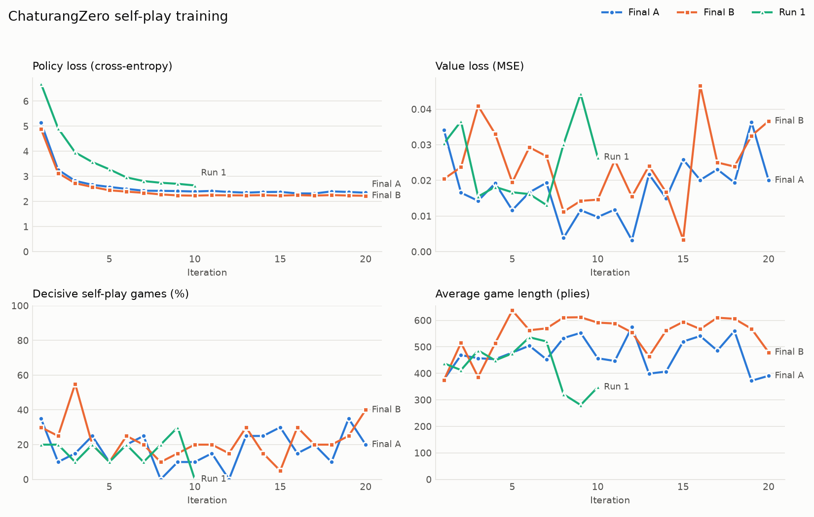
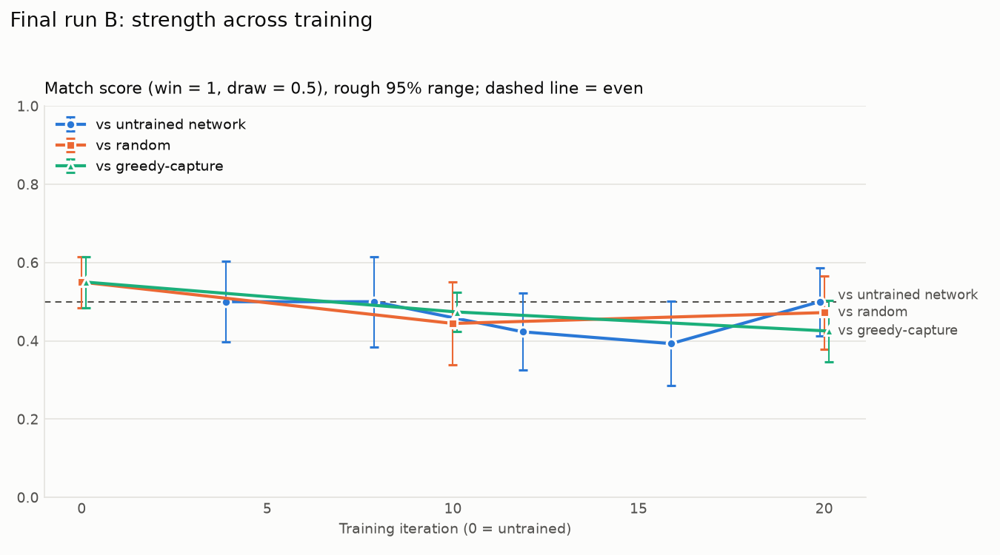
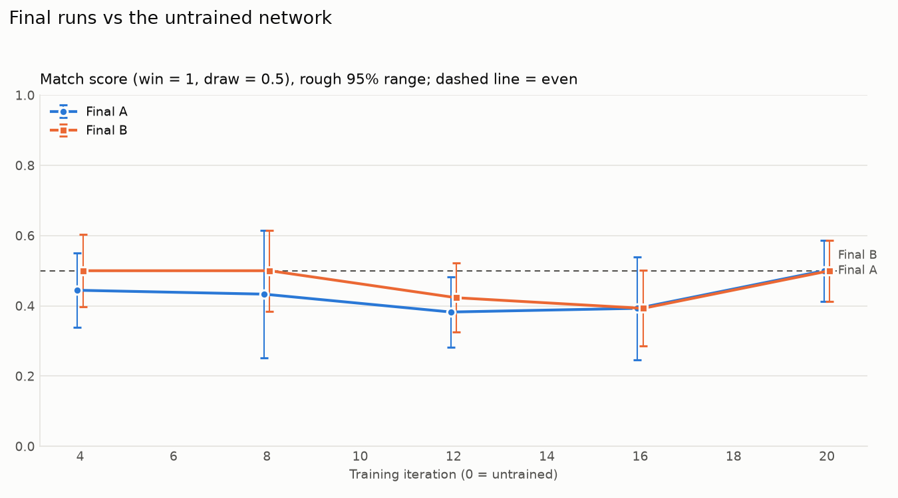
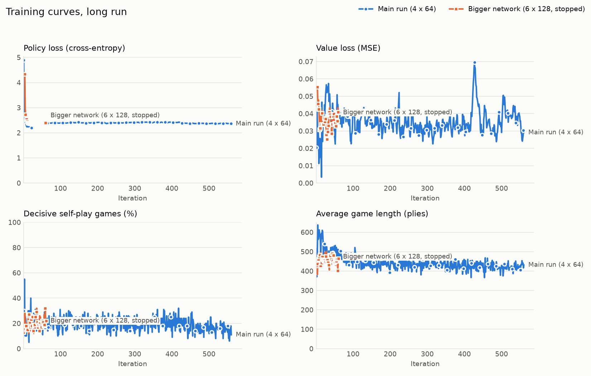
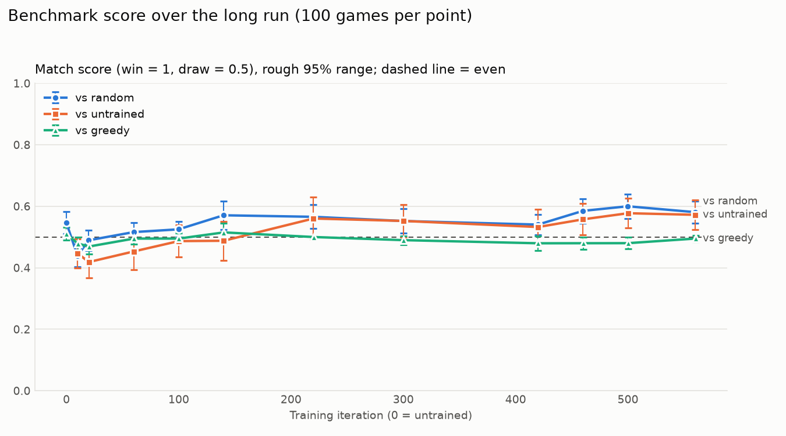
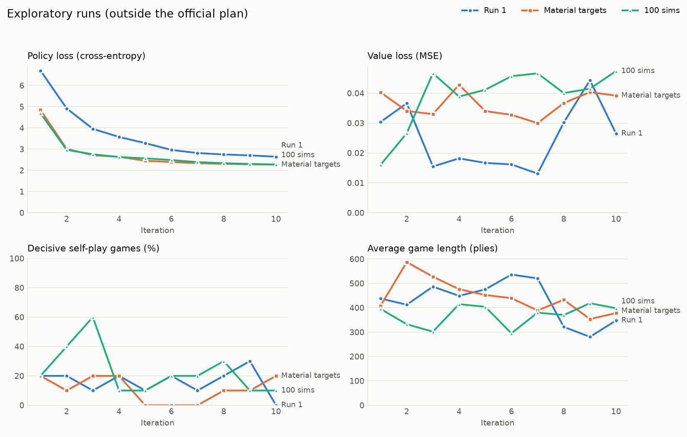

# Abstract

We built ChaturangZero, an AlphaZero-style agent for Chaturanga, the ancient
Indian ancestor of chess. The agent knows only the rules. A residual network
with a policy head and a value head guides Monte Carlo Tree Search (MCTS) with
PUCT selection, and the network is trained on the games the agent plays against
itself. The system has a rules engine checked by unit tests, the network,
search, a self-play training loop with a replay buffer, and an evaluation
suite. Our first two runs of 400 self-play games each (50 simulations per move,
a 4-block, 64-filter network) did not make the agent measurably stronger than
an untrained network: about 80% of games were drawn and the data was far too
small. We then made self-play about 11 times faster and trained for 540 more
iterations (54,000 games, about 144 hours on one laptop). That model,
iteration 560, beat its starting point 27 wins to 0 and beat random and
untrained play, but drew almost every game against a greedy-capture player and
rarely checkmated. Smaller learning rates, counting draws as bad, search-value
targets, shorter games, averaged weights and a larger network gave no
measurable gain, and resigning hopeless games could not work because the model
does not see a loss coming. More search at play time helped, so the browser
game uses 1600 simulations per move. The one training change that helped was
Gumbel self-play, which keeps the search, network and loss but trains on an
improved policy from a Gumbel root search instead of on visit counts. 660 more
iterations with it (66,000 games, about 39 hours) produced iteration 1220,
which beats iteration 560 by 83 wins to 1 at 1600 simulations per move.
Considering 32 instead of 16 root moves in the Gumbel search for 60 more
iterations gave the final model, iteration 1280, which beats 1220 by 60 wins
to 28 (score 0.580) and 560 by 87 wins to 3 at 1600 simulations (0.933). It
beats random play 51 to 0, the untrained network 69 to 2 and greedy capture
76 to 0, and most of its games against these programs end in checkmate. An
experienced chess player (FIDE blitz rating 1641) beat iteration 560 in five
of ten games, losing two, and then beat iteration 1220 in thirteen of
fourteen, with one draw: strength against programs did not carry over to a
strong human who attacks the king. Everything
stays within the course constraints: no knowledge beyond the rules, 50
simulations per move in training, and a 4-block, 64-filter network.

# 1. Introduction

AlphaZero (Silver et al., 2018) showed that one algorithm can learn chess,
shogi and Go to superhuman level from the rules alone, by combining tree search
with a neural network trained on self-play. The goal of this project was to
build that method from scratch for Chaturanga and to measure how far it gets on
the compute of a course project.

The course plan set these constraints:

- no human domain knowledge beyond the rules (no opening books, no piece
  values, no hand-written evaluation);
- 30 to 50 MCTS simulations per move during training;
- a residual network with 4 to 6 blocks and 64 to 128 filters;
- a 4096-wide action space (every from-square, to-square pair).

The project had four milestones: (1) a rules engine verified by unit tests,
(2) MCTS working with an untrained network, (3) a self-play pipeline with the
loss tracked over at least 50 to 100 games, and (4) benchmarks against earlier
iterations and baseline players, with learning curves. All four are complete.

The report follows the project in order: the first runs (Section 5.1 and
6.1 to 6.5) gave a negative result, the diagnosis (Section 7) led to a faster
pipeline and a much longer run, and that long run produced the first final
model, iteration 560 (Sections 5.3 and 6.6 to 6.10). Sections 6.11 to 6.19
test what else could make it stronger. Gumbel self-play (Section 6.19) did,
and Section 6.20 presents its result, iteration 1220. A last tweak, 32 root
moves instead of 16, improved it once more, and Section 6.21 presents that
model, iteration 1280, which is the final model.

# 2. The game

Chaturanga is played on the Ashtapada, an 8x8 board whose squares are all the
same color (it is not checkered like a chess board; our browser game draws it
this way). The starting layout is the same as in chess, but most pieces are
weaker:

| Piece | Letter | Move |
|---|---|---|
| Raja (king) | K | one square in any direction |
| Mantri (counselor) | Q | one square diagonally |
| Ratha (chariot) | R | any distance orthogonally, like a rook |
| Gaja (elephant) | E | exactly two squares diagonally, jumping the square between |
| Ashva (horse) | N | an L-shaped jump, like a knight |
| Padati (foot soldier) | P | one square forward, captures one square diagonally forward, promotes to Mantri on the last rank |

There is no castling, no pawn double step and no en passant. Checkmate wins.
Stalemate, 100 plies with no capture or pawn move (the no-progress rule) and
threefold repetition are draws. Because the Mantri and Gaja are short-range,
material advantages are much harder to convert into checkmate than in chess,
which turns out to matter for learning (Section 7).

# 3. Method

## 3.1 State and action encoding

A position is encoded as 13 planes of 8x8: one plane per piece type and color
(12) and one plane for the side to move. Squares are absolute (the board is not
flipped for Black). A move is the action `from * 64 + to`, giving 4096 actions;
illegal actions are masked out of the policy before the softmax. We checked
that the encoding and the action indices agree for both colors.

## 3.2 Network

`ChaturangaNet` is a residual network:

- an input 3x3 convolution to 64 filters with batch normalization and ReLU;
- 4 residual blocks, each two 3x3 convolutions with batch normalization and a
  skip connection;
- a policy head (1x1 convolution to 2 planes, then a linear layer to 4096
  logits);
- a value head (1x1 convolution to 1 plane, a 64-unit hidden layer, then a
  tanh output in [-1, 1], the expected result for the side to move).

It has 836,359 parameters. The loss is value mean squared error plus policy
cross-entropy against the MCTS visit distribution, with L2 regularization
(weight decay 1e-4).

## 3.3 Monte Carlo Tree Search

Each simulation descends the tree from the root by choosing the child that
maximizes

$$ -Q(s') + c_{puct} \, P(s, a) \, \frac{\sqrt{N(s)}}{1 + N(s')} $$

where $Q(s')$ is the child's mean value from the child's side (negated to give
the parent's view), $P(s, a)$ is the network's prior for the move, $N$ are
visit counts and $c_{puct} = 1.5$. At a new leaf, the network gives the priors
for its children and a value, which is backed up the path with its sign
flipped at each ply. There are no random rollouts. Child states are created
only when first visited. During self-play, Dirichlet noise
($\alpha = 0.3$, weight 0.25) is mixed into the root priors so that the agent
explores moves the network does not yet favor.

## 3.4 Self-play and training

Each training iteration:

1. **Self-play.** The current network plays 20 games (100 in the long run)
   against itself with 50 simulations per move. Moves are sampled in proportion to visit counts.
   Every position becomes an example (state, visit distribution, result from
   the mover's view: +1, -1 or 0 for a draw). Games longer than 800 plies stop
   and count as draws.
2. **Training.** Examples go into a replay buffer of the latest positions
   (20,000 in the first runs, 250,000 in the long run). The network takes Adam
   steps on random batches (400 steps of 64 in the first runs, 500 steps of
   256 in the long run).
3. **Checkpoint.** The network is saved, so every iteration can be evaluated
   later.

One rules-only addition: with `--avoid_repetition`, the agent never picks a
move that causes a threefold-repetition draw unless every searched move does.
This uses only the rules, so it fits the no-domain-knowledge requirement. We
added it because early self-play games often ended in repetition loops.

# 4. Implementation and testing

The code is plain Python with NumPy and PyTorch, organized by component:

| Folder | Contents |
|---|---|
| `chaturanga/` | rules engine, move generation, game end, encoding |
| `network/` | the network, loss and checkpoints |
| `mcts/` | tree nodes, PUCT search, root noise |
| `training/` | self-play, replay buffer, training loop |
| `evaluation/` | baseline players, benchmark, parallel matches, game-ending classifier, human-game log |

164 automated tests cover the rules (36 tests, including check, checkmate,
stalemate, promotion and the draw rules), the search (including a toy game
with a known best move), the network, value-target signs, policy targets, a
complete small training run including resuming from a checkpoint, the
benchmark scoring, the search-value targets of Section 6.16, the evaluation tools, batched GPU self-play and the browser game. All runs
are seeded and repeatable.

**Faster self-play.** For the long run we sped up self-play about 11 times on
the same hardware, without changing what it computes:

| Change | ms per move (50 simulations) |
|---|---|
| Original | 259 |
| Faster rules engine: legal moves cached per position, check detection that looks outward from the king, precomputed move tables | 48 |
| Network copy for search with batch normalization folded into the convolutions | 19 |

On top of that, 6 worker processes play games in parallel, each with its own
seed derived from the run seed, the iteration and the game number, so a run
does not depend on the number of workers. Training steps run on the laptop's
GPU. A test compares the fast rules engine with a frozen copy of the original
on every ply of 40 random games and on 3,000 random positions (same legal moves
in the same order, same check and game results).

**Self-play on the GPU.** Later we moved the network evaluations of self-play
to the laptop's GPU. The search is written as a generator that pauses
whenever it needs the network, so each worker can run many games side by
side and send all the positions they are waiting on to the GPU in one batch.
The moves do not change: on the CPU the batched games are exactly the games
played one at a time, which tests check. Two changes made the search itself
about 20% faster with the same moves: move probabilities are computed on the
legal moves only, and a node's children are created when the search first
visits them. For 120 games of the 4 x 64 network, self-play went from 544 to
246 seconds; for 60 games of the 6 x 128 network, from 830 to 351 seconds.

# 5. Experiments

## 5.1 Training runs

| Run | Simulations | Games | Move choice in self-play | Decisive games | Policy loss | Time |
|---|---|---|---|---|---|---|
| Run 1 (early) | 30 | 10 x 10 | earlier settings | 16 of 100 (16%) | 6.70 to 2.64 | 0.5 h |
| Final A | 50 | 20 x 20 | sample 30 plies, then best | 71 of 400 (18%) | 5.15 to 2.35 | 7.1 h |
| Final B | 50 | 20 x 20 | sample the whole game | 90 of 400 (22%) | 4.89 to 2.23 | 6.8 h |

Final B is the model we kept.

## 5.2 Benchmark protocol

To compare checkpoints fairly, every checkpoint plays 20 games against a fixed
opponent under the same conditions: 50 simulations, no root noise, temperature
0.3, repetition avoidance, alternating colors, the same random seed for every
checkpoint, and an 800-ply cap (unfinished games are left out). The score is
(wins + 0.5 x draws) / finished games, with a 95% margin of
$1.96 \sqrt{p(1-p)/n}$. The opponents are:

- **untrained**: the same MCTS agent with a freshly initialized network;
- **random**: a uniformly random legal move;
- **greedy-capture**: captures the most valuable piece it can, otherwise
  plays randomly. Its piece values are used only by this baseline, never by
  our agent.

Head-to-head matches between two checkpoints use the same protocol. In the long
run every benchmark and match uses 100 games, with margins of about 0.03 to
0.06.

## 5.3 The long run

The long run continues from final B (iteration 20) with the same official
settings (4 x 64 network, 50 simulations, root noise, repetition avoidance,
800-ply cap, draws valued 0). Each iteration plays 100 self-play games and then
takes 500 Adam steps of batch 256 from a buffer of 250,000 positions.

| Iterations | Learning rate | Notes |
|---|---|---|
| 21 to 420 | 1e-3 | |
| 421 to 500 | 1e-4 | two stretches of 40 iterations |
| 501 to 560 | 3e-5 | final stretch |

That is 540 iterations, 54,000 games and about 23.7 million positions, in
about 144 hours. We also tried a larger network (6 blocks, 128 filters, 2.3
million parameters) for 61 iterations; its first 5 iterations trained on games
played by our best 4 x 64 checkpoint so it did not start from random play
(Section 6.10).

# 6. Results

Sections 6.1 to 6.5 are the first runs; 6.6 to 6.10 are the long run; 6.11
to 6.14 are later attempts to go further; 6.15 breaks the constraints.

## 6.1 Learning curves



The policy loss falls quickly over the first 5 iterations and then flattens
around 2.2 to 2.4: the network learns to predict its own search, but search is
not getting better. The value loss stays below 0.05 and noisy, because most
targets are 0. The share of decisive games does not trend upward, and games
stay long (400 to 600 plies on average).

## 6.2 Benchmarks against fixed opponents



| Iteration (final B) | vs untrained | vs random | vs greedy-capture |
|---|---|---|---|
| 0 (untrained) | 0.5 by definition | 0.550 +/- 0.066 | 0.550 +/- 0.066 |
| 4 | 0.500 +/- 0.103 | | |
| 8 | 0.500 +/- 0.115 | | |
| 10 | | 0.444 +/- 0.106 | 0.474 +/- 0.050 |
| 12 | 0.423 +/- 0.098 | | |
| 16 | 0.393 +/- 0.108 | | |
| 20 | 0.500 +/- 0.087 | 0.472 +/- 0.093 | 0.425 +/- 0.078 |

Final A against the untrained network scored 0.444, 0.433, 0.382, 0.393 and
0.500 at iterations 4, 8, 12, 16 and 20. Every score in both runs is within its
margin of 0.5.



## 6.3 Against earlier iterations

| Match (20 games) | Wins | Losses | Draws | Unfinished | Score |
|---|---|---|---|---|---|
| Final B iter 20 vs final A iter 20 | 1 | 1 | 15 | 3 | 0.500 |
| Final B iter 20 vs final B iter 10 | 0 | 0 | 15 | 5 | 0.500 |

Ten more iterations of training did not give a single win over the older
network.

## 6.4 Agent vs. human

A team member who is new to chess played six games against final B, alternating
colors.

| Game | Human plays | Result | Ending | Plies | Pieces left (human / agent) |
|---|---|---|---|---|---|
| 1 | White | Human win | Checkmate | 91 | 11 / 2 |
| 2 | Black | Human win | Checkmate | 128 | 12 / 2 |
| 3 | White | Draw | Stalemate | 137 | 12 / 1 |
| 4 | Black | Human win | Checkmate | 90 | 16 / 1 |
| 5 | White | Draw | Stalemate | 161 | 8 / 1 |
| 6 | Black | Draw | Stalemate | 260 | 7 / 1 |

The agent won none of the six games. Its score is 0.250, with a 95% Wilson
range of 0.060 to 0.635. Six games are too few to separate that from 0.5
statistically, but the final positions are one-sided: the agent always ended
with at most two pieces, and in each draw it had only its king left, which the
human stalemated while going for checkmate.

**Against iteration 560.** Later, an experienced chess player from outside the team (FIDE blitz rating 1641,
rapid 1617) played ten games against iteration 560, the final model at the time, at 800 simulations per move,
five with each color, using the browser board (`play_web.py`). One more game, stopped after 4 plies, is left
out.

| Game | Human plays | Result | Ending | Plies | Pieces left (human / agent) |
|---|---|---|---|---|---|
| 1 | White | Human win | Checkmate | 133 | 8 / 4 |
| 2 | Black | Draw | Stalemate | 234 | 6 / 1 |
| 3 | White | Human win | Checkmate | 105 | 9 / 2 |
| 4 | White | Human win | Checkmate | 87 | 12 / 5 |
| 5 | Black | Human win | Checkmate | 74 | 11 / 4 |
| 6 | Black | Agent win | Human resigned | 295 | 6 / 1 |
| 7 | Black | Agent win | Checkmate | 207 | 5 / 3 |
| 8 | White | Draw | Stalemate | 137 | 8 / 1 |
| 9 | White | Draw | Stalemate | 183 | 3 / 1 |
| 10 | Black | Human win | Checkmate | 66 | 13 / 7 |

The human won five games, four of them in under 110 plies, and the agent won
two: one by checkmate and one by resignation, in a position where it had only
its king left after the human could not find a checkmate in 295 plies. The
agent's score is 0.350 (95% Wilson range 0.137 to 0.646). That is higher than
final B's 0.250 although this opponent was much stronger than the beginner who
played final B, and it kept more material: two to seven pieces in the games
it lost, against one or two for final B. It did better when the human played
Black (2 wins, 1 draw, 2 losses) than White (0 wins, 2 draws, 3 losses).
Iteration 560 is much stronger than final B against programs (Sections 6.7
and 6.9), but an experienced player aiming directly at its king still usually beats it:
it has rarely seen that kind of attack in self-play, where about 85% of games
are drawn.

**Against iteration 1220.** The same player then played
fourteen games against iteration 1220 (Section 6.20), the final model at the time, again at 800 simulations
per move, eight as White and six as Black. The player was in another city, so
these games were played on a standalone web version of the agent
(`web/standalone/`): the rules, search and network ported to JavaScript and
WebAssembly, checked against the Python code on 114,767 positions and 8 full
searches with no differences, and with network outputs within 6e-6 of
PyTorch's. All fourteen games replay legally in the Python engine and end as
recorded.

| Game | Human plays | Result | Ending | Plies | Pieces left (human / agent) |
|---|---|---|---|---|---|
| 1 | White | Human win | Checkmate | 143 | 9 / 1 |
| 2 | Black | Human win | Checkmate | 90 | 11 / 1 |
| 3 | White | Human win | Checkmate | 93 | 12 / 4 |
| 4 | Black | Human win | Checkmate | 144 | 9 / 2 |
| 5 | White | Human win | Checkmate | 61 | 13 / 7 |
| 6 | Black | Human win | Checkmate | 80 | 12 / 1 |
| 7 | White | Human win | Checkmate | 77 | 12 / 2 |
| 8 | Black | Human win | Checkmate | 124 | 10 / 1 |
| 9 | White | Human win | Checkmate | 55 | 15 / 8 |
| 10 | Black | Human win | Checkmate | 68 | 15 / 10 |
| 11 | White | Human win | Checkmate | 103 | 13 / 3 |
| 12 | Black | Human win | Checkmate | 74 | 12 / 4 |
| 13 | White | Human win | Checkmate | 67 | 13 / 7 |
| 14 | White | Draw | Stalemate | 71 | 13 / 1 |

The human won thirteen games, all by checkmate, and the fourteenth was a
stalemate with the agent down to its king. The agent's score is 0.036 (95%
Wilson range 0.004 to 0.268), against 0.350 for iteration 560; the two
ranges barely overlap. The games were also much shorter: a median of 79
plies, against 135 against 560, and ten of the thirteen losses took under
110 plies. Four were lost with seven to ten pieces still on the board,
which means the agent walked into a mating attack rather than being ground
down.

This is not a controlled comparison. The player had already played ten games
against the agent and knew how it plays, so part of the drop is the player
learning. Even so, the result is clear in one direction: iteration 1220 beats
560 by 83 wins to 1 at 1600 simulations and is better against every program
we tested, yet it did no better against a strong human. Gumbel self-play made
its own games more decisive (44% against about 15%), but those are games
between two copies of an agent that does not attack like a person, and they
did not teach it to defend against a direct attack on its king.

## 6.5 How games end

Final B at iteration 16, 10 games against each opponent under the benchmark
protocol:

| Ending | vs itself | vs random | vs greedy-capture |
|---|---|---|---|
| No-progress rule | 5 | 5 | 7 |
| Threefold repetition | 2 | 3 | 3 |
| Checkmate | 2 | 1 | 0 |
| 800-ply cap | 1 | 1 | 0 |

## 6.6 Long run: learning curves



The policy loss stays around 2.4, and the share of decisive self-play games
stays around 15 to 25%. These curves do not show the improvement, because the
targets move with the network: as the agent improves, so does its opponent.
Game length fell from about 530 to about 430 plies. Strength has to be
measured by matches.

## 6.7 Long run: progress against the starting model

Checkpoints of the long run against final B (iteration 20), 100 games each:

| Iteration | Wins | Losses | Draws | Unfinished | Score |
|---|---|---|---|---|---|
| 40 | 10 | 3 | 61 | 26 | 0.547 +/- 0.047 |
| 100 | 18 | 4 | 61 | 17 | 0.584 +/- 0.052 |
| 140 | 27 | 2 | 57 | 14 | 0.645 +/- 0.053 |
| 220 | 21 | 5 | 57 | 17 | 0.596 +/- 0.057 |
| 300 | 27 | 5 | 52 | 16 | 0.631 +/- 0.060 |
| 380 | 11 | 5 | 63 | 21 | 0.538 +/- 0.049 |
| 500 | 27 | 3 | 60 | 10 | 0.633 +/- 0.053 |
| **560 (final)** | **27** | **0** | **59** | **14** | **0.657 +/- 0.049** |

Unlike the first runs, training now clearly helps: every checkpoint beats the
starting model, and the final one won 27 games and lost none. Most of the gain
came in the first 100 to 140 iterations. From there to iteration 420 the score
moved up and down by about its own margin.

## 6.8 Lowering the learning rate

To choose a model, iterations 140, 300, 420 and 460 (the first 40 iterations
at learning rate 1e-4) played each other, 100 games per pair. The table gives
the row model's score against the column model.

| | vs 140 | vs 300 | vs 420 | vs 460 |
|---|---|---|---|---|
| 140 | | 0.511 | 0.488 | 0.413 |
| 300 | 0.489 | | 0.500 | 0.463 |
| 420 | 0.512 | 0.500 | | 0.453 |
| 460 | **0.587** | **0.537** | **0.547** | |

Iterations 140, 300 and 420 are even with each other, while 460 beats all
three (41 wins, 9 losses in total). At learning rate 1e-3 the network kept
moving around one level of play; the lower rate let it settle. Further
stretches still helped, by smaller steps: iteration 500 scored 0.526 against
460 (8 wins, 3 losses), and iteration 560 scored 0.524 against 500 over 300
games (26 wins, 12 losses). Iteration 560 was the final model of the long
run, and Sections 6.9 to 6.18 call it "the final model". Gumbel self-play
later replaced it with iteration 1220 (Section 6.20), and then iteration 1280
with 32 root moves (Section 6.21).

## 6.9 Long run: benchmarks of the final model



| Iteration | vs random | vs untrained | vs greedy-capture |
|---|---|---|---|
| 20 (final B) | 4 W, 6 L: 0.489 | 4 W, 18 L: 0.419 | 0 W, 6 L: 0.469 |
| 100 | 6 W, 1 L: 0.525 | 7 W, 9 L: 0.487 | 1 W, 2 L: 0.495 |
| 220 | 15 W, 2 L: 0.566 | 23 W, 13 L: 0.560 | 0 W, 0 L: 0.500 |
| 420 | 10 W, 2 L: 0.540 | 13 W, 8 L: 0.533 | 1 W, 5 L: 0.480 |
| **560 (final)** | **16 W, 0 L: 0.581** | **17 W, 4 L: 0.572** | **0 W, 1 L: 0.495** |

The final model beats random play and the untrained network and almost never
loses to them, where final B lost more than it won. Against greedy capture,
99 of 100 games were drawn.

How the final model's games end, 30 games each:

| Ending | vs random | vs greedy-capture |
|---|---|---|
| Checkmate | 3 | 1 |
| Stalemate | 0 | 2 |
| No-progress rule | 12 | 27 |
| Threefold repetition | 14 | 0 |
| 800-ply cap | 1 | 0 |

The agent no longer gives material away, but it rarely turns an advantage into
checkmate. Against random most games end by the no-progress rule or by
repetitions that the random player causes (our agent avoids them).

## 6.10 A larger network

| Match (100 games) | Wins | Losses | Score |
|---|---|---|---|
| 6 x 128 iteration 30 vs 4 x 64 iteration 460 | 4 | 21 | 0.411 +/- 0.048 |
| 6 x 128 iteration 60 vs 4 x 64 iteration 460 | 3 | 17 | 0.427 +/- 0.043 |
| 6 x 128 iteration 60 vs 4 x 64 iteration 420 | 8 | 14 | 0.468 +/- 0.049 |

Each iteration of the larger network took about 25 to 30 minutes instead of
about 9. After 61 iterations (about 31 hours) it was still behind and
improving slowly, so we stopped it and used the time for the lower learning
rate instead. Section 6.12 tries it again with faster self-play.

## 6.11 Two more tests on the final model

**More search when playing.** The 30 to 50 simulation limit applies to
training, so we also measured the final model with more search at play time.
With 200 simulations per move against itself at 50 (100 games) it scored
9 wins, 4 losses and 86 draws (0.525 +/- 0.035). More search helps more:

| Final model, simulations per move (vs itself at 50, 100 games) | Wins | Losses | Draws | Unfinished | Score |
|---|---|---|---|---|---|
| 200 | 9 | 4 | 86 | 1 | 0.525 +/- 0.035 |
| 400 | 12 | 0 | 88 | 0 | 0.560 +/- 0.032 |
| 800 | 23 | 0 | 76 | 1 | 0.616 +/- 0.042 |

At 800 simulations the model won 23 games and lost none, a larger gain than
the last 100 iterations of training gave. Most games are still drawn, so the
extra search mainly avoids mistakes and punishes the opponent's, rather than
converting slow advantages. A move then takes about a third of a second,
which is fine for play against a person. Section 6.18 shows that 1600 simulations is
better still, and that is now the default for games against the final model.

**Counting draws as slightly bad.** We continued the final model from
iteration 560 with a value target of -0.2 for both sides in every drawn or
unfinished self-play game, instead of 0, at learning rate 1e-4. It uses only
the game result, so it stays within the rules-only constraint. Decisive
self-play games rose from about 14% to about 19%, but play got weaker:

| Match (100 games) | Wins | Losses | Draws | Unfinished | Score |
|---|---|---|---|---|---|
| iteration 600 vs final (560) | 4 | 9 | 85 | 2 | 0.474 +/- 0.036 |
| iteration 630 vs final (560) | 0 | 9 | 89 | 2 | 0.454 +/- 0.029 |

We stopped it at iteration 631 and kept iteration 560 as the final model.

## 6.12 The larger network, second attempt

With GPU self-play an iteration of the 6 x 128 network takes about 10
minutes instead of 25 to 30. We trained it again, this time learning for 30
iterations from games played by the final model before playing its own.

| Run | Iteration | Wins | Losses | Draws | Score vs final (560) |
|---|---|---|---|---|---|
| learning rate 1e-3 | 30 (end of learning from 560's games) | 5 | 6 | 89 | 0.495 +/- 0.032 |
| learning rate 1e-3 | 60 | 2 | 13 | 82 | 0.443 +/- 0.037 |
| learning rate 1e-3 | 120 | 1 | 16 | 80 | 0.423 +/- 0.039 |
| learning rate 1e-4, from iteration 30 | 50 | 4 | 6 | 87 | 0.490 +/- 0.032 |
| learning rate 1e-4, from iteration 30 | 70 | 6 | 7 | 86 | 0.495 +/- 0.036 |

Learning from the final model's games made the larger network as strong as
the final model. On its own games at 1e-3 it got steadily weaker; at 1e-4 it
stayed level but did not get stronger, and we stopped it at iteration 90.

## 6.13 Can hopeless games end early?

AlphaZero resigns a game when the search rates the position as clearly lost,
so lost games give a real result instead of a long draw. Before training with
it, we recorded the final model's evaluation of every position in 160
self-play games and counted, for each threshold, how often a resignation
would have been wrong (the side did not go on to lose):

| Resign when below (2 moves in a row) | Would resign | Wrong |
|---|---|---|
| -0.3 | 34 | 32 |
| -0.4 | 16 | 14 |
| -0.5 | 7 | 6 |
| -0.6 | 2 | 2 |
| -0.8 | 0 | 0 |

Nearly every resignation would have been in a game that ended in a draw. The
21 decisive games were mostly short (11 to 250 plies), and the losing side's
evaluation stayed near 0 until just before the mate. Resigning would have
turned draws into wrong losses, so we did not train with it.

## 6.14 Even smaller learning steps

The lower learning rates of Section 6.8 still gave small gains, so we
continued the final model from iteration 560 for 140 more iterations at
learning rate 2e-5 (about 10 hours with GPU self-play):

| Match vs final (560) | Games | Wins | Losses | Draws | Score |
|---|---|---|---|---|---|
| iteration 620 | 100 | 3 | 1 | 96 | 0.510 +/- 0.020 |
| iteration 660 | 100 | 7 | 7 | 84 | 0.500 +/- 0.037 |
| iteration 700 | 200 | 15 | 9 | 173 | 0.515 +/- 0.024 |

No checkpoint is clearly stronger than the final model, so we kept
iteration 560 and stopped the run at iteration 702.

## 6.15 Exploratory runs (outside the course constraints)

We ran two short experiments that break the constraints, to test the
diagnosis below. They are not the final agent.

- **Material value targets** (30 simulations, 10 x 10 games): drawn games get a
  value target from the final material balance, which uses piece values. The
  value head did learn material (correlation +0.45 with the material balance,
  against +0.07 in run 1), but strength did not improve (0.474 and 0.469
  against untrained at iterations 5 and 10).
- **100 simulations per move** (10 x 10 games, also with material targets):
  decisive games peaked at 60% in iteration 3, but strength against untrained
  was 0.421 at iteration 5 and 0.346 at iteration 10.



## 6.16 Learning from the search's own values

About 85% of self-play games are draws, so most value targets are 0 and the
value head learns little (Section 7). A rules-only fix is to blend each
position's final result z with the value the search itself found at that
position, q: the target becomes (1 - w) z + w q. Even in a drawn game, the
search's values then tell the value head which positions looked better or
worse. We continued the final model (iteration 560) for 100 more iterations
with w = 0.5 (`--q_mix 0.5`, learning rate 1e-4), keeping every other setting
the same, and tested iterations 600, 630 and 660 against iteration 560.

| Match vs final (560) | Games | Wins | Losses | Draws | Unfinished | Score |
|---|---|---|---|---|---|---|
| iteration 600 | 100 | 7 | 5 | 84 | 4 | 0.510 +/- 0.035 |
| iteration 630 | 100 | 9 | 6 | 84 | 1 | 0.515 +/- 0.038 |
| iteration 660 | 200 | 21 | 14 | 162 | 3 | 0.518 +/- 0.029 |

All three are slightly above an even score but inside the margin, so none is
clearly stronger and we kept iteration 560. Self-play changed little: 16.6%
of games were decisive, against 15.3% over the same iterations of the 2e-5
run (Section 6.14). The value loss was much lower (0.007 against 0.037), but
that is expected and not a sign of learning: half of each target is now the
search's own estimate, which the network finds easy to predict. The run took
about 10.6 hours (`results/qmix/`).

The likely reason is that the search's values come from the same value head
we are trying to improve. Where that head cannot yet tell a won position from
a lost one, the search's estimate is close to 0 as well, so the blended target
adds little new information.

## 6.17 Shorter self-play games

In the matches, games with a winner are short (median 132 plies) and draws
are long (median 469), so most self-play time goes into long drawn games. We
continued the final model from iteration 560 for 100 iterations with
self-play games stopped at 300 plies instead of 800 (`--max_plies 300`,
learning rate 1e-4, seed 31), everything else unchanged. Games that reach the
cap get the draw value 0, as before. Benchmarks still use the 800-ply cap.

| Match vs final (560) | Games | Wins | Losses | Draws | Unfinished | Score |
|---|---|---|---|---|---|---|
| iteration 600 | 100 | 4 | 4 | 92 | 0 | 0.500 +/- 0.028 |
| iteration 630 | 100 | 10 | 4 | 86 | 0 | 0.530 +/- 0.036 |
| iteration 660 | 200 | 10 | 10 | 177 | 3 | 0.500 +/- 0.022 |

Iteration 630 was the best of any continuation, but inside its margin, and
the 200-game match at iteration 660 was exactly even, so we kept iteration
560. The idea worked as intended on the data side: rounds took about 2.4
minutes instead of 6 to 7, 15% of games still had a winner, and the run
produced about 380 decisive games per hour against about 160 in the q_mix run
(4 hours in all, `results/shortcap/`). More decisive games per hour did not
give a stronger agent within 100 iterations, which again points to what the
value head can learn from them rather than how many there are.

## 6.18 Averaging checkpoints, more search, and keeping the search tree

**Averaging checkpoints (a "model soup").** All our continuations ended close
to the final model, so we tried averaging the weights of seven of them into
one network: iteration 560 and iterations 620, 640 and 660 of both the q_mix
run (Section 6.16) and the shorter-games run (Section 6.17). It needs no
training, only a few seconds to average the numbers
(`results/soup_and_sims/make_soup.py`).

| Match (50 sims) | Games | Wins | Losses | Draws | Unfinished | Score |
|---|---|---|---|---|---|---|
| averaged model vs final (560) | 200 | 16 | 10 | 173 | 1 | 0.515 +/- 0.025 |

The averaged model is slightly ahead, but inside the margin, so we kept
iteration 560.

**1600 simulations against 800.** Section 6.11 showed that 800 simulations
beat 50. To see whether more search still helps, the final model played
itself with 1600 simulations per move against 800 (100 games).

| Match | Games | Wins | Losses | Draws | Unfinished | Score |
|---|---|---|---|---|---|---|
| final at 1600 vs final at 800 | 100 | 15 | 3 | 82 | 0 | 0.560 +/- 0.040 |
| final at 3200 vs final at 1600 | 100 | 7 | 6 | 87 | 0 | 0.505 +/- 0.035 |

1600 simulations is measurably better than 800 (the score stays above 0.5
even at the bottom of the margin), but the gain is smaller than from 50 to
800 (0.616), and 3200 is no better than 1600. Each doubling of search helps
less than the one before, and past 1600 the gain is gone: more search cannot
make up for a value head that does not recognize won positions. A move takes
about 0.55 seconds at 1600 against about 0.3 seconds at 800, so the
browser game now uses 1600 by default (`play_web.py --simulations 1600`). The
human games in Section 6.4 were played at 800, the first set before this
change and the second at 800 again so the two sets compare.

**Keeping the search tree between moves.** After the agent moves, the part
of its tree below that move already holds searches of the opponent's likely
replies. The search can now keep that part and, once the opponent has
replied, start the next search from the subtree of the reply actually played
instead of from nothing (`mcts/reuse.py`, `--reuse_a`/`--reuse_b` in the match
tool; the browser game does it by default). It uses only the search itself.
In a 60-move game with the final model at 1600 simulations, 58 searches
started from a kept subtree, but each brought only about 76 visits on
average: the search spreads widely, so the move played gets only about 15 to
20% of the visits and the opponent's actual reply far fewer. That is about 5%
more search per move, far too little to measure when doubling the search
from 1600 to 3200 gave nothing, so we did not run a match for it.

## 6.19 A last round of ideas

To make sure no obvious idea was left untried, we tested every remaining
improvement we know of that stays within the course rules. Ideas that change
only how the final model plays are measured with 200 games against it.
Training ideas continue the final model from iteration 560 for 60 iterations
with the settings of Section 6.17 (except the idea itself, and the 800-ply
cap) and then play 200 games against iteration 560. All games use the
benchmark protocol (50 simulations, temperature 0.3). The options are in
`training/README.md` and the match files in `results/last_ideas/`.

| Idea | What changes | Wins | Losses | Draws | Score vs 560 |
|---|---|---|---|---|---|
| Search constant c_puct 1.0 (play only) | Less exploration in the search than the usual 1.5 | 9 | 10 | 177 | 0.497 +/- 0.022 |
| Search constant c_puct 2.0 (play only) | More exploration | 15 | 14 | 171 | 0.502 +/- 0.026 |
| Search constant c_puct 3.0 (play only) | Much more exploration | 6 | 13 | 176 | 0.482 +/- 0.022 |
| Three networks averaged (play only), 400 games | Final model + q_mix 660 + short-games 660 (Sections 6.16, 6.17), priors and values averaged | 30 | 18 | 347 | 0.515 +/- 0.017 |
| More root noise in self-play | Dirichlet weight 0.4 instead of 0.25 | 8 | 19 | 168 | 0.472 +/- 0.026 |
| Late starts | 30% of self-play games start from a position 50-90% of the way through a game of the previous iteration | 10 | 9 | 180 | 0.503 +/- 0.021 |
| Mixed searches | Half of the moves get the full 50-simulation search and are trained on; the rest a fast 30-simulation search that is not; 160 games per iteration | 5 | 11 | 179 | 0.485 +/- 0.020 |
| Decisive games weighted | Positions from won or lost games are sampled 3 times as often in training | 9 | 10 | 176 | 0.497 +/- 0.022 |
| Mirror augmentation | Each sampled position is flipped left to right with probability 0.5 (a symmetry of the rules, checked by a test) | 13 | 9 | 177 | 0.510 +/- 0.023 |
| Older opponents | A quarter of self-play games are against iteration 300, 420, 520 or 540 (in turn); only the current network's moves are trained on | 9 | 10 | 178 | 0.497 +/- 0.022 |
| Gumbel self-play, 400 games | Self-play uses Gumbel root search (Sequential Halving over 16 sampled moves) and trains on its improved policy instead of visit counts; matches still use plain PUCT | 40 | 8 | 351 | 0.540 +/- 0.017 |
| Gumbel self-play, 60 more iterations (680) | The Gumbel model continued from 620 to 680 with the same settings | 40 | 3 | 156 | 0.593 +/- 0.030 |
| Gumbel self-play, 120 more iterations (740) | The Gumbel model continued from 680 to 740 with the same settings | 69 | 5 | 124 | 0.662 +/- 0.036 |
| Gumbel self-play, 180 more iterations (800) | The Gumbel model continued from 740 to 800 with the same settings | 88 | 3 | 108 | 0.714 +/- 0.036 |
| Gumbel self-play, 240 more iterations (860) | The Gumbel model continued from 800 to 860 with the same settings | 120 | 2 | 77 | 0.796 +/- 0.036 |
| Gumbel self-play, 300 more iterations (920) | The Gumbel model continued from 860 to 920 with the same settings | 112 | 6 | 82 | 0.765 +/- 0.039 |
| Gumbel self-play, 360 more iterations (980) | The Gumbel model continued from 920 to 980 with the same settings | 107 | 11 | 82 | 0.740 +/- 0.042 |
| Gumbel self-play, 420 more iterations (1040) | The Gumbel model continued from 980 to 1040 with the same settings | 89 | 7 | 103 | 0.706 +/- 0.039 |
| Gumbel self-play, 480 more iterations (1100) | The Gumbel model continued from 1040 to 1100 with the same settings | 88 | 18 | 90 | 0.679 +/- 0.045 |
| Gumbel plus mirror, decisive weight and late starts (680) | Same start (Gumbel 620) and length as the row above, with the three ideas that came out even or slightly above added | 40 | 7 | 148 | 0.585 +/- 0.032 |
| Moves-left head | A training-only head predicts how many plies the game still lasts (loss weight 0.1), so the shared layers learn it too | 7 | 14 | 178 | 0.482 +/- 0.022 |
| Reanalyse | Each iteration also searches every position of 50 games from the last 5 iterations again with the current network and adds them with fresh policy targets | 4 | 12 | 179 | 0.479 +/- 0.020 |

The search constant of 1.5 used throughout is as good as any we tried.
Averaging the final model with the two strongest continuations is the only
idea with a score above 0.5 in both of its 200-game matches (0.521 and
0.510), but pooled over 400 games the margin still reaches 0.5, and each
move costs three network evaluations instead of one. We did not adopt it.
More root noise during self-play, to explore more openings, made the model
slightly weaker, if anything. Starting some self-play games late, so that more
training positions come from endgames where games are decided, gave an even
score. Mixing fast, untrained searches into self-play (playout cap
randomization), which gives more games for the same time, did not help
either. Nor did sampling positions from decisive games three times as often,
which gives the value head more non-zero targets. Flipping training positions
left to right, which doubles the variety of the data for free, was slightly
above even but well inside the margin. Playing a quarter of the self-play games
against earlier versions, to keep the network from forgetting how to beat
them, gave an even score.

The one exception is Gumbel self-play (Danihelka et al., 2022). With only 50
simulations, visit counts are a coarse policy target, and a move that is never
visited gets no credit. The Gumbel search instead trains on
softmax(logits + sigma(completed Q)), which gives every legal move a target
from its prior and, where it was searched, its value. It is the only idea
whose margin stays above 0.5: 17 wins against 5 losses (0.530 +/- 0.023) in
the first 200 games, and 23 against 3 (0.550 +/- 0.024) in a second 200 with
new seeds, so 0.540 +/- 0.017 over 400 games. Continuing
the Gumbel run for 60 more iterations made it stronger again: iteration 680
scored 0.593 +/- 0.030 against iteration 560 (40 wins, 3 losses) and
0.515 +/- 0.025 against Gumbel iteration 620 (16 wins, 10 losses). Unlike
every other continuation of the final model, this one is still improving,
so we are training it further. Iteration 740 scored 0.662 +/- 0.036
against 560 (69 wins, 5 losses) and 0.545 +/- 0.030 against Gumbel 680
(28 wins, 10 losses), and 23.5% of its self-play games were decisive, against
about 15% before. Iteration 800 improved again: 0.714 +/- 0.036 against 560
(88 wins, 3 losses) and 0.557 +/- 0.035 against Gumbel 740 (39 wins,
16 losses), with 28% of its self-play games decisive. Iteration 860 made the largest
jump so far: 0.796 +/- 0.036 against 560 (120 wins, 2 losses) and
0.640 +/- 0.039 against Gumbel 800 (68 wins, 12 losses). (This run was
stopped at iteration 806 by a laptop shutdown and resumed from the saved
checkpoint, refilling the replay buffer first.) After that the gains became
small. Iteration 920 scored 0.518 +/- 0.044 against Gumbel 860 (44 wins,
37 losses) and 980 scored 0.552 +/- 0.045 against 920 (53 wins, 32 losses),
1040 scored 0.515 +/- 0.042 against 980 (40 wins, 34 losses) and 1100
scored 0.510 +/- 0.043 against 1040 (40 wins, 36 losses), but against
iteration 560 the scores went down: 0.796 (860), 0.765 (920), 0.740 (980),
0.706 (1040), 0.679 (1100). Each step beats the one before by a little, yet may not be
stronger overall, so the newest model is not automatically the best. To
choose, every Gumbel model from 800 on played every other in a round robin
(200 games a pair; each cell is the row model's score against the column
model):

| Model | 800 | 860 | 920 | 980 | 1040 | 1100 | Average |
|---|---|---|---|---|---|---|---|
| 1100 | 0.601 | 0.518 | 0.583 | 0.580 | 0.500 | - | 0.556 |
| 1040 | 0.578 | 0.602 | 0.543 | 0.557 | - | 0.500 | 0.556 |
| 920 | 0.635 | 0.530 | - | 0.470 | 0.457 | 0.417 | 0.502 |
| 980 | 0.595 | 0.500 | 0.530 | - | 0.443 | 0.420 | 0.498 |
| 860 | 0.590 | - | 0.470 | 0.500 | 0.398 | 0.482 | 0.488 |
| 800 | - | 0.410 | 0.365 | 0.405 | 0.422 | 0.399 | 0.400 |

Head to head the newest models are the strongest. Iterations 1040 and 1100
tied with each other (42 wins each) and both average 0.556, with 1100 ahead
only in the fourth decimal, so iteration 1100 is taken as the best Gumbel
model. Their lower scores against 560 suggest the later models specialise
against Gumbel-style play; Section 6.20 tests the chosen model against 560
again at 1600 simulations.

We then tuned the Gumbel run. Each row continues iteration 1100 for 60
iterations with one setting changed, and plays 200 games against 1100 and
200 against 560:

| Change (60 more iterations from 1100) | Against 1100 (W-L-D) | Score against 1100 | Score against 560 |
|---|---|---|---|
| None: the last chain step, 1040 to 1100, for reference | 40-36-124 (against 1040) | 0.510 +/- 0.043 | 0.679 +/- 0.045 |
| Learning rate 3e-5 instead of 1e-4 | 63-28-109 | 0.588 +/- 0.045 | 0.719 +/- 0.041 |
| Learning rate 3e-5, 60 more iterations (1220) | 59-35-104 (against the 3e-5 model at 1160) | 0.561 +/- 0.047 | 0.814 +/- 0.036 |
| Learning rate 3e-5, 60 more iterations (1280) | 44-48-108 (against 1220) | 0.490 +/- 0.047 | 0.770 +/- 0.038 |
| 8 root moves considered instead of 16 | 30-86-84 | 0.360 +/- 0.049 | 0.693 +/- 0.040 |
| 32 root moves instead of 16 (60 iterations from 1220 at learning rate 1e-4) | 38-53-109 (against 1220) | 0.463 +/- 0.046 | 0.711 +/- 0.038 |
| 32 root moves instead of 16 (60 iterations from 1220 at learning rate 3e-5) | 60-28-112 (against 1220) | 0.580 +/- 0.045 | 0.812 +/- 0.037 |
| 1000 training steps per iteration instead of 500 (60 iterations from 1220, learning rate 3e-5) | 30-65-104, 1 unfinished (against 1220) | 0.412 +/- 0.046 | 0.747 +/- 0.038 |
| 32 simulations and 150 games per iteration instead of 50 and 100 (60 iterations from 1220, learning rate 3e-5) | 50-45-104, 1 unfinished (against 1220) | 0.513 +/- 0.048 | 0.780 +/- 0.040 |
| Learning rate 3e-4 instead of 3e-5 (60 iterations from 1220) | 20-93-87 (against 1220) | 0.318 +/- 0.046 | 0.680 +/- 0.045 |
| Replay buffer of 100,000 positions instead of 250,000 (60 iterations from 1220) | 25-52-123 (against 1220) | 0.432 +/- 0.042 | 0.741 +/- 0.037 |
| Weight decay 1e-3 instead of 1e-4 (60 iterations from 1220) | 39-54-105 (against 1220) | 0.462 +/- 0.047 | 0.741 +/- 0.040 |
| Weight decay 1e-5 instead of 1e-4 (60 iterations from 1220) | 56-33-110 (against 1220) | 0.558 +/- 0.046 | 0.773 +/- 0.039 |
| No repetition avoidance in self-play (60 iterations from 1220) | 55-36-108 (against 1220) | 0.548 +/- 0.047 | 0.801 +/- 0.039 |

A lower learning rate is the first change that clearly beats the plain
continuation: 0.588 against 1100, well outside the margin, and 0.719
against 560, the best since iteration 920. With a smaller step the network
keeps what it has learned instead of chasing the newest games. Continuing
at 3e-5 for 60 more iterations (to 1220) improved it again: 0.561 against
the 3e-5 model at 1160 and 0.814 +/- 0.036 against 560 (128 wins,
3 losses), the best score against 560 of any model so far. The next 60
iterations (to 1280) did not improve it (0.490 against 1220, 0.770 against
560), so the 3e-5 run stopped at 1220. A round robin of 1100 and the two
best 3e-5 models (200 games a pair, row against column) confirms it:

| Model | 1100 | 3e-5 at 1160 | 3e-5 at 1220 | Average |
|---|---|---|---|---|
| 3e-5 at 1220 | 0.662 | 0.563 | - | 0.612 |
| 3e-5 at 1160 | 0.560 | - | 0.437 | 0.499 |
| 1100 | - | 0.440 | 0.338 | 0.389 |

Iteration 1220 beat 1100 by 83 wins to 18 and is the new best model.

Finally, we tried changes at play time only, with no training, each in 200
games of 1220 against itself:

| Change at play time (1220 against plain 1220) | Wins | Losses | Draws | Score |
|---|---|---|---|---|
| c_puct 1.0 instead of 1.5 | 57 | 40 | 103 | 0.542 +/- 0.048 |
| c_puct 2.0 | 44 | 51 | 104 | 0.482 +/- 0.048 |
| c_puct 3.0 | 42 | 75 | 83 | 0.417 +/- 0.052 |
| Gumbel move choice instead of PUCT visit counts | 53 | 53 | 94 | 0.500 +/- 0.050 |
| Mirror-averaged network | 43 | 48 | 108 | 0.487 +/- 0.047 |
| Weight average of iterations 1180 to 1220 | 60 | 49 | 91 | 0.527 +/- 0.051 |

Only c_puct 3.0 makes a clear difference, and it is worse. The others are
within the margin, so the plain model with c_puct 1.5 is kept. Considering
only 8 root moves in the Gumbel search clearly hurt (0.360 against 1100):
with fewer candidates the search misses good moves more often, and the
training targets get worse. Considering 32 instead, continued from 1220
at learning rate 1e-4, did not help either: 0.463 +/- 0.046 against 1220,
within the margin but below even, and 0.711 against 560, below 1220's
0.814. Because 1220 was trained at 3e-5, this run also changed the
learning rate. Repeated at 3e-5, 32 root moves did help: 60 wins to 28
against 1220 (0.580 +/- 0.045), where the same 60 iterations with 16 root
moves gave 0.490 (the 1280 row), and 0.812 against 560. That is the first
change from 1220 to beat it outside the margin. Two re-checks confirmed it.
Against the plain 1280 model, where only the number of root moves differs,
it won 55 games to 28 (0.568 +/- 0.044, 200 games, one unfinished), and
against 1220 at the browser setting of 1600 simulations it won 30 to 13
(0.589 +/- 0.065, 100 games, four unfinished). It became the final model
(Section 6.21); the remaining tweaks from 1220 all use 3e-5 and are compared
with 1220.
Training twice as hard on each iteration's data (1000 steps instead of
500) made it worse: 0.412 +/- 0.046 against 1220 and 0.747 against 560,
most likely because the network fits each batch of self-play games too
closely. Playing 150 games per iteration at 32 simulations instead of 100
at 50 (about the same time, still inside the 30 to 50 limit) gave no clear
change (0.513 +/- 0.048 against 1220, 0.780 against 560): more games with
a weaker search balance out. A larger learning rate, 3e-4, was clearly
worse (0.318 against 1220, 0.680 against 560), which agrees with Section
6.19's finding that the small rate of 3e-5 is what kept the Gumbel run
improving. A smaller replay buffer, 100,000 positions instead of 250,000,
was also worse (0.432 +/- 0.042 against 1220, 0.741 against 560): training
on only the newest games seems to make the network forget older lessons.
Ten times stronger weight decay (1e-3 instead of 1e-4) gave no clear gain
and leaned slightly worse (0.462 +/- 0.047 against 1220, 0.741 against 560).
Ten times weaker weight decay (1e-5) did better: 56 wins to 33 against 1220
(0.558 +/- 0.046, 0.773 against 560), close to the final model's 0.580, but
the re-check did not hold up: against the final model it scored 33-45-121
(0.470 +/- 0.043), and against the plain 1280, where only the weight decay
differs, 46-44-109 (0.505 +/- 0.047). Weight decay 1e-5 makes no clear
difference, and the final model is unchanged. Turning off the repetition
avoidance in self-play (Section 3.4) scored 55-36-108 against 1220 (0.548 +/-
0.047, 0.801 against 560), so with Gumbel self-play the nudge is no longer
needed; a re-check against the final model is queued.

Gumbel self-play stays within the project specification: it is still an MCTS
guided by the network's policy priors with leaves evaluated by the value head
and no rollouts, it uses 50 simulations per move, the network and loss (value
MSE, policy cross-entropy, L2) are unchanged, and it uses no knowledge beyond
the rules. Only the root of the self-play search changes; below the root, and
in every evaluation match and in the browser, the PUCT search is used as
before.

To see whether the ideas that came out even or slightly above add anything on
top of Gumbel, a second run from Gumbel 620 to 680 also used mirror
augmentation, decisive-game weight 3 and late starts. It scored 0.585 against
560, like Gumbel alone, and 0.495 +/- 0.030 against Gumbel 680 (18 wins,
20 losses), so they add nothing. Averaging three networks (this run, Gumbel
680 and Gumbel 620) scored 0.530 +/- 0.028 against Gumbel 680 (23 wins, 11
losses), a small gain for three times the cost per move, which we again did
not adopt. Its policy loss is lower
(1.90 against about 2.35) only because the target is different, so the
losses are not comparable.

A moves-left head (as in KataGo), which gives the shared layers a dense
signal about how close a game is to its end even in drawn games, did not
help (0.482). Nor did MuZero's Reanalyse, which re-searches recent games with
the current network to refresh their policy targets (0.479).

## 6.20 Iteration 1220

Iteration 1220 of the Gumbel run replaced iteration 560 as the final model,
until iteration 1280 with 32 root moves replaced it in turn (Section 6.21).
It is kept as `models/chaturangzero_1220.pt`, and iteration 560 as
`models/chaturangzero_560.pt`. It took 660 iterations from 560 (66,000
games, about 39 hours of self-play and training on the laptop): Gumbel
self-play at learning rate 1e-4 to iteration 1100, then 3e-5 to 1220.

**At the browser's settings.** The scores in Section 6.19 use 50 simulations
per move. At 1600 simulations, with both sides keeping their search trees
between moves as the browser game does, iteration 1220 played iteration 560
for 100 games: 83 wins, 1 loss, 12 draws and 4 unfinished, a score of
0.927 +/- 0.038. The gain holds, and grows, with more search, so it is not
specific to 50-simulation play.

**Benchmarks.** The same protocol as Section 6.9 (100 games each,
50 simulations, temperature 0.3):

| Opponent | Iteration 560 | Iteration 1220 |
|---|---|---|
| Random | 16 W, 0 L: 0.581 | **56 W, 0 L: 0.780 +/- 0.049** |
| Untrained network | 17 W, 4 L: 0.572 | **52 W, 2 L: 0.766 +/- 0.055** |
| Greedy capture | 0 W, 1 L: 0.495 | **70 W, 0 L: 0.850 +/- 0.045** |

How the games end, 30 games each:

| Ending | 560 vs random | 1220 vs random | 560 vs greedy | 1220 vs greedy |
|---|---|---|---|---|
| Checkmate | 3 | 16 | 1 | 22 |
| Stalemate | 0 | 0 | 2 | 1 |
| No-progress rule | 12 | 10 | 27 | 5 |
| Threefold repetition | 14 | 4 | 0 | 2 |
| 800-ply cap | 1 | 0 | 0 | 0 |

This is the largest change in the whole project. Greedy capture, which the
long-run models could only draw against, now loses 70 games and wins none,
and most games against both programs end in checkmate instead of by the
no-progress rule. The weakness Sections 6.9 and 7 describe, converting an
advantage, is much smaller, though not gone: a third of the games against
random still end by the no-progress rule. In self-play, 44% of iteration
1220's games were decisive, against about 15% in the long run. Against a
person it did not improve: the experienced player who beat iteration 560 in
five of ten games beat 1220 in thirteen of fourteen, with one draw (Section
6.4). Result files are in `results/final_model/`.

## 6.21 The final model: iteration 1280 with 32 root moves

The final model (`models/chaturangzero_final.pt`) is iteration 1220
continued for 60 iterations (6,000 games, about 3.3 hours) with one change:
the Gumbel root search considers 32 candidate moves instead of 16, at the
same learning rate of 3e-5 (Section 6.19). With more candidates, the
sequential halving at the root spreads the same 50 simulations over more
moves, so a good move the prior ranks low is less often left out of the
improved policy the network learns from.

**Against 1220.** It was the only change from 1220 to beat it outside the
margin, and it did so three times:

| Match | Result | Score |
|---|---|---|
| Against 1220, 50 simulations, 200 games | 60-28-112 | 0.580 +/- 0.045 |
| Against the plain 1280 (same 60 iterations, 16 root moves), 50 simulations, 200 games | 55-28-116, 1 unfinished | 0.568 +/- 0.044 |
| Against 1220, 1600 simulations with tree reuse, 100 games | 30-13-53, 4 unfinished | 0.589 +/- 0.065 |

The second match matters most: the same 60 iterations with 16 root moves
did not improve on 1220 (0.490), so the gain comes from the 32 root moves,
not from the extra training.

**Against 560 at the browser's settings.** At 1600 simulations with tree
reuse, 100 games: 87 wins, 3 losses, 7 draws and 3 unfinished, a score of
0.933 +/- 0.042 (1220: 0.927 +/- 0.038). At 50 simulations it scores
0.812 +/- 0.037 against 560 (1220: 0.814).

**Benchmarks.** The same protocol as Sections 6.9 and 6.20 (100 games each,
50 simulations, temperature 0.3):

| Opponent | Iteration 560 | Iteration 1220 | Iteration 1280, 32 root moves (final) |
|---|---|---|---|
| Random | 16 W, 0 L: 0.581 | 56 W, 0 L: 0.780 +/- 0.049 | **51 W, 0 L: 0.755 +/- 0.049** |
| Untrained network | 17 W, 4 L: 0.572 | 52 W, 2 L: 0.766 +/- 0.055 | **69 W, 2 L: 0.842 +/- 0.050** |
| Greedy capture | 0 W, 1 L: 0.495 | 70 W, 0 L: 0.850 +/- 0.045 | **76 W, 0 L: 0.880 +/- 0.042** |

How the games end, 30 games each:

| Ending | 1220 vs random | Final vs random | 1220 vs greedy | Final vs greedy |
|---|---|---|---|---|
| Checkmate | 16 | 16 | 22 | 23 |
| Stalemate | 0 | 0 | 1 | 0 |
| No-progress rule | 10 | 6 | 5 | 6 |
| Threefold repetition | 4 | 8 | 2 | 1 |

It is better than 1220 against the untrained network and greedy capture, and
level with it against random (the two random scores are within each
other's margins). In the last ten iterations of its training, about half of
its self-play games were decisive (51%), against 44% for 1220. The human
games of Section 6.4 were played against iteration 560 and iteration 1220;
the final model's own games against the same player are not yet in this
report. Result files are in `results/final_model/` (the `final` files) and
`results/last_ideas/tuning/` (the `actions32b` files).

# 7. Discussion

**The first runs.** We first checked for a bug. The tests confirm the value
targets have the right sign for both colors, the policy targets match the visit
counts, and the encoding and actions agree for Black, so we believe the result
reflected the method at that scale, not an error. Three causes stood out:

1. **Too little data.** 400 games (about 200,000 positions) per run is tiny
   for this method. AlphaZero used millions of games, with far more search per
   move.
2. **The value head learns almost nothing.** With about 80% of games drawn,
   nearly every value target is 0. In run 1, 81% of value predictions were
   within 0.05 of 0, and their correlation with the material balance was only
   +0.07. Without a useful value, 50-simulation search cannot tell losing a
   piece from a quiet move, so trained play is no sharper than untrained play.
3. **Games are long and rarely decisive.** Chaturanga's short-range pieces make
   checkmate hard to force. Games average 400 to 600 plies, and most end by the
   no-progress rule (Section 6.5), so the rare win or loss signal is spread over
   hundreds of quiet positions.

The human games show the same weakness from the outside: the agent gives away
material steadily and cannot defend, and a beginner beat final B. Against the
stronger iteration 560, an experienced player (FIDE blitz rating 1641) still won five of
ten games and lost two (Section 6.4),
though the agent kept more of its pieces. Against iteration 1220 the same
player won thirteen of fourteen and drew one, most of them in under 110
plies.

The exploratory runs suggested that a better value signal alone is not enough
at that scale: the value head learned material, but 30 to 100 simulations with
a weak policy still did not produce stronger play in 100 games.

**The long run confirms the first cause.** With 135 times as many games and
nothing else changed in the method, the agent became clearly stronger than its
starting point and than random and untrained play (Sections 6.7 and 6.9). Two
lessons stand out. First, most of the gain came early, and at a fixed learning
rate of 1e-3 the network then moved around one level of play; lowering the
learning rate gave the clearest single improvement of the run (Section 6.8).
Second, the third cause above remains: about 80% of self-play games are still
drawn, so the agent has learned to keep material and not to lose, but it gets
few examples of how a won position is finished, and most of its games end by
the no-progress rule. Greedy capture, which trades whenever it can, is hard to
beat for an agent that cannot yet force checkmate.

**The limit of this setup.** The last tests point the same way. Lowering the
learning rate further gave only small steps (0.505 and 0.531 against the
previous checkpoint) and then none at all (0.515 after 140 iterations at
2e-5, Section 6.14), and penalizing draws made the agent play more decisive
games against itself but lose more against the final model (Section 6.11). Pushing for decisive results
without a better sense of which positions are won seems to lead to riskier,
worse play. Within the constraints and our compute, the 4 x 64 network at 50
simulations appears close to its limit. The one clear gain left is outside
training: 800 simulations per move at play time beat the final model at 50
by 23 wins to 0 (Section 6.11), and 1600 beat 800 by 15 wins to 3, but
3200 was no better than 1600 (Section 6.18). Averaging the weights of late checkpoints gave no measurable
gain (Section 6.18).

**Gumbel self-play moved that limit.** The conclusion above held for
training on visit counts. With 50 simulations, visit counts are a coarse
target: a move the search never visits gets no credit, however good it is.
The Gumbel search trains on softmax(logits + sigma(completed Q)) instead, so
every legal move gets a target from its prior and, where it was searched,
from its value. With the same network, the same 50 simulations and the same
loss, this kept improving for 660 iterations where every other continuation
of iteration 560 stalled, and it raised the share of decisive self-play games
from about 15% to about 44%. More decisive games give the value head more
real results to learn from, which is the problem the earlier paragraphs
describe. Iteration 1220 beats greedy capture 70 to 0 and checkmates in
most of its games against the baseline programs (Section 6.20), and the
final model, which considers 32 root moves instead of 16, improves on it
again (Section 6.21).

**Size and what the value head knows.** The larger network learned to play as
well as the final model from its games, but its own games did not take it
further, so network size is not what holds the agent back. The resignation
measurement (Section 6.13) shows what does: the value head does not know when
a position is won or lost. Decisive games come from sudden mistakes that the
search punishes, not from advantages built up and converted, and the losing
side does not see its loss coming. With about 85% of self-play games drawn,
the value head gets too few clear results to learn from, and that is the
problem every change we tried ran into.

**Why the agent does not master the game.** The proposal's aim was an agent
that masters Chaturanga. Ours does not, and the reason is scale. The method is
the same as AlphaZero's; the amount of training is not:

| | AlphaZero (chess) | ChaturangZero |
|---|---|---|
| Self-play games | about 44 million | about 126,000 |
| Simulations per move in training | 800 | 50 |
| Network | about 20 blocks of 256 filters | 4 blocks of 64 filters |
| Hardware | thousands of TPU chips | one laptop |
| Training time | hours, on that hardware | about 186 hours |

That is roughly 350 times fewer games. At our speed (about 126,000 games in
about 186 hours), 44 million games would take about 350 x 186 hours, or
roughly 7.5 years of nonstop running on this laptop. Chaturanga's weaker pieces probably
make it simpler than chess, so it may need fewer games, but very likely still
millions rather than thousands. The course constraints also cap strength
regardless of time: 30 to 50 simulations per move in training and a small
network give much weaker training targets than AlphaZero's 800 simulations.

Within these limits, three things can still raise strength, and we tried each:

1. **Learn more from each game, or play more decisive games.** Mixing the
   search's own value into the value targets gives the value head a signal
   even from drawn games (Section 6.16), and capping self-play at 300 plies
   gives about 2.4 times more decisive games per hour (Section 6.17). Neither
   made the model measurably stronger in 100 iterations. Gumbel self-play,
   which trains on an improved policy instead of visit counts, did
   (Sections 6.19 to 6.21), and it produced the final model.
2. **Search more at play time.** The constraint on simulations applies to
   training only. At 800 simulations the final model beats its own 50-simulation
   version 23 wins to 0 (Section 6.11), and 1600 beats 800 by 15 wins to 3,
   but 3200 is no better than 1600 (Section 6.18), so the browser game uses
   1600.
3. **More hardware.** Running self-play on several machines at once would
   multiply the number of games, but four laptops or a rented GPU would give
   a few times more games, not 350 times more.

So the honest summary is: the full AlphaZero method works here and keeps
improving with more games, and the gap to mastery is one of compute, which we
measured rather than guessed.

# 8. Limitations and future work

- The first runs' benchmarks use 20 games per checkpoint, so differences
  smaller than about 0.1 cannot be resolved there. The long run uses 100 games
  per benchmark, and differences smaller than about 0.03 to 0.06 still cannot.
- With most games drawn, a match score says little about how often the agent
  can actually win.
- The human evaluation is thirty games by two players: six by a beginner
  against final B, and ten against iteration 560 and then fourteen against
  iteration 1220 by an experienced player (FIDE blitz rating 1641). None of
  the sets is large enough for a precise score, the 1220 games came after
  the player had already learned the agent's style from the 560 games, and
  the final model, iteration 1280, has not yet played this player.
- Compute was the main limit: even with GPU self-play, one iteration of 100
  games takes about 4 minutes, and the larger network about 10.

What we expect would help most, in order:

1. A way for results to reach the value head more often, within the rules.
   Counting draws as slightly bad (Section 6.11), search-value targets
   (Section 6.16) and a shorter game cap (Section 6.17) did not make the
   agent stronger in 100 iterations, and resigning needs a value head that
   already recognizes lost positions (Section 6.13). Each might need far more
   iterations than we could run.
2. Far more self-play games with the larger network, which can start from the
   final model's level (Section 6.12) but needs many more games than we could
   play to improve on it. That would take several days of nonstop GPU time,
   for example on Google Colab or a university machine. We did not use free
   Colab: it gives only 2 processor cores (our search runs mostly on the
   processor, where the laptop has 6), its sessions stop after a few hours,
   and it has a daily GPU limit, so it would not have been faster than the
   laptop.

# 9. Conclusion

We implemented every part of an AlphaZero-style system for Chaturanga under the
course constraints and verified it with 164 tests. With 400 self-play games per
run the agent did not improve, and we measured why: draws starve the value
head, and the data was far too small. After making self-play about 11 times
faster, a run of 54,000 games with the same method produced a clearly stronger
agent, iteration 560, which beat random and untrained play but drew nearly
every game against greedy capture and rarely checkmated. Longer training at
smaller learning rates, counting draws as bad, learning from the search's own
values, shorter self-play games, averaging checkpoints and a larger network
did not change that, and the model's own evaluations showed why: it did not
recognize won or lost positions until the end was near. More search at play
time helped (1600 simulations per move in the browser). Gumbel self-play
changed it: 66,000 more games trained on improved-policy targets gave
iteration 1220, which beats iteration 560 by 83 wins to 1 at 1600
simulations, and 6,000 more with 32 root moves gave the final model,
iteration 1280, which beats 1220 by 60 wins to 28, beats greedy capture 76
to 0, and ends most of its games against the baseline programs in
checkmate. The agent is still far from
mastering the game, which would need hundreds of times more games than one
laptop can play (Section 7). An experienced chess player beat iteration 560
in five of ten games and iteration 1220 in thirteen of fourteen, with one
draw: being better against programs did not make it harder for a strong
human to beat. The
evaluation tools (a fixed benchmark protocol, head-to-head matches, round
robins, game-ending counts and human-game logging) made both the negative
and the positive results measurable.

# References

1. Silver, D. et al. (2018). A general reinforcement learning algorithm that
   masters chess, shogi, and Go through self-play. *Science*, 362(6419),
   1140-1144.
2. Silver, D. et al. (2017). Mastering the game of Go without human knowledge.
   *Nature*, 550, 354-359.

# Appendix A: Team roles

| Role | Area |
|---|---|
| Student 1: Environment and logic | rules engine (`chaturanga/`), `play.py` |
| Student 2: Deep learning and pipeline | network, training loop, replay buffer |
| Student 3: Search and evaluation | MCTS, evaluation suite, benchmarks, plots, `play_vs_ai.py` |

# Appendix B: Reproducing the results

```
python -m pytest -q
OMP_NUM_THREADS=1 python -m training.train --iterations 20 --games_per_iter 20 \
    --simulations 50 --avoid_repetition --temperature_moves 1000 \
    --max_plies 800 --train_steps 400 \
    --checkpoint_dir checkpoints/final_B --log checkpoints/final_B/log.csv
python -m evaluation.benchmark --checkpoint_dir checkpoints/final_B --opponent untrained --every 4
python -m evaluation.game_endings --checkpoint checkpoints/final_B/iter_0016.pt --opponent self --games 10
# long run (continues final B; see training/README.md for the later stretches)
OMP_NUM_THREADS=1 python -m training.train --resume checkpoints/final_B/latest.pt \
    --iterations 420 --games_per_iter 100 --simulations 50 --avoid_repetition \
    --temperature_moves 1000 --max_plies 800 --buffer_capacity 250000 \
    --min_buffer 150000 --batch_size 256 --train_steps 500 --lr 1e-3 \
    --device mps --workers 6 --seed 1 \
    --checkpoint_dir checkpoints/long --log checkpoints/long/log.csv
# Gumbel self-play from 560: 60 iterations at a time, --lr 1e-4 to 1100,
# then --lr 3e-5 to 1220, then --gumbel_actions 32 to 1280 (seeds are in
# each checkpoint's metadata)
OMP_NUM_THREADS=1 python -m training.train --resume models/chaturangzero_560.pt \
    --iterations 620 --games_per_iter 100 --simulations 50 --avoid_repetition \
    --temperature_moves 1000 --max_plies 800 --buffer_capacity 250000 \
    --min_buffer 150000 --batch_size 256 --train_steps 500 --lr 1e-4 \
    --gumbel --gumbel_actions 16 --device mps --workers 6 --selfplay_device mps \
    --checkpoint_dir checkpoints/gumbel --log checkpoints/gumbel/log.csv
python -m evaluation.parallel_match --a models/chaturangzero_final.pt \
    --b models/chaturangzero_560.pt --games 100 --workers 6 --device mps \
    --simulations 1600 --reuse_a --reuse_b
python play_vs_ai.py --checkpoint models/chaturangzero_final.pt --player NAME --simulations 1600
python play_web.py --player NAME    # the same game in the browser
```

Every log, benchmark CSV, match log and plot is in `results/`. The final
model (iteration 1280, 32 root moves) is `models/chaturangzero_final.pt`;
iteration 1220 is `models/chaturangzero_1220.pt` and iteration 560 is
`models/chaturangzero_560.pt`.

# Appendix C: The project proposal, item by item

Every requirement of the course proposal, and where it is met.

| Proposal requirement | Where it is met |
|---|---|
| Efficient, bug-free 8x8 rules engine: legal moves, turns, terminal states | `chaturanga/`; 36 rule tests and an equivalence test of the fast engine (Section 4) |
| 12 piece types encoded as a 13-channel 8x8 tensor with a turn indicator | Section 3.1 |
| Moves as from-square to to-square transitions | Section 3.1 |
| Dual-head residual network: policy over the flattened action space, value in [-1, 1] | Section 3.2 |
| MCTS guided by the policy priors, leaves evaluated by the value head, no random rollouts | Section 3.3 |
| Loss: value MSE + policy cross-entropy + L2 regularization | Section 3.2 |
| Local self-play loop with a replay buffer | Section 3.4 |
| 4 to 6 residual blocks, 64 to 128 filters | 4 x 64 final model; 6 x 128 tried (Sections 6.10 and 6.12) |
| 30 to 50 simulations per move in training | 50 in every training run |
| 4,096-dimensional action space, illegal moves masked before the softmax | Sections 3.1 and 3.3 |
| No human domain knowledge beyond the rules | The final model uses only the rules; the two runs that break this are labeled exploratory (Section 6.15) |
| Runs on consumer hardware in an academic timeframe | One laptop; self-play about 11 times faster, then 2.2 to 2.4 times faster on its GPU (Section 4) |
| Milestone 1: rules engine verified by unit tests | Section 4 |
| Milestone 2: MCTS with an untrained network | Search tests and untrained baselines (Sections 4 and 5.2) |
| Milestone 3: self-play pipeline, loss tracked over 50 to 100+ games | About 126,000 games (54,000 in the long run, 72,000 with Gumbel self-play) with loss curves (Sections 6.1 and 6.6) |
| Milestone 4: benchmarks against past iterations and baseline players, learning curves | Sections 6.2, 6.3, 6.7 to 6.9 and 6.19 to 6.21 |
| Agent vs. random and agent vs. human evaluation | Sections 6.2, 6.4, 6.9, 6.20 and 6.21 |
| Progress plots | `results/` and the figures in Section 6 |
| Uncheckered 8x8 Ashtapada board; Mantri one diagonal step, Gaja two-square diagonal jump | Section 2; the browser game draws the uncheckered board |
| An agent that masters the game from scratch | Not reached; Section 7 ("Why the agent does not master the game") explains the roughly 350-fold gap in games and what we did within the limits |
| Three-student division of labor | Appendix A |

