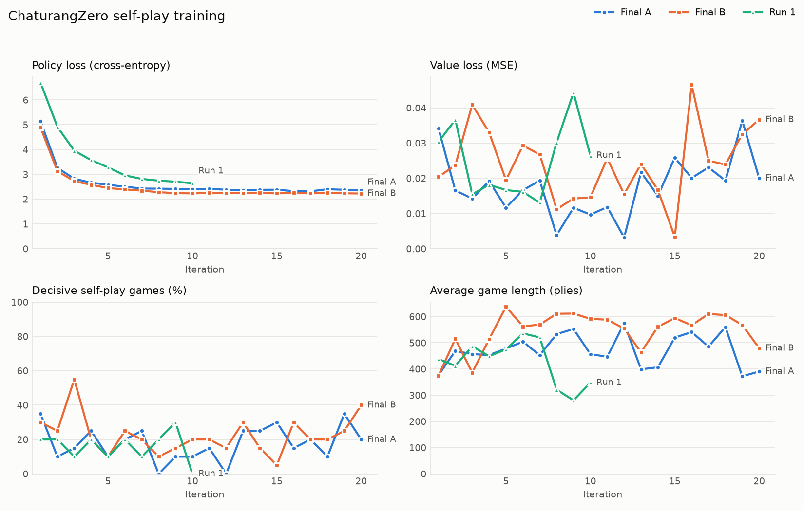
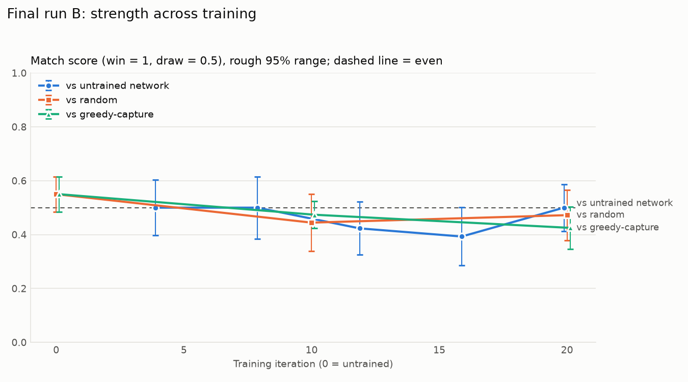
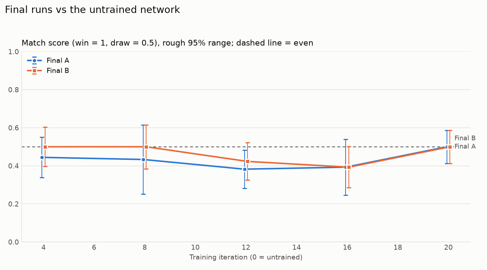
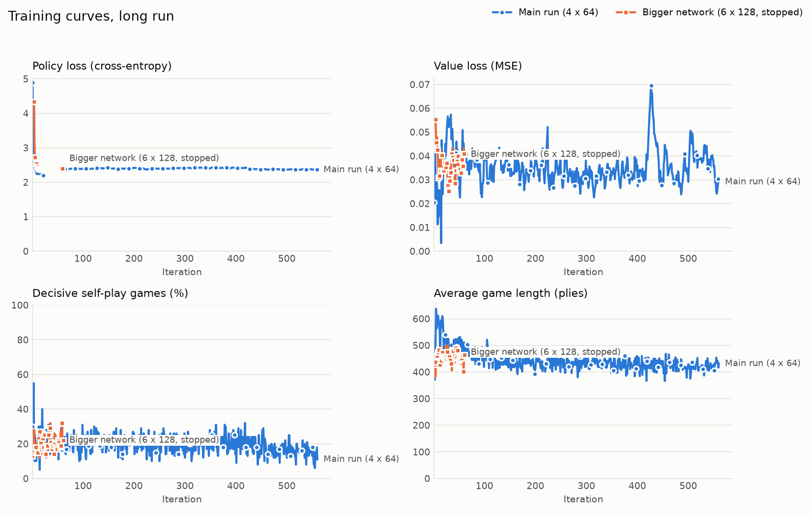
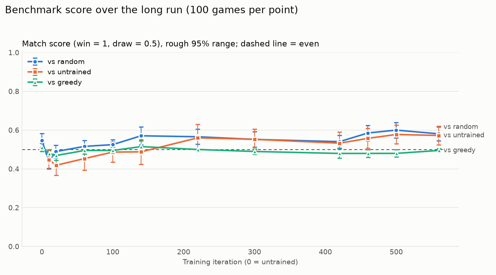
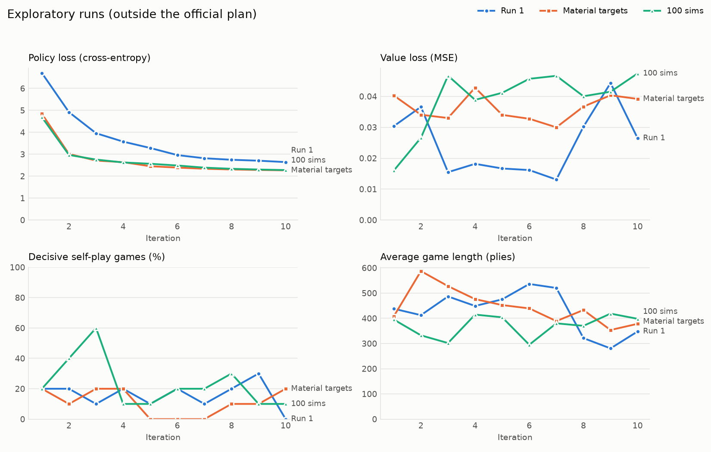

# Abstract

We built ChaturangZero, an AlphaZero-style agent for Chaturanga, the ancient
Indian ancestor of chess. The agent knows only the rules. A residual network
with a policy head and a value head guides Monte Carlo Tree Search (MCTS) with
PUCT selection, and the network is trained on the games the agent plays against
itself. The system has a rules engine checked by unit tests, the network,
search, a self-play training loop with a replay buffer, and an evaluation
suite. Our first two runs of 400 self-play games each (50 simulations per move,
a 4-block, 64-filter network) did not make the agent measurably stronger than
an untrained network: about 80% of games were drawn and the data was far too
small. We then made self-play about 11 times faster without changing the rules
or the search, and trained for 540 more iterations (54,000 games, about 144
hours on one laptop), lowering the learning rate at the end. Under the same
course constraints, the final model beats the model it started from 27 wins to
0 (score 0.657 over 100 games), beats a random player 16 to 0 and an untrained
network 17 to 4, but still draws almost every game against a greedy-capture
player. Its main weakness is converting an advantage: most of its games end by
the 100-ply no-progress rule rather than checkmate. A larger 6-block,
128-filter network did not catch up in the time we had. Two later tests, more
search per move when playing and counting draws as slightly bad in training,
gave a small gain and a loss of strength respectively.

# 1. Introduction

AlphaZero (Silver et al., 2018) showed that one algorithm can learn chess,
shogi and Go to superhuman level from the rules alone, by combining tree search
with a neural network trained on self-play. The goal of this project was to
build that method from scratch for Chaturanga and to measure how far it gets on
the compute of a course project.

The course plan set these constraints:

- no human domain knowledge beyond the rules (no opening books, no piece
  values, no hand-written evaluation);
- 30 to 50 MCTS simulations per move during training;
- a residual network with 4 to 6 blocks and 64 to 128 filters;
- a 4096-wide action space (every from-square, to-square pair).

The project had four milestones: (1) a rules engine verified by unit tests,
(2) MCTS working with an untrained network, (3) a self-play pipeline with the
loss tracked over at least 50 to 100 games, and (4) benchmarks against earlier
iterations and baseline players, with learning curves. All four are complete.

The report follows the project in order: the first runs (Section 5.1 and
6.1 to 6.5) gave a negative result, the diagnosis (Section 7) led to a faster
pipeline and a much longer run, and that long run produced the final model
(Sections 5.3 and 6.6 to 6.10).

# 2. The game

Chaturanga is played on an 8x8 board with the same starting layout as chess,
but most pieces are weaker:

| Piece | Letter | Move |
|---|---|---|
| Raja (king) | K | one square in any direction |
| Mantri (counselor) | Q | one square diagonally |
| Ratha (chariot) | R | any distance orthogonally, like a rook |
| Gaja (elephant) | E | exactly two squares diagonally, jumping the square between |
| Ashva (horse) | N | an L-shaped jump, like a knight |
| Padati (foot soldier) | P | one square forward, captures one square diagonally forward, promotes to Mantri on the last rank |

There is no castling, no pawn double step and no en passant. Checkmate wins.
Stalemate, 100 plies with no capture or pawn move (the no-progress rule) and
threefold repetition are draws. Because the Mantri and Gaja are short-range,
material advantages are much harder to convert into checkmate than in chess,
which turns out to matter for learning (Section 7).

# 3. Method

## 3.1 State and action encoding

A position is encoded as 13 planes of 8x8: one plane per piece type and color
(12) and one plane for the side to move. Squares are absolute (the board is not
flipped for Black). A move is the action `from * 64 + to`, giving 4096 actions;
illegal actions are masked out of the policy before the softmax. We checked
that the encoding and the action indices agree for both colors.

## 3.2 Network

`ChaturangaNet` is a residual network:

- an input 3x3 convolution to 64 filters with batch normalization and ReLU;
- 4 residual blocks, each two 3x3 convolutions with batch normalization and a
  skip connection;
- a policy head (1x1 convolution to 2 planes, then a linear layer to 4096
  logits);
- a value head (1x1 convolution to 1 plane, a 64-unit hidden layer, then a
  tanh output in [-1, 1], the expected result for the side to move).

It has 836,359 parameters. The loss is value mean squared error plus policy
cross-entropy against the MCTS visit distribution, with L2 regularization
(weight decay 1e-4).

## 3.3 Monte Carlo Tree Search

Each simulation descends the tree from the root by choosing the child that
maximizes

$$ -Q(s') + c_{puct} \, P(s, a) \, \frac{\sqrt{N(s)}}{1 + N(s')} $$

where $Q(s')$ is the child's mean value from the child's side (negated to give
the parent's view), $P(s, a)$ is the network's prior for the move, $N$ are
visit counts and $c_{puct} = 1.5$. At a new leaf, the network gives the priors
for its children and a value, which is backed up the path with its sign
flipped at each ply. There are no random rollouts. Child states are created
only when first visited. During self-play, Dirichlet noise
($\alpha = 0.3$, weight 0.25) is mixed into the root priors so that the agent
explores moves the network does not yet favor.

## 3.4 Self-play and training

Each training iteration:

1. **Self-play.** The current network plays 20 games (100 in the long run)
   against itself with 50 simulations per move. Moves are sampled in proportion to visit counts.
   Every position becomes an example (state, visit distribution, result from
   the mover's view: +1, -1 or 0 for a draw). Games longer than 800 plies stop
   and count as draws.
2. **Training.** Examples go into a replay buffer of the latest positions
   (20,000 in the first runs, 250,000 in the long run). The network takes Adam
   steps on random batches (400 steps of 64 in the first runs, 500 steps of
   256 in the long run).
3. **Checkpoint.** The network is saved, so every iteration can be evaluated
   later.

One rules-only addition: with `--avoid_repetition`, the agent never picks a
move that causes a threefold-repetition draw unless every searched move does.
This uses only the rules, so it fits the no-domain-knowledge requirement. We
added it because early self-play games often ended in repetition loops.

# 4. Implementation and testing

The code is plain Python with NumPy and PyTorch, organized by component:

| Folder | Contents |
|---|---|
| `chaturanga/` | rules engine, move generation, game end, encoding |
| `network/` | the network, loss and checkpoints |
| `mcts/` | tree nodes, PUCT search, root noise |
| `training/` | self-play, replay buffer, training loop |
| `evaluation/` | baseline players, benchmark, parallel matches, game-ending classifier, human-game log |

108 automated tests cover the rules (36 tests, including check, checkmate,
stalemate, promotion and the draw rules), the search (including a toy game
with a known best move), the network, value-target signs, policy targets, a
complete small training run including resuming from a checkpoint, the
benchmark scoring and the evaluation tools. All runs are seeded and repeatable.

**Faster self-play.** For the long run we sped up self-play about 11 times on
the same hardware, without changing what it computes:

| Change | ms per move (50 simulations) |
|---|---|
| Original | 259 |
| Faster rules engine: legal moves cached per position, check detection that looks outward from the king, precomputed move tables | 48 |
| Network copy for search with batch normalization folded into the convolutions | 19 |

On top of that, 6 worker processes play games in parallel, each with its own
seed derived from the run seed, the iteration and the game number, so a run
does not depend on the number of workers. Training steps run on the laptop's
GPU. A test compares the fast rules engine with a frozen copy of the original
on every ply of 40 random games and on 3,000 random positions (same legal moves
in the same order, same check and game results).

# 5. Experiments

## 5.1 Training runs

| Run | Simulations | Games | Move choice in self-play | Decisive games | Policy loss | Time |
|---|---|---|---|---|---|---|
| Run 1 (early) | 30 | 10 x 10 | earlier settings | 16 of 100 (16%) | 6.70 to 2.64 | 0.5 h |
| Final A | 50 | 20 x 20 | sample 30 plies, then best | 71 of 400 (18%) | 5.15 to 2.35 | 7.1 h |
| Final B | 50 | 20 x 20 | sample the whole game | 90 of 400 (22%) | 4.89 to 2.23 | 6.8 h |

Final B is the model we kept.

## 5.2 Benchmark protocol

To compare checkpoints fairly, every checkpoint plays 20 games against a fixed
opponent under the same conditions: 50 simulations, no root noise, temperature
0.3, repetition avoidance, alternating colors, the same random seed for every
checkpoint, and an 800-ply cap (unfinished games are left out). The score is
(wins + 0.5 x draws) / finished games, with a 95% margin of
$1.96 \sqrt{p(1-p)/n}$. The opponents are:

- **untrained**: the same MCTS agent with a freshly initialized network;
- **random**: a uniformly random legal move;
- **greedy-capture**: captures the most valuable piece it can, otherwise
  plays randomly. Its piece values are used only by this baseline, never by
  our agent.

Head-to-head matches between two checkpoints use the same protocol. In the long
run every benchmark and match uses 100 games, with margins of about 0.03 to
0.06.

## 5.3 The long run

The long run continues from final B (iteration 20) with the same official
settings (4 x 64 network, 50 simulations, root noise, repetition avoidance,
800-ply cap, draws valued 0). Each iteration plays 100 self-play games and then
takes 500 Adam steps of batch 256 from a buffer of 250,000 positions.

| Iterations | Learning rate | Notes |
|---|---|---|
| 21 to 420 | 1e-3 | |
| 421 to 500 | 1e-4 | two stretches of 40 iterations |
| 501 to 560 | 3e-5 | final stretch |

That is 540 iterations, 54,000 games and about 23.7 million positions, in
about 144 hours. We also tried a larger network (6 blocks, 128 filters, 2.3
million parameters) for 61 iterations; its first 5 iterations trained on games
played by our best 4 x 64 checkpoint so it did not start from random play
(Section 6.10).

# 6. Results

Sections 6.1 to 6.5 are the first runs; 6.6 to 6.10 are the long run.

## 6.1 Learning curves



The policy loss falls quickly over the first 5 iterations and then flattens
around 2.2 to 2.4: the network learns to predict its own search, but search is
not getting better. The value loss stays below 0.05 and noisy, because most
targets are 0. The share of decisive games does not trend upward, and games
stay long (400 to 600 plies on average).

## 6.2 Benchmarks against fixed opponents



| Iteration (final B) | vs untrained | vs random | vs greedy-capture |
|---|---|---|---|
| 0 (untrained) | 0.5 by definition | 0.550 +/- 0.066 | 0.550 +/- 0.066 |
| 4 | 0.500 +/- 0.103 | | |
| 8 | 0.500 +/- 0.115 | | |
| 10 | | 0.444 +/- 0.106 | 0.474 +/- 0.050 |
| 12 | 0.423 +/- 0.098 | | |
| 16 | 0.393 +/- 0.108 | | |
| 20 | 0.500 +/- 0.087 | 0.472 +/- 0.093 | 0.425 +/- 0.078 |

Final A against the untrained network scored 0.444, 0.433, 0.382, 0.393 and
0.500 at iterations 4, 8, 12, 16 and 20. Every score in both runs is within its
margin of 0.5.



## 6.3 Against earlier iterations

| Match (20 games) | Wins | Losses | Draws | Unfinished | Score |
|---|---|---|---|---|---|
| Final B iter 20 vs final A iter 20 | 1 | 1 | 15 | 3 | 0.500 |
| Final B iter 20 vs final B iter 10 | 0 | 0 | 15 | 5 | 0.500 |

Ten more iterations of training did not give a single win over the older
network.

## 6.4 Agent vs. human

A team member who is new to chess played six games against final B, alternating
colors.

| Game | Human plays | Result | Ending | Plies | Pieces left (human / agent) |
|---|---|---|---|---|---|
| 1 | White | Human win | Checkmate | 91 | 11 / 2 |
| 2 | Black | Human win | Checkmate | 128 | 12 / 2 |
| 3 | White | Draw | Stalemate | 137 | 12 / 1 |
| 4 | Black | Human win | Checkmate | 90 | 16 / 1 |
| 5 | White | Draw | Stalemate | 161 | 8 / 1 |
| 6 | Black | Draw | Stalemate | 260 | 7 / 1 |

The agent won none of the six games. Its score is 0.250, with a 95% Wilson
range of 0.060 to 0.635. Six games are too few to separate that from 0.5
statistically, but the final positions are one-sided: the agent always ended
with at most two pieces, and in each draw it had only its king left, which the
human stalemated while going for checkmate.

## 6.5 How games end

Final B at iteration 16, 10 games against each opponent under the benchmark
protocol:

| Ending | vs itself | vs random | vs greedy-capture |
|---|---|---|---|
| No-progress rule | 5 | 5 | 7 |
| Threefold repetition | 2 | 3 | 3 |
| Checkmate | 2 | 1 | 0 |
| 800-ply cap | 1 | 1 | 0 |

## 6.6 Long run: learning curves



The policy loss stays around 2.4, and the share of decisive self-play games
stays around 15 to 25%. These curves do not show the improvement, because the
targets move with the network: as the agent improves, so does its opponent.
Game length fell from about 530 to about 430 plies. Strength has to be
measured by matches.

## 6.7 Long run: progress against the starting model

Checkpoints of the long run against final B (iteration 20), 100 games each:

| Iteration | Wins | Losses | Draws | Unfinished | Score |
|---|---|---|---|---|---|
| 40 | 10 | 3 | 61 | 26 | 0.547 +/- 0.047 |
| 100 | 18 | 4 | 61 | 17 | 0.584 +/- 0.052 |
| 140 | 27 | 2 | 57 | 14 | 0.645 +/- 0.053 |
| 220 | 21 | 5 | 57 | 17 | 0.596 +/- 0.057 |
| 300 | 27 | 5 | 52 | 16 | 0.631 +/- 0.060 |
| 380 | 11 | 5 | 63 | 21 | 0.538 +/- 0.049 |
| 500 | 27 | 3 | 60 | 10 | 0.633 +/- 0.053 |
| **560 (final)** | **27** | **0** | **59** | **14** | **0.657 +/- 0.049** |

Unlike the first runs, training now clearly helps: every checkpoint beats the
starting model, and the final one won 27 games and lost none. Most of the gain
came in the first 100 to 140 iterations. From there to iteration 420 the score
moved up and down by about its own margin.

## 6.8 Lowering the learning rate

To choose a model, iterations 140, 300, 420 and 460 (the first 40 iterations
at learning rate 1e-4) played each other, 100 games per pair. The table gives
the row model's score against the column model.

| | vs 140 | vs 300 | vs 420 | vs 460 |
|---|---|---|---|---|
| 140 | | 0.511 | 0.488 | 0.413 |
| 300 | 0.489 | | 0.500 | 0.463 |
| 420 | 0.512 | 0.500 | | 0.453 |
| 460 | **0.587** | **0.537** | **0.547** | |

Iterations 140, 300 and 420 are even with each other, while 460 beats all
three (41 wins, 9 losses in total). At learning rate 1e-3 the network kept
moving around one level of play; the lower rate let it settle. Further
stretches still helped, by smaller steps: iteration 500 scored 0.526 against
460 (8 wins, 3 losses), and iteration 560 scored 0.524 against 500 over 300
games (26 wins, 12 losses). Iteration 560 is the final model.

## 6.9 Long run: benchmarks of the final model



| Iteration | vs random | vs untrained | vs greedy-capture |
|---|---|---|---|
| 20 (final B) | 4 W, 6 L: 0.489 | 4 W, 18 L: 0.419 | 0 W, 6 L: 0.469 |
| 100 | 6 W, 1 L: 0.525 | 7 W, 9 L: 0.487 | 1 W, 2 L: 0.495 |
| 220 | 15 W, 2 L: 0.566 | 23 W, 13 L: 0.560 | 0 W, 0 L: 0.500 |
| 420 | 10 W, 2 L: 0.540 | 13 W, 8 L: 0.533 | 1 W, 5 L: 0.480 |
| **560 (final)** | **16 W, 0 L: 0.581** | **17 W, 4 L: 0.572** | **0 W, 1 L: 0.495** |

The final model beats random play and the untrained network and almost never
loses to them, where final B lost more than it won. Against greedy capture,
99 of 100 games were drawn.

How the final model's games end, 30 games each:

| Ending | vs random | vs greedy-capture |
|---|---|---|
| Checkmate | 3 | 1 |
| Stalemate | 0 | 2 |
| No-progress rule | 12 | 27 |
| Threefold repetition | 14 | 0 |
| 800-ply cap | 1 | 0 |

The agent no longer gives material away, but it rarely turns an advantage into
checkmate. Against random most games end by the no-progress rule or by
repetitions that the random player causes (our agent avoids them).

## 6.10 A larger network

| Match (100 games) | Wins | Losses | Score |
|---|---|---|---|
| 6 x 128 iteration 30 vs 4 x 64 iteration 460 | 4 | 21 | 0.411 +/- 0.048 |
| 6 x 128 iteration 60 vs 4 x 64 iteration 460 | 3 | 17 | 0.427 +/- 0.043 |
| 6 x 128 iteration 60 vs 4 x 64 iteration 420 | 8 | 14 | 0.468 +/- 0.049 |

Each iteration of the larger network took about 25 to 30 minutes instead of
about 9. After 61 iterations (about 31 hours) it was still behind and
improving slowly, so we stopped it and used the time for the lower learning
rate instead. With more compute it might overtake the smaller network; we
could not test that.

## 6.11 Two more tests on the final model

**More search when playing.** The 30 to 50 simulation limit applies to
training, so we also measured the final model with more search at play time.
With 200 simulations per move against itself at 50 (100 games) it scored
9 wins, 4 losses and 86 draws (0.525 +/- 0.035). Four times the search gives
only a small edge, since the extra search does not help it finish games.

**Counting draws as slightly bad.** We continued the final model from
iteration 560 with a value target of -0.2 for both sides in every drawn or
unfinished self-play game, instead of 0, at learning rate 1e-4. It uses only
the game result, so it stays within the rules-only constraint. Decisive
self-play games rose from about 14% to about 19%, but play got weaker:

| Match (100 games) | Wins | Losses | Draws | Unfinished | Score |
|---|---|---|---|---|---|
| iteration 600 vs final (560) | 4 | 9 | 85 | 2 | 0.474 +/- 0.036 |
| iteration 630 vs final (560) | 0 | 9 | 89 | 2 | 0.454 +/- 0.029 |

We stopped it at iteration 631 and kept iteration 560 as the final model.

## 6.12 Exploratory runs (outside the course constraints)

We ran two short experiments that break the constraints, to test the
diagnosis below. They are not the final agent.

- **Material value targets** (30 simulations, 10 x 10 games): drawn games get a
  value target from the final material balance, which uses piece values. The
  value head did learn material (correlation +0.45 with the material balance,
  against +0.07 in run 1), but strength did not improve (0.474 and 0.469
  against untrained at iterations 5 and 10).
- **100 simulations per move** (10 x 10 games, also with material targets):
  decisive games peaked at 60% in iteration 3, but strength against untrained
  was 0.421 at iteration 5 and 0.346 at iteration 10.



# 7. Discussion

**The first runs.** We first checked for a bug. The tests confirm the value
targets have the right sign for both colors, the policy targets match the visit
counts, and the encoding and actions agree for Black, so we believe the result
reflected the method at that scale, not an error. Three causes stood out:

1. **Too little data.** 400 games (about 200,000 positions) per run is tiny
   for this method. AlphaZero used millions of games, with far more search per
   move.
2. **The value head learns almost nothing.** With about 80% of games drawn,
   nearly every value target is 0. In run 1, 81% of value predictions were
   within 0.05 of 0, and their correlation with the material balance was only
   +0.07. Without a useful value, 50-simulation search cannot tell losing a
   piece from a quiet move, so trained play is no sharper than untrained play.
3. **Games are long and rarely decisive.** Chaturanga's short-range pieces make
   checkmate hard to force. Games average 400 to 600 plies, and most end by the
   no-progress rule (Section 6.5), so the rare win or loss signal is spread over
   hundreds of quiet positions.

The human games show the same weakness from the outside: the agent gives away
material steadily and cannot defend, and a beginner can win.

The exploratory runs suggested that a better value signal alone is not enough
at that scale: the value head learned material, but 30 to 100 simulations with
a weak policy still did not produce stronger play in 100 games.

**The long run confirms the first cause.** With 135 times as many games and
nothing else changed in the method, the agent became clearly stronger than its
starting point and than random and untrained play (Sections 6.7 and 6.9). Two
lessons stand out. First, most of the gain came early, and at a fixed learning
rate of 1e-3 the network then moved around one level of play; lowering the
learning rate gave the clearest single improvement of the run (Section 6.8).
Second, the third cause above remains: about 80% of self-play games are still
drawn, so the agent has learned to keep material and not to lose, but it gets
few examples of how a won position is finished, and most of its games end by
the no-progress rule. Greedy capture, which trades whenever it can, is hard to
beat for an agent that cannot yet force checkmate.

**The limit of this setup.** The last tests point the same way. Lowering the
learning rate further gave only small steps (0.505 and 0.531 against the
previous checkpoint), four times more search at play time gave 0.525, and
penalizing draws made the agent play more decisive games against itself but
lose more against the final model (Section 6.11). Pushing for decisive results
without a better sense of which positions are won seems to lead to riskier,
worse play. Within the constraints and our compute, the 4 x 64 network at 50
simulations appears close to its limit.

# 8. Limitations and future work

- The first runs' benchmarks use 20 games per checkpoint, so differences
  smaller than about 0.1 cannot be resolved there. The long run uses 100 games
  per benchmark, and differences smaller than about 0.03 to 0.06 still cannot.
- With most games drawn, a match score says little about how often the agent
  can actually win.
- The human evaluation is six games by one beginner, against final B, not the
  final model.
- Compute was the main limit: even after the speed-up, one iteration of 100
  games takes about 9 minutes, and the larger network about 25 to 30.

What we expect would help most, in order:

1. A way for results to reach the value head more often, within the rules: a
   shorter game cap during self-play, or resigning hopeless games. Simply
   counting draws as slightly bad did not work (Section 6.11).
2. Even longer training, with a lower learning rate earlier in the run.
3. The larger network, given the days of compute it needs to catch up.

# 9. Conclusion

We implemented every part of an AlphaZero-style system for Chaturanga under the
course constraints and verified it with 108 tests. With 400 self-play games per
run the agent did not improve, and we measured why: draws starve the value
head, and the data was far too small. After making self-play about 11 times
faster, a run of 54,000 games with the same method produced a clearly stronger
agent. The final model beats its starting point 27 wins to 0 and beats random
and untrained play, losing almost no games. It still draws nearly every game
against greedy capture and rarely checkmates, so learning to convert an
advantage remains the open problem: neither more search at play time nor
counting draws as bad in training solved it. The evaluation tools (a fixed benchmark
protocol, head-to-head matches, game-ending counts and human-game logging) made
both the negative and the positive result measurable.

# References

1. Silver, D. et al. (2018). A general reinforcement learning algorithm that
   masters chess, shogi, and Go through self-play. *Science*, 362(6419),
   1140-1144.
2. Silver, D. et al. (2017). Mastering the game of Go without human knowledge.
   *Nature*, 550, 354-359.

# Appendix A: Team roles

| Role | Area |
|---|---|
| Student 1: Environment and logic | rules engine (`chaturanga/`), `play.py` |
| Student 2: Deep learning and pipeline | network, training loop, replay buffer |
| Student 3: Search and evaluation | MCTS, evaluation suite, benchmarks, plots, `play_vs_ai.py` |

# Appendix B: Reproducing the results

```
python -m pytest -q
OMP_NUM_THREADS=1 python -m training.train --iterations 20 --games_per_iter 20 \
    --simulations 50 --avoid_repetition --temperature_moves 1000 \
    --max_plies 800 --train_steps 400 \
    --checkpoint_dir checkpoints/final_B --log checkpoints/final_B/log.csv
python -m evaluation.benchmark --checkpoint_dir checkpoints/final_B --opponent untrained --every 4
python -m evaluation.game_endings --checkpoint checkpoints/final_B/iter_0016.pt --opponent self --games 10
# long run (continues final B; see training/README.md for the later stretches)
OMP_NUM_THREADS=1 python -m training.train --resume checkpoints/final_B/latest.pt \
    --iterations 420 --games_per_iter 100 --simulations 50 --avoid_repetition \
    --temperature_moves 1000 --max_plies 800 --buffer_capacity 250000 \
    --min_buffer 150000 --batch_size 256 --train_steps 500 --lr 1e-3 \
    --device mps --workers 6 --seed 1 \
    --checkpoint_dir checkpoints/long --log checkpoints/long/log.csv
python -m evaluation.parallel_match --a models/chaturangzero_final.pt \
    --b checkpoints/final_B/latest.pt --games 100 --workers 6
python play_vs_ai.py --checkpoint models/chaturangzero_final.pt --player NAME
```

Every log, benchmark CSV, match log and plot is in `results/`, and the final
model is `models/chaturangzero_final.pt`.
